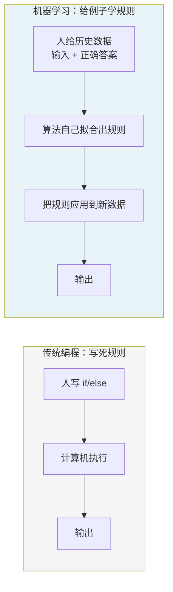
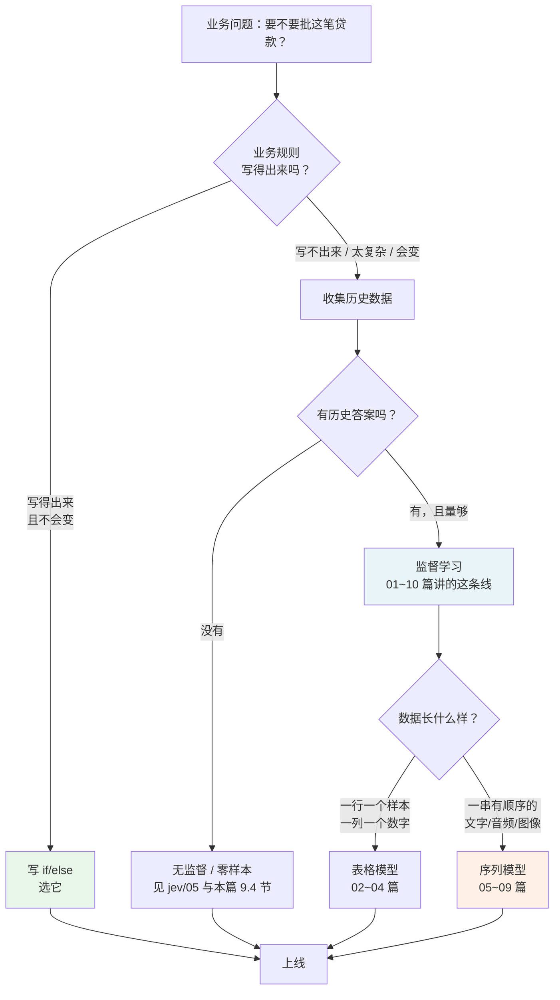
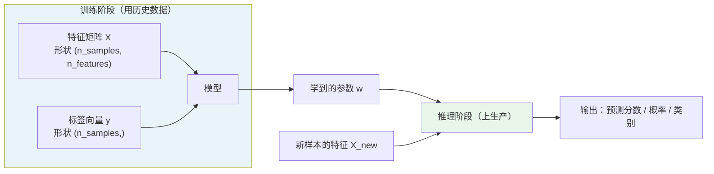
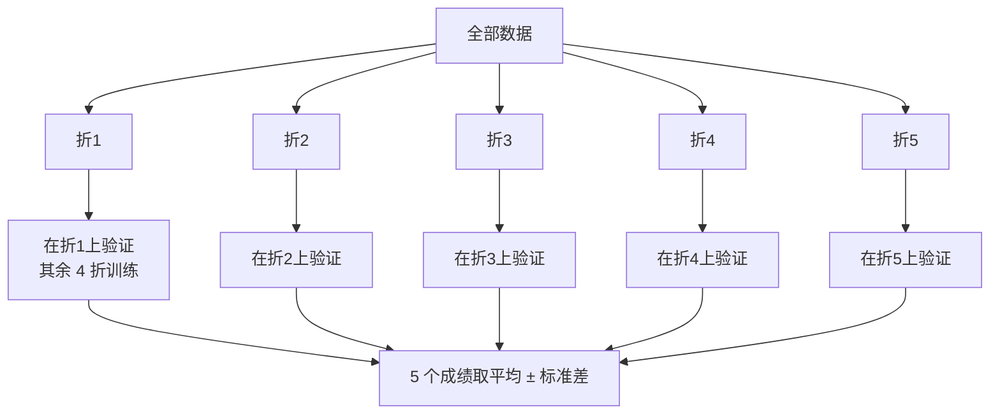
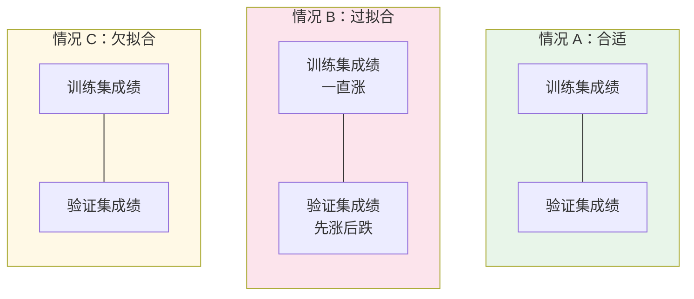
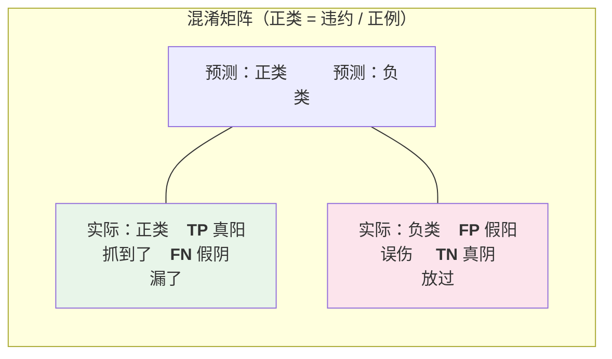
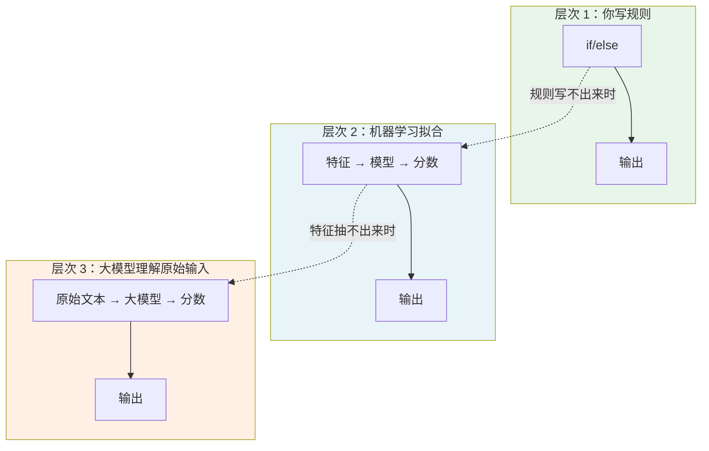

# 01 · 从手写规则到机器学习：范式转变

> 读者假设：你会写 Python/Java/Go，能看懂 `if/else`、函数、数组、循环。**不会**机器学习。
>
> 目标：读完这一篇，你能说清"我什么时候该写规则、什么时候该上模型"，并且能自己跑通第一个分类任务。
>
> 本文所有数字都来自 [`examples/`](examples/) 目录下四个可运行脚本的真实输出，不是教科书抄的。凡是实测和预期不一致的地方，本文写实际跑出来的结果，并解释为什么预期错了。
>
> 复现环境：Python 3.12 · numpy 2.4.6 · scikit-learn 1.9.1 · xgboost 3.2.0 · torch（CPU）。所有脚本固定随机种子（`seed=42`），所以**指标类数字**在同版本下可完全复现；**`fit_s` / `pred_ms` 这类耗时**与机器和线程数有关，本文给的是本机的实测值，换机器必然不同——请只把它当数量级参考。

---

## 目录

- [1. 先说人话：机器学习到底是什么](#1-先说人话机器学习到底是什么)
- [2. 一个你一定写过的规则](#2-一个你一定写过的规则)
- [3. 范式转变：谁在做什么](#3-范式转变谁在做什么)
- [4. 三个必须先搞懂的词：特征、标签、模型](#4-三个必须先搞懂的词特征标签模型)
- [5. 训练 / 验证 / 测试：为什么要切成三段](#5-训练--验证--测试为什么要切成三段)
- [6. 过拟合：机器学习最常见的翻车方式](#6-过拟合机器学习最常见的翻车方式)
- [7. 该用什么指标：accuracy 会骗你](#7-该用什么指标accuracy-会骗你)
- [8. 第一个可运行的例子](#8-第一个可运行的例子)
- [9. 这和 Laya、大模型什么关系](#9-这和-laya大模型什么关系)
- [10. 本篇的检查清单](#10-本篇的检查清单)

---

## 1. 先说人话：机器学习到底是什么

### 1.1 一句话定义

> **传统编程：你给规则，机器执行结果。**
> **机器学习：你给例子，机器把规则拟合出来。**

这是整个领域最重要的一次反转，值得多看两遍。



### 1.2 两种写法的分工

| | 传统编程 | 机器学习 |
|---|---|---|
| 你提供什么 | 规则（`if x > 100 then ...`） | 例子（`x=120 → 结果=通过`） |
| 谁做决策 | 人 | 算法 |
| 规则是新的还是已知的 | 已知的、你写死的 | **算法自己找出来的** |
| 需求一变 | 改代码，重新发版 | **重新喂数据，重新训练** |
| 可解释性 | 天然可解释（就是那段代码） | 差（要额外手段） |
| 数据需求 | 几乎不需要 | **需要，而且量很关键** |

### 1.3 关键点：机器学习不是"魔法"，是"用统计方法代替人写规则"

很多人以为机器学习"很智能"。恰恰相反，它很**笨**：

- 它不知道什么是"收入"、"负债率"，它只看到 8 个数字；
- 它不会推理"如果他失业了还想借钱投资那就有问题"，它只会数"这种情况在历史上出现过多少次"；
- 它给出的结果是一个**从历史数据里统计出来的规律**，而不是一个"道理"。

所以它会犯很蠢的错：训练数据里没见过的组合，它一律处理不了。这一点在第 9 篇（工程选型）里会变成一条硬约束：**模型的能力上限由信息量决定，不由模型大小决定**。

---

## 2. 一个你一定写过的规则

我们拿信贷审批举例。假设你在写一个风控接口。

### 2.1 传统写法

```python
def approve(applicant):
    # 规则一：负债率不能太高
    if applicant.debt_ratio > 0.45:
        return "拒绝", "负债率过高"
    # 规则二：收入不能太低
    if applicant.monthly_income < 42000:
        return "拒绝", "收入过低"
    # 规则三：必须是稳定就业
    if applicant.employ_type not in ("公务员", "国企", "外企", "民企正式"):
        return "拒绝", "就业不稳定"
    return "通过", ""
```

这段代码有三个致命问题，而这三个问题**不是换个写法能解决的**：

**问题一：规则之间会互相打架。**
业务上真正的逻辑是"负债率高"**和**"收入低"**同时出现**才危险，只要占一个就还好。
写成代码就是：

```
风险 = (负债率 > 0.45) XOR (月收入 < 4.2万)
```

XOR（异或）是"两个条件里恰好一个成立"的意思。这种逻辑用一串 `if/else` 写出来会非常别扭：
你得先判断组合情况（4 种），再决定要不要拒。这就是为什么很多风控代码最后长成了一张大得没人敢动的状态机表。

**问题二：阈值从哪来？**
`0.45` 和 `4.2万` 这两个数哪来的？拍脑袋？拍脑袋的后果就是：你不知道改成 `0.4` 会不会更好，也不知道历史坏账率变化后该往哪调。

**问题三：没见过的组合完全没定义。**
"负债率 0.8 + 收入 2 万 + 有 6 次贷款查询"这种组合，代码里如果没写就崩，写了就又是一堆 if。

### 2.2 换成机器学习怎么做

同样这个问题，机器学习的做法是：

```
把历史上 20000 个申请单 + 每一个到底通过了没有，喂给模型。
模型自己去找规律。
```

结果就是 [`examples/tabular_baselines.py`](examples/tabular_baselines.py) §2 里那一段实测输出。逐字摘录：

```
信贷违约（合成，n=20000）
  训练 (15000, 8) / 测试 (5000, 8)   特征数=8
  正类比例 训练=0.106  测试=0.106

[2] 固定 75/25 划分上的完整指标
  模型                        acc  bal_acc     F1     AUC  logloss     ECE
  LogisticRegression     0.8938   0.5000 0.0000 0.6816   0.3195  0.0112
  DecisionTree(d=3)      0.8938   0.5000 0.0000 0.6861   0.3092  0.0014
  RandomForest(300)      0.8900   0.5037 0.0248 0.8192   0.2710  0.0292
  GradientBoosting       0.8938   0.5008 0.0038 0.8469   0.2541  0.0158
  XGBoost                0.8902   0.5104 0.0518 0.8320   0.2592  0.0201
```

读这张表：

- **AUC**（下一节解释）从逻辑回归的 0.68 涨到了 GBDT 的 0.85。这就是"树能表达交互、线性不能"换来的收益，**0.16 的 AUC 差距**。
- **但 accuracy 六个模型全在 0.89 上下**，看起来完全没差别。这个不是巧合，是正类只有 10.6% 导致的——第 7 节专门讲。
- 你现在**一个 if 都不用写**，却拿到了明显更好的排序能力。

这就是范式转变的收益。

---

## 3. 范式转变：谁在做什么

### 3.1 一张流程图



### 3.2 转变的三个阶段

对照你可能会遇到的真实情况：

**阶段 1：规则能写，就写规则。**
不要一上来就上模型。规则的优势是：可解释（出事了能跟客户/监管解释）、延迟极低（0.001 ms）、没有数据依赖（冷启动可用）。
[`examples/lm_vs_laya_demo.py`](examples/lm_vs_laya_demo.py) §2 里手写规则的实测延迟是 `0.000 ms`，而 Laya 零样本是 `25.604 ms/条`，**慢 29193 倍**。什么时候这个代价是值得的，10 篇会给决策表。

**阶段 2：规则写不出来了，或者写出来发现阈值全靠拍脑袋 → 表格模型。**
02~04 篇讲这一类。这是结构化数据的标准答案：特征是数字/类别，目标是 0/1 或数值。

**阶段 3：输入是文本/图片/音频这种"没法变成列"的东西 → 序列模型 / 大模型。**
05~09 篇讲这一类。

**但真正重要的判断点在这里：** 上大模型之前，先问一句"**这数据能不能变成列？**"
这条不是理论，是 [`examples/lm_vs_laya_demo.py`](examples/lm_vs_laya_demo.py) §5 的实测结论，而且结论是**反直觉的**：

```
  名称                        AUC                 Acc                 ECE   标签  可训参数
  文本向量 + LR                 0.8759              0.7929              0.1365   800   1025
  文本向量 + 8 数值 + LR          0.8998              0.8157              0.1148   800  1033
  （对照）仅 2 列手工特征 + LR        0.8013              0.7457              0.1087   800      3
```

**一个 394.8M 参数、吃 800 条标注训出来的 1024 维表示，打不过 2 维手工列出来的特征。**
原因是那段文本是固定模板，真正有信息量的只有 4 个空（收入、负债率、就业类型、用途），编码器做的是一次**有损压缩**。

所以工程判断的第一条永远是：
- 文本是**模板化**的 → 别上编码器，把它解析成列，编码器是纯浪费。
- 文本是**自由书写**的 → 才轮到编码器，因为变量你事先想不到。

---

## 4. 三个必须先搞懂的词：特征、标签、模型

### 4.1 特征（feature）

**大白话**：模型用来做判断的**输入信息**。就是那几个数字、那几个词。

信贷例子里的 8 个特征（真实取自 `tabular_baselines.py`）：

| 特征名 | 含义 | 类型 |
|---|---|---|
| `debt_to_income` | 负债收入比 | 连续 |
| `income` | 月收入 | 连续 |
| `age` | 年龄 | 连续 |
| `emp_years` | 就业年限 | 连续 |
| `inquiries_6m` | 近 6 月贷款查询次数 | 计数 |
| `is_invest` | 用途是否投资 | 0/1 |
| `is_consume` | 用途是否消费 | 0/1 |
| `is_edu` | 用途是否教育 | 0/1 |

**这是机器学习里最脏、最耗人、最容易被低估的一步。**
代码只是一行 `x[3]`，但"第 3 列到底怎么算出来的"往往比模型本身重要得多。
有一个专门的领域叫 **特征工程（feature engineering）**，说白了就是"怎么把原始数据加工成模型爱吃的形状"。
而本篇 3.2 节那条"能不能变成列"的判断，说的就是这件事。

### 4.2 标签（label，又叫 target / y）

**大白话**：模型要学的**正确答案**。历史数据里已有的、你希望模型学会的东西。

- 信贷：这一单**实际**最终违约了吗（1）或没违约（0）。
- 垃圾邮件：用户最终标记它是垃圾邮件了吗。

**关键：标签必须是"已经发生的客观事实"，不能是"某个人的主观判断"。**
如果审核员之间对同一单意见都不一致，那这个标签本身就有噪声，任何模型都学不好——这不是模型的问题。

### 4.3 模型（model）

**大白话**：算法拟合出来的那一坨参数。输入特征，输出一个分数。

它长什么样取决于算法：

- 逻辑回归：一串系数 `w = [-1.93, -0.0000, +0.0008, ...]`（真实取自 `tabular_baselines.py` §4）
- 决策树：一棵 if/else 树
- 随机森林：300 棵这样的树
- 神经网络：几十亿个数

`tabular_baselines.py` 的真实输出里，信贷数据上逻辑回归学到的第一个系数是 `-1.9284`——负债收入比每高 1，通过的对数几率就往下压 1.93。
这句话本身就是一个可读的规则。**这就是"模型可解释性"最基本的形态。**

### 4.4 三者的关系



**一个必须记住的术语区分**：

| | 训练（training） | 推理 / 预测（inference / predict） |
|---|---|---|
| 干什么 | 拟合参数 | 用已有参数算新样本 |
| 跑几次 | 一次（可能几十分钟到几天） | **每秒成千上万次** |
| 成本大头 | 时间、算力 | **延迟** |
| 会不会变 | 会（每次重新训练都变） | 参数固定，只算输出 |

你写的生产代码 99% 跑的是右边这一列。左边只在模型迭代时跑。
所以一个常见的工程要求是：**训练和推理必须能分开部署**——训练用 Python + 复杂依赖，推理只需要一个轻量运行时。

---

## 5. 训练 / 验证 / 测试：为什么要切成三段

### 5.1 问题

如果你用同一份数据既训练又评估，会得到一个假的好成绩。
因为模型会把训练数据**背下来**，在见过的样本上必然表现极好。这个假成绩对未来完全没用。

**术语定义（这几个词后面全文都会用，必须先钉死）：**

- **训练集（train）**：用来拟合参数的那部分。模型看得见答案。
- **验证集（validation / val）**：用来选超参数（深度、树棵数、学习率……）的那部分。模型拟合时也看得见答案，但**不是用来学参数的**，是用来"打分"做决策的。
- **测试集（test）**：只在最后用一次。用来估计"上线以后能有多好"。

**类比**：训练集是课后习题，验证集是模拟考，测试集是高考。
你刷完课后习题去做模拟考，选一个"看起来考得好"的方法；高考只考一次，成绩才是真的。
**如果你用高考真题反复刷，最后的高考成绩就废了。**

### 5.2 为什么不是"训练/测试"两段

因为你会**用测试集做选择**。
比如你试了 10 个不同的模型配置，在测试集上挑最好的那个——那测试集就已经被你的选择污染了，不 anymore 是"没见过的数据"。

三段划分的本质是**给每一类决策分配一份独立的数据**：

- 拟合参数 → 训练集
- 选超参数/选模型 → 验证集
- 报最终成绩 → 测试集

### 5.3 三段的比例

没有标准答案，常见做法：

| 情况 | 比例 | 说明 |
|---|---|---|
| 数据量少（几百条） | 60/20/20 或 5 折交叉验证 | 见下 |
| 数据量中等（几千） | 70/15/15 | |
| 数据量多（十万+） | 80/10/10，甚至 95/5/5 | 大数据下测试集不用太大 |
| **时间序列数据** | **绝不能随机打乱** | 必须按时间切，否则会用未来预测过去 = 泄露 |

最后一条是生产环境的血泪教训。信贷数据不能随机划分——用 2024 年的样本训练、2025 年的样本测试才是真实场景。
**违反这一条算出来的 AUC 是虚高的**，而且是那种"离线很好、上线就崩"的头号原因。

### 5.4 交叉验证（cross validation）

数据少的时候三段划分会让每段都很小，指标波动大。用交叉验证：



**为什么要报"± 标准差"？** 因为同一模型换一种数据划分，成绩就能差好几个百分点。
`tabular_baselines.py` §1 的真实输出：

```
[1] 5 折交叉验证 accuracy（同一模型换数据划分的波动）
  LogisticRegression     0.9543  ± 0.0187   0.965 0.921 0.965 0.947 0.973
  DecisionTree(d=3)      0.9245  ± 0.0211   0.921 0.886 0.947 0.930 0.938
  RandomForest           0.9526  ± 0.0131   0.965 0.930 0.956 0.947 0.965
  GradientBoosting       0.9491  ± 0.0237   0.956 0.904 0.956 0.956 0.973
```

看决策树：五折分别是 0.921 / 0.886 / 0.947 / 0.930 / 0.938，最大最小差 0.061。
**所以"我们的模型准确率 92.5%"这句话本身是有水分的**——换个划分就是 88.6%。
报数字时把标准差一起报出去，这是一种诚实。

---

## 6. 过拟合：机器学习最常见的翻车方式

### 6.1 大白话

**过拟合 = 模型把你的训练数据背下来了，而不是学到了规律。**

判断方法：**训练集成绩很好，测试集成绩差**，而且差得越多越严重。

打个比方：
- 背课文（过拟合）：把 100 篇指定的文章背得滚瓜烂熟，考原题满分，考新题零分。
- 理解原理（泛化）：搞懂了这 100 篇的共同规律，换 100 篇新文章照样能做对。

术语：**泛化（generalization）** = 模型在**没见过的数据**上的表现。生产环境里只有泛化有意义。

### 6.2 为什么会过拟合

因为训练流程是"不断调整参数去降低训练集上的错误"。参数越多、训练越久，理论上**总有办法**把训练集错误压到 0——哪怕是死记硬背。

`from_scratch_ml.py` §1.4 有一个干净的例子：

```
[1.4] 过拟合：同一个数据，只放开 max_depth
  max_depth=1  树深=1 叶子数=2   logloss=0.3589
  max_depth=2  树深=2 叶子数=3   logloss=0.0000
  max_depth=3  树深=2 叶子数=3   logloss=0.0000
  max_depth=8  树深=2 叶子数=3   logloss=0.0000
```

这个数据本身完全可分，所以深度够就行。但注意 `max_depth=8` 并没有继续变深——**数据不支持更深的切分了**，再多给深度也没有用。

真正翻车的例子在 `tabular_baselines.py`（信贷数据，**不平衡**的那个）：

```
  模型                        acc  bal_acc     F1     AUC  logloss     ECE
  DecisionTree(不限制)      0.8340   0.5877 0.2602  0.5877   3.4401  0.1660
  RandomForest(300)      0.8900   0.5037 0.0248  0.8192   0.2710  0.0292
```

不限深度的决策树：logloss **3.4401**。这个数字大到离谱——logloss 理论上限是无穷，所以 3.44 意味着模型在测试集上给出了极端自信但完全错误的结果。
**这就是过拟合的典型指纹：它不仅错了，还错得特别自信。**

对照乳腺癌数据集（样本多、信号近似线性）：

```
  DecisionTree(d=3)      0.9441   0.9362 0.9560 0.9463   0.5549  0.0376
  DecisionTree(不限制)      0.9231   0.9234 0.9379 0.9234   1.5941  0.0769
```

同样是不限深度更差。**两个数据集都指向同一个结论。**

### 6.3 怎么防

这是机器学习里最实用的一张表，记住它能省掉大量返工：

| 手段 | 怎么做 | 治什么 |
|---|---|---|
| **加数据** | 采更多样本 | **最通用，往往是唯一根治手段** |
| **加正则** | L1/L2 惩罚项；树模型限深度/限叶子数/加惩罚 | 压住参数太自由 |
| **早停** | 验证集成绩不再变好就停 | 防止训过头 |
| **降模型** | 随机森林换梯度提升、集成更多树、剪枝 | 降方差 |
| **做特征选择** | 只留有用的列 | 降噪声 |
| **数据增强** | 图像翻转/裁剪、文本改写 | 造出更多不同的样本 |

`tabular_baselines.py` §[3] 还有一个**反直觉但极重要**的实测结论，关于概率校准：

```
[3] 概率校准前后（isotonic）
  模型                      logloss     ECE   |   校准后 logloss     ECE    |  结论
  LogisticRegression       0.0879  0.0273   |        0.0846  0.0366    |  一好一坏
  RandomForest(300)        0.1046  0.0481   |        0.1031  0.0276    |  两项都变好
  ⚠ 校准**不保证**变好：样本少时 isotonic 容易过拟合校准集本身，
    出现「一好一坏」是正常结果。所以校准必须实测，不能默认打开。
```

**很多"优化手段"是有副作用的，必须实测，不能默认打开。** 这条在 Laya 的温度标定上完全同理，见 [`jev/06-3 温度与校准`](../jev/06-3-温度与校准.md)。

### 6.4 训练 / 验证 /测试曲线长什么样



- **情况 A（合适）**：两条线贴在一起，训练集成绩略高一点点。正常。
- **情况 B（过拟合）**：训练集继续涨，验证集开始跌。**这个交叉点就是早停的位置。**
- **情况 C（欠拟合）**：两条线都低、也贴在一起。说明模型太弱/训练不够，**该加模型容量，不是加数据**。

**诊断口诀：训练集也学不好 → 欠拟合（改模型）；训练好测试差 → 过拟合（加数据/加正则）。**

---

## 7. 该用什么指标：accuracy 会骗你

### 7.1 accuracy（准确率）为什么不够

$$ \text{accuracy} = \frac{\text{预测正确的样本数}}{\text{总样本数}} $$

简单、直觉上最好懂，但**在类别不平衡时完全失效**。

看 `tabular_baselines.py` 信贷数据的真实输出：

```
  正类比例 训练=0.106  测试=0.106
  LogisticRegression     acc=0.8938  bal_acc=0.5000  F1=0.0000  AUC=0.6816
  GradientBoosting       acc=0.8938  bal_acc=0.5008  F1=0.0038  AUC=0.8469
```

- 正类（违约）只有 **10.6%**。
- 所以"**永远预测不违约**"这个废物模型的 accuracy 是 **89.4%**。
- 六个模型的 accuracy 全在 0.89 上下——它们**全都在做同一件事：全预测不违约**。
- 证据是 F1 = 0.0000（一个违约都没抓到），balanced accuracy = 0.5000（一半对一半错，跟抛硬币一样）。

`lm_vs_laya_demo.py` 里正类比例是 0.246，情况稍好但同样有这个问题（见 10 篇的阈值成本表）。

### 7.2 混淆矩阵

评价指标全从这张表推导出来，**必须先记住这四个格子**：



大白话（以"垃圾邮件检测"为例）：

- **TP**：确实是垃圾邮件，被判成垃圾邮件了。✓
- **FN**：确实是垃圾邮件，被判成正常邮件了。**漏放**（病毒进来了，最危险）
- **FP**：确实是正常邮件，被判成垃圾邮件了。**误伤**（正常邮件进垃圾箱，用户投诉）
- **TN**：确实是正常邮件，被判成正常邮件。✓

### 7.3 从矩阵到指标

$$ \text{precision} = \frac{TP}{TP + FP} \qquad \text{「我说它是正类的时候，有多准」} $$

$$ \text{recall} = \frac{TP}{TP + FN} \qquad \text{「真正的正类里，我抓到了多少」} $$

$$ F_1 = \frac{2 \cdot \text{precision} \cdot \text{recall}}{\text{precision} + \text{recall}} \qquad \text{两者的调和平均} $$

$precision$ 和 $recall$ **天然对立**：阈值放松 → recall 涨、precision 掉；阈值收紧 → 反之。
$F_1$ 是折中，**只有当两个都重要时才用它**。

### 7.4 AUC：不依赖阈值的排序能力

**AUC（Area Under the ROC Curve，ROC 曲线下面积）** 是一种不看阈值的指标。

**ROC 曲线怎么来的？**
把分类阈值从 1 扫到 0，每一个阈值算一对 (FPR, TPR)，连成曲线。

$$ \text{TPR (recall)} = \frac{TP}{TP + FN}, \qquad \text{FPR} = \frac{FP}{FP + TN} $$

**AUC 的实际含义（这句要背下来）：**

> **随机拿一个正样本和一个负样本，模型给正样本打的分更高的概率。**

- AUC = 0.5：完全随机，抛硬币。
- AUC = 1.0：完美排序。
- **AUC 只关心"排序对不对"，不关心"分数准不准"。**

这就是为什么在不平衡数据上 AUC 比 accuracy 有用得多——它不受"全预测同一类"的退化解影响。
上面的实测里，六个模型 accuracy 全是 0.8938，但 AUC 从 0.68 到 0.85 分得清清楚楚，**这才是模型之间真实的差距**。

### 7.5 log-loss：既管排序又管置信度

$$ \text{logloss} = -\frac{1}{n}\sum_{i=1}^{n}\left[ y_i \log \hat{y}_i + (1 - y_i) \log(1 - \hat{y}_i) \right] $$

其中 $\hat{y}_i$ 是模型给出的概率。它同时惩罚"排错"和"排对但太自信"。

**这就是过拟合的数字指纹**（前面那个不限深度决策树的 3.4401）。
一个排序不错的模型如果给出了极端错误的概率，logloss 会爆掉。

**log-loss 越小越好，数学上是负对数似然（negative log-likelihood）。**
理解"为什么越小越好"：$-\log(0.99) = 0.01$，$-\log(0.01) = 4.6$。**模型越自信、越接近真相，代价越小；自信地犯错，代价极大。**

### 7.6 ECE：模型能不能说真话

**ECE（Expected Calibration Error，期望校准误差）** 衡量"模型说 80% 的时候，实际是不是真的 80%"。

做法：把样本按预测概率分到 10 个桶（0-10%、10-20%…90-100%），每桶算「平均预测概率」和「实际正类率」之差，加权平均：

$$ \text{ECE} = \sum_{b=1}^{B} \frac{n_b}{n} \cdot \left| \underbrace{\overline{p_b}}_{\text{平均预测}} - \underbrace{\overline{y_b}}_{\text{实际频率}} \right| $$

**两个极端：**
- 模型输出只有 0 和 1（像手写规则那样硬判）→ **ECE ≈ 0.43**，因为它说"确定是 1"的时候实际只有 57% 是 1。
- 校准良好的模型 → ECE < 0.03。

实测印证（`lm_vs_laya_demo.py` §2）：

```
  手写规则         AUC 0.6165  Acc 0.5657  ECE 0.4343
  逻辑回归         AUC 0.7369  Acc 0.7300  ECE 0.0427
  XGBoost          AUC 0.8769  Acc 0.7786  ECE 0.1173
```

**手写规则在排序上很差（AUC 0.62）而且极度不可信（ECE 0.43）——这两个数字都在说"别用它"。**

### 7.7 指标选择决策表

| 场景 | 主指标 | 辅指标 |
|---|---|---|
| 类别平衡的普通分类 | accuracy | logloss |
| **类别不平衡（风控/反欺诈/疾病筛查）** | **AUC** | PR-AUC、recall@precision=0.9 |
| 成本不对称（漏判贵） | recall / PR-AUC | logloss |
| 需要输出概率给下游 | **logloss + ECE** | AUC |
| 排序/召回场景（推荐、搜索） | recall@k / NDCG | — |

**PR-AUC 的补充说明**：AUC 在正类极稀少时可能显得虚高，生产上更常用 PR 曲线下的面积。
本篇的实测数据集（10.6% 正类）已经不算极端，没有用 PR-AUC；真实风控里正类可能只有 0.1%，那时必须用。

---

## 8. 第一个可运行的例子

### 8.1 环境

```bash
cd ml-llm/examples
/home/amosli/develop/llm/engerneering/jev/.venv/bin/python tabular_baselines.py
```

四个脚本的依赖：`numpy` / `scikit-learn` / `xgboost` / `torch`，全部用上面这个解释器跑。
**全部数字可复现**（固定随机种子），离线运行，不需要 API key。

### 8.2 五行代码分类

```python
from sklearn.datasets import load_breast_cancer
from sklearn.tree import DecisionTreeClassifier

X, y = load_breast_cancer(return_X_y=True)   # X: (569, 30)  y: (569,)
X_tr, X_te, y_tr, y_te = train_test_split(X, y, test_size=0.25, random_state=42)

clf = DecisionTreeClassifier(max_depth=3, random_state=42)
clf.fit(X_tr, y_tr)                            # 训练

pred = clf.predict(X_te)                       # 推理
prob = clf.predict_proba(X_te)[:, 1]           # 概率
```

逐行解释：

| 行 | 作用 | 对应本篇哪个概念 |
|---|---|---|
| `load_breast_cancer` | 加载数据，X 是 569 行 × 30 列的特征，y 是 569 个标签 | §4.1 特征 / §4.2 标签 |
| `train_test_split` | 切成 426 训练 + 143 测试 | §5 训练/测试划分 |
| `max_depth=3` | 一个超参数（"这棵树最多切几刀"） | §6.3 正则 |
| `fit` | 拟合参数，**只做一次** | §4.4 训练 |
| `predict` / `predict_proba` | 推理，**生产里跑这个** | §4.4 推理 |

### 8.3 真实输出

`tabular_baselines.py` 在乳腺癌数据上的完整结果（真实运行）：

```
乳腺癌诊断（真实，n=569）
  训练 (426, 30) / 测试 (143, 30)   特征数=30
  正类比例 训练=0.627  测试=0.629

[2] 固定 75/25 划分上的完整指标（fit_s = 训练耗时，pred_ms = 单条预测延迟）
  模型                        acc  bal_acc     F1     AUC  logloss     ECE   fit_s  pred_ms
  LogisticRegression     0.9580   0.9473 0.9674 0.9960   0.0879  0.0273    0.12    0.068
  DecisionTree(d=3)      0.9441   0.9362 0.9560 0.9463   0.5549  0.0376    0.00    0.055
  DecisionTree(不限制)      0.9231   0.9234 0.9379 0.9234   1.5941  0.0769    0.00    0.056
  RandomForest(300)      0.9580   0.9512 0.9670 0.9949   0.1046  0.0481    0.23    8.494
  GradientBoosting       0.9580   0.9473 0.9674 0.9925   0.1248  0.0380    0.21    0.149
  XGBoost                0.9650   0.9567 0.9727 0.9964   0.0726  0.0223    0.20    0.118
```

**读这张表的四个观察：**

1. **这个数据集几乎是线性的**——逻辑回归的 AUC 高达 **0.9960**，反而不输 XGBoost 的 0.9964。
   对照信贷数据上 LR 只有 0.6816。**同一个算法，在不同数据上差距是 0.31。这就是为什么"哪个模型更好"没有答案，只有"你的数据长什么样"。**

2. **不限深度的决策树更差**（logloss 0.5549 → 1.5941）。过拟合当场可见。

3. **随机森林的单条预测约 8.5 ms**，是其他模型的 100 多倍——因为一条样本要走 300 棵树。
   **延迟是生产选型的一等公民**，这条会在 10 篇变成硬约束。

4. **XGBoost 综合最好**：AUC 0.9964、logloss 0.0726、ECE 0.0223、延迟 0.118 ms。
   注意它的 ECE 是全场最低——**意味着它的置信度最可信**。

### 8.4 建议自己动手改的四个参数

```python
DecisionTreeClassifier(max_depth=3)        # 限深度
DecisionTreeClassifier(min_samples_leaf=10) # 每个叶子至少 10 条
RandomForestClassifier(n_estimators=300)   # 树的数量
XGBClassifier(learning_rate=0.1, n_estimators=500)  # 学习率 + 树数
```

每个改一个，重跑，看看 6.2 节那张表怎么变。
**这就是理解模型最快的方式——不看十篇文章，改十个参数。**

---

## 9. 这和 Laya、大模型什么关系

### 9.1 三个层次



**这三个层次不是替代关系，是"能用哪个用哪个"。**
而且最关键的判断点是：**你有没有能力把原始数据变成第二层的特征？**

- 如果能 → 用第二层。快、便宜、可解释、延迟 0.1 ms。
- 如果不能（变量事先想不到、自由文本、图片、跨模态）→ 用第三层。

### 9.2 三层的实测对比

`lm_vs_laya_demo.py` 把三层放在**同一个信贷问题**上跑（2000 个申请，通过率 0.246），真实输出：

```
§2 只看 8 个数值特征（传统模型）
  手写规则        AUC 0.6165  Acc 0.5657  ECE 0.4343
  决策树(d=6)     AUC 0.8696  Acc 0.8114  ECE 0.0614
  随机森林(300)    AUC 0.8758  Acc 0.7843  ECE 0.0924
  逻辑回归        AUC 0.7369  Acc 0.7300  ECE 0.0427
  XGBoost         AUC 0.8769  Acc 0.7786  ECE 0.1173

§3 把 2 个关键因子补进表里（对照实验）
  决策树          AUC 0.9990  Acc 0.9986
  随机森林(300)    AUC 1.0000  Acc 0.9914
  逻辑回归        AUC 0.8578  Acc 0.7929
  XGBoost         AUC 1.0000  Acc 1.0000
  → 最好 Acc 从 0.8114 涨到 1.0000（+0.1886）
```

**§3 是这份教程里最重要的一个实验。** 那 2 个补进去的列（就业类型、贷款用途）在 §0 的数据构造里**只出现在自述文字里，从没进过那 8 个数值列**。

于是有一句话被这个实验**证实**了：

> **0.8114 → 1.0000 这 0.19 的差距，来自信息缺失，不是来自模型能力不够。**

传统模型怎么换、怎么调参，都够不着一个它**从来没拿到过**的信息。
这就是"信息上限"的概念，也是本篇最重要的一句话：

> **先问信息够不够，再问模型强不强。**

### 9.3 大模型的真实位置

在同一个数据集上，Laya 的三种用法（§4/§5，真实输出）：

```
§4 Laya 零样本：一条标注都不要，先看它能站在哪
    AUC=0.7106  Acc=0.2350  ECE=0.7303
    分数分布：min=0.875 中位=0.970 max=1.000

§5 编码器冻结 + 轻量分类头
  文本向量 + LR              AUC 0.8759  Acc 0.7929  ECE 0.1365  800 标注  1025 参数
  文本向量 + 8 数值 + LR       AUC 0.8998  Acc 0.8157  ECE 0.1148  800 标注  1033 参数
  （对照）仅 2 列手工特征 + LR    AUC 0.8013  Acc 0.7457  ECE 0.1087  800 标注     3 参数
```

**注意 ECE 0.7303。** 零样本 Laya 的置信度是完全不可信的——它给的东西 min 0.875 / max 1.000，看起来非常确定，实际准确率只有 0.235。
**这就是 7.6 节 ECE 那张表的实际后果：分数不能当概率用，只能当排序分。**

`lm_vs_laya_demo.py` §8 那个"信息不够"实验还揭示了一个更反直觉的结论：
**在模板化文本上，那个 394.8M 参数的编码器输给了 2 维手工列（0.7457 vs 0.7929）。**
所以大模型的优势是**冷启动和非结构化**，不是全面碾压。详见第 10 篇的决策矩阵。

### 9.4 零样本和监督学习的关系

| | 零样本（zero-shot） | 监督学习（supervised） |
|---|---|---|
| 需要标注 | **0 条** | 几十到几千条 |
| 冷启动 | 立刻可用 | 数据积累周期可能数月 |
| 精度 | 低（本例 AUC 0.71） | 高（可达 0.99） |
| 置信度可信吗 | **不可信**（ECE 0.73） | 需要校准但可做 |
| 真正的价值 | 排序、探路、发现特征、兜底 | 最终上线的判别器 |

**大模型真正的价值在这张表的"真正的价值"那一行，不在 AUC 那一行。**
零样本模型 AUC 0.71 的意思是"能排个大概的序"，不是"能替代判别器"。

### 9.5 对照关系表

| 本篇概念 | Laya / JEV 对应物 | 大模型对应物 |
|---|---|---|
| 特征 | 结构化因子（人工/规则抽取） | **原始文本，直接吃** |
| 标签 | 历史人工标注 | 人工标注 / 众包 / RLHF 偏好 |
| 训练 | 微调（fine-tune） | 预训练 + 对齐（见 09 篇） |
| 超参数 | 树数、深度、学习率 | **温度、top-p、mask 策略** |
| 校准 | isotonic / Platt | **温度缩放**（06-3 篇） |
| 推理延迟 | 0.001–10 ms | 10–30 ms（GPU 零样本 25.6 ms/条） |
| 置信度门控 | 阈值 + 转人工 | 同样的机制，见 10 篇 |

---

## 10. 本篇的检查清单

动手做机器学习项目之前，把这张表过一遍：

- [ ] **业务规则真的写不出来了吗？** 写得出来就写规则（0 ms 延迟、可解释、无数据依赖）。
- [ ] **标注在哪？有多少？** 没有标注就走零样本探路，不要硬上模型。
- [ ] **数据能变成列吗？** 能变就变（§3.2 的实测结论：模板文本上编码器打不过 2 维手工列）。
- [ ] **时间顺序切分了吗？** 不是时间序列就必须问一句。
- [ ] **类别比例多少？** 不平衡就**别看 accuracy**（本篇实测里它完全失效）。
- [ ] **训练集 vs 测试集差距多大？** 大就是过拟合，先加数据。
- [ ] **模型输出的分数是可信的概率吗？** 算一下 ECE，不可信就做校准（校准本身要实测效果）。
- [ ] **单条预测延迟多少？** 超预算就砍模型复杂度（随机森林约 8.5 ms，在某些场景就不可用）。
- [ ] **欠拟合还是过拟合？** 训练集也差 → 改模型；训练好测试差 → 加数据/正则。

---

## 下一篇

**[02 · 决策树：最小可解释模型](02-决策树.md)** —— 树怎么切、切在哪、为什么树能表达 XOR 而直线不能、过拟合是怎么发生的。附 `from_scratch_ml.py` §1 的纯 numpy 手算过程。

---

## 相关文档

- [`jev/01-JEV与Laya深度对比`](../jev/01-JEV与Laya深度对比.md) —— System 1 决策模型与 LLM 的分工
- [`jev/02-企业落地实战指南`](../jev/02-企业落地实战指南.md) —— 互联网金融资质审核、电商退换货的实际落地
- [`jev/05-未知领域调优与模型路由`](../jev/05-未知领域调优与模型路由实战.md) —— 冷启动调优与模型路由
- [`jev/06-3 温度与校准`](../jev/06-3-温度与校准.md) —— 本文 ECE 那套指标的模型侧对应
