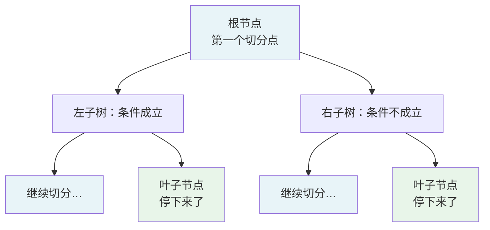
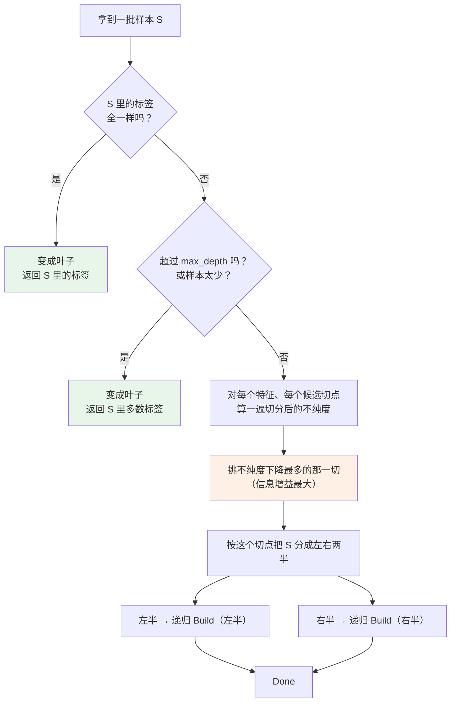
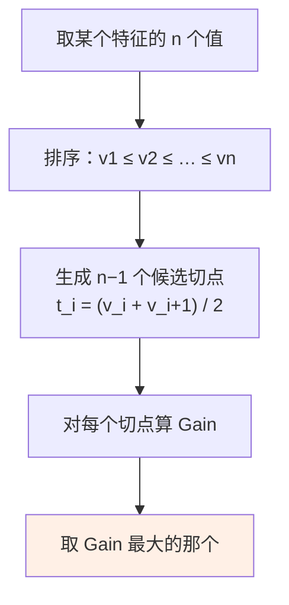
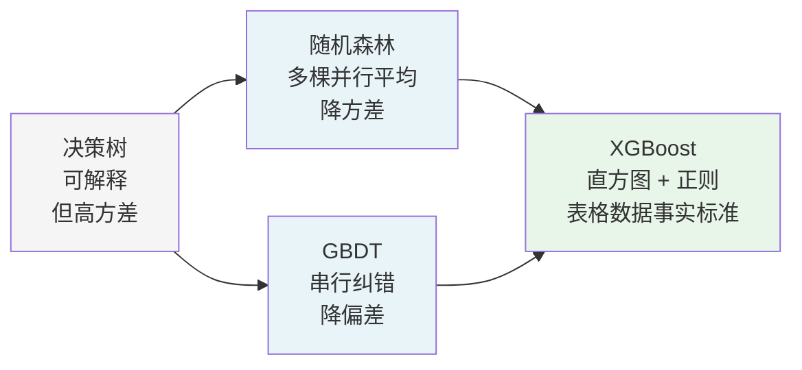

# 02 · 决策树：最小可解释模型

> 读者假设：读过 [01 篇](01-从手写规则到机器学习.md)，知道特征、标签、训练/验证/测试、过拟合、AUC 这些词。
>
> 本文所有数字来自 [`examples/from_scratch_ml.py`](examples/from_scratch_ml.py) §1 和 [`examples/tabular_baselines.py`](examples/tabular_baselines.py) 的真实输出。那两个脚本**纯 numpy 手写**了本篇的每一个公式，所以本文的每个数字你都能自己重算一遍。

---

## 目录

- [1. 一棵树长什么样](#1-一棵树长什么样)
- [2. 树的构建：贪心策略](#2-树的构建贪心策略)
- [3. 不纯度：怎么衡量一个节点"乱不乱"](#3-不纯度怎么衡量一个节点乱不乱)
- [4. 信息增益：这一刀值不值得切](#4-信息增益这一刀值不值得切)
- [5. 完整的手算过程](#5-完整的手算过程)
- [6. 连续特征怎么切](#6-连续特征怎么切)
- [7. 树为什么能表达 XOR，而直线不能](#7-树为什么能表达-xor而直线不能)
- [8. 特征重要性：树最大的优点](#8-特征重要性树最大的优点)
- [9. 过拟合：树是怎么把自己练废的](#9-过拟合树是怎么把自己练废的)
- [10. 控制树的三种方式](#10-控制树的三种方式)
- [11. 决策树 vs 逻辑回归](#11-决策树-vs-逻辑回归)
- [12. 树的软肋](#12-树的软肋)
- [13. 检查清单](#13-检查清单)

---

## 1. 一棵树长什么样

### 1.1 它就是 if/else 嵌套

**决策树没有魔法。训练完的决策树，就是一棵 if/else。**

这是 `from_scratch_ml.py` §1.3 真实打印出来的一棵拟合好的树（原文照抄）：

```
if x[0] <= 1.5000:
    return 0.0000   (n=1, 正类=0)
else:
    if x[1] <= 8.5000:
        return 1.0000   (n=6, 正类=6)
    else:
        return 0.0000   (n=1, 正类=0)
实际树深=2  叶子数=3  训练准确率=1.0000
```

翻译成人话：**先看第 0 个特征是不是 ≤ 1.5。是 → 返回 0。不是 → 再看第 1 个特征是不是 ≤ 8.5。是 → 返回 1。不是 → 返回 0。**

**这就是决策树唯一的秘密：你手写的那串 if/else，和模型学出来的这串 if/else，语法上一模一样。**
区别只在于：你的阈值是拍出来的，它的阈值是算出来的。

### 1.2 术语对照



| 术语 | 英文 | 含义 |
|---|---|---|
| **节点** | node | 一个切分点（带 if 条件），或一个终点（叶子） |
| **根节点** | root | 最上面那个节点，树的入口 |
| **内部节点** | internal node | 带 if 条件的节点 |
| **叶子/叶节点** | leaf | 树的终点，输出预测值 |
| **分支/边** | branch / edge | 从父节点到子节点的连线，对应条件的真/假 |
| **树深** | depth | 从根到最远叶子的层数。上面那棵树深度 = 2 |
| **分叉** | split | 一次"切一刀"这个动作 |

**为什么叫"决策树"**：因为它在**逐步做决策**。走完一条从根到叶的路径 = 做了一系列 if/else 判断 = 得出一个结论。

---

## 2. 树的构建：贪心策略

### 2.1 完整算法



**这个算法叫 CART（Classification and Regression Tree，分类与回归树）。**
注意它是**贪心**的：在当前这一步选最好的切法，不回头看全局最优。

**贪心意味着什么？** 它找的是"当前这一步的最优"，不是"整棵树的最优"。
类比 Huffman 编码——也是贪心，也是不保证全局最优，但效果够好，所以被广泛使用。

### 2.2 为什么是"逐步切"而不是"直接写规则"

因为**你不知道第一个问题该问什么**。

手写规则时你必须先决定："我先问收入还是先问负债率？"
这是全凭经验的。而决策树的做法是：把所有可能的切点都试一遍，选信息增益最大的那个当第一个问题，然后再在左右两半里各问下一个问题。

**这就是"从数据里学出规则"的具体含义**——连"先问什么"都是学出来的。

---

## 3. 不纯度：怎么衡量一个节点"乱不乱"

### 3.1 三个概念先分清

| 词 | 层次 | 含义 |
|---|---|---|
| **熵 / 信息熵** | 单个节点 | 这个节点里的样本有多"乱" |
| **不纯度** | 单个节点 | 同上，是熵的家族统称（Gini / 熵 / 错分率都是它） |
| **信息增益** | 一次切分 | 切完之后乱的程度降低了多少 |

### 3.2 基尼系数（Gini，CART 的默认选择）

**大白话**：你闭着眼睛从袋子里摸球，摸到某一种的概率。摸中同一类的概率越高，节点越"纯"。

$$ G = 1 - \sum_{k=1}^{K} p_k^2 $$

其中 $p_k$ 是第 $k$ 类的占比，$K$ 是类别数。

**直觉记忆：**
- 全部同类（比如 10 个都是正类）→ $p_1 = 1$ → $G = 1 - 1 = 0$ → **纯**
- 完全均匀（比如 5 正 5 负）→ $p_1 = p_2 = 0.5$ → $G = 1 - 0.25 - 0.25 = 0.5$ → **最脏**

**取值的实际范围是 $[0, 0.5]$**（二分类时），多分类最大是 $1 - 1/K$。

### 3.3 信息熵（Entropy，ID3/C4.5 用）

$$ H = -\sum_{k=1}^{K} p_k \log_2 p_k $$

**为什么叫"熵"？** 这是热力学和信息论里衡量"无序程度"的量，1948 年香农把它借来描述信息的不确定性。

同样：
- 全部同类 → $H = -1\log_2 1 = 0$ → 纯
- 二分类均匀 → $H = -(0.5\log_2 0.5 + 0.5\log_2 0.5) = 1$ → 最脏

### 3.4 真实数值对照

`from_scratch_ml.py` §1.1 的真实输出（10 个样本，二分类）：

```
    类别计数    Gini=      Entropy=
    [10, 0]    0.0000      0.0000
    [8,  2]    0.3200      0.7219
    [5,  5]    0.5000      1.0000
    [2,  8]    0.3200      0.7219
    [0,  10]   0.0000      0.0000
```

**手算 [8, 2] 这一行（Gini）：**

$$ G = 1 - \left(\frac{8}{10}\right)^2 - \left(\frac{2}{10}\right)^2 = 1 - 0.64 - 0.04 = 0.32 \quad ✓ $$

**手算 [8, 2] 这一行（Entropy）：**

$$ H = -\left(0.8 \log_2 0.8 + 0.2 \log_2 0.2\right) = -(0.8 \times (-0.3219) + 0.2 \times (-2.3219)) $$

$$ = 0.2575 + 0.4644 = 0.7219 \quad ✓ $$

**两个不纯度函数都是单调的**——[8,2] 和 [2,8] 得分一样（对称），[5,5] 最高，两端为 0。
**所以排序结果几乎一致**。CART 默认用 Gini 只是因为它算起来更便宜（没有 log）。

### 3.5 还有第三个：错分率

$$ \text{Error} = 1 - \max_k p_k $$

最简单的一个。理论上合理，但**对样本量变化太敏感**（一个节点 3 条样本 2 正 1 负，错分率 0.33；同比例 300 条样本也是 0.33，但它其实相当可靠了）。所以实践中不用。

---

## 4. 信息增益：这一刀值不值得切

### 4.1 公式

**这一刀切下去，节点的"乱"降低了多少？**

$$ \text{Gain}(S, A) = \text{Impurity}(S) - \sum_{v \in V} \frac{|S_v|}{|S|} \cdot \text{Impurity}(S_v) $$

逐项拆开（大白话版）：

| 符号 | 含义 |
|---|---|
| $S$ | 当前节点的样本集合 |
| $A$ | 候选切分（某个特征 + 某个切点） |
| $\text{Impurity}$ | 不纯度函数，用 Gini 或 Entropy |
| $V$ | 切完得到的所有子集（决策树里就是"左半 + 右半"） |
| $S_v$ | 第 $v$ 个子集 |
| $\frac{\lvert S_v\rvert}{\lvert S\rvert}$ | 这个子集占原集合的比例——**加权平均的权重** |

**读法**：$\text{Gain}$ 越大，这一刀越好。

**为什么第二项要加权？** 因为切完可能不均匀。比如 100 条切成了 95 + 5，两边不纯度就算很高，加权后也压不下去。**加权就是让"切歪了"的切法拿不到高增益。**

### 4.2 换成信息论的说法（信息增益）

如果 $\text{Impurity}$ 用 Entropy，这个量就叫**信息增益（information gain, IG）**，也就是 ID3 的判据。

$$ IG(S, A) = H(S) - \sum_v \frac{|S_v|}{|S|} H(S_v) $$

**这里的 $H(S)$ 就是信息的"混乱程度"**，切分降低了多少混乱，就是你获得了多少信息。
**所以"信息增益"这个名字是字面意义的。**

### 4.3 增益率（Gain Ratio，C4.5 的修正）

**ID3 有一个已知毛病**：它偏爱"能切出很多子集"的特征。

举例：特征"身份证号"（几乎每条都不同）能切出 $n$ 个子集，每个子集 1 条、纯净度 100%，增益 = 0.5 拉满——**但这个特征毫无预测价值，它只是在背书。**

C4.5 用**增益率**修正：

$$ \text{GainRatio}(S, A) = \frac{\text{Gain}(S, A)}{\text{SplitInfo}(A)}, \qquad \text{SplitInfo}(A) = -\sum_v \frac{|S_v|}{|S|} \log_2 \frac{|S_v|}{|S|} $$

分母 $\text{SplitInfo}(A)$ 就是"这个切分本身有多不确定"。切得越碎，SplitInfo 越大，增益率越小。

**一句话：ID3 只看收益，C4.5 收益除以代价。**

> 实践中 sklearn 的 `DecisionTreeClassifier` 用的是 **Gini + 加权分裂**（等价于 CART 加一个 minimum_weight_fraction），不是你需要自己实现的算法。上面这些历史是理解"为什么公式长这样"，真上手用库就行。

---

## 5. 完整的手算过程

这是本文最重要的一节。**8 条样本，2 个特征，我们手算一遍完整的建树过程。**

`from_scratch_ml.py` §1.2 真实输出：

```
[1.2] 一次真实的信息增益计算（2 个特征 8 条样本）
    父节点 计数=[4 4]  正类率=0.500  Gini=0.5000
    切点 x0<=4.5:  左 n=4 计数=[4 0] Gini=0.0000 | 右 n=4 计数=[0 4] Gini=0.0000
           gain = 0.5000 - (0.50×0.0000 + 0.50×0.0000) = 0.5000
    切点 x0<=6.5:  左 n=6 计数=[4 2] Gini=0.4444 | 右 n=2 计数=[0 2] Gini=0.0000
           gain = 0.5000 - (0.75×0.4444 + 0.25×0.0000) = 0.1667
```

### 5.1 算父节点

8 条样本，4 个正类 4 个负类：$p_1 = p_2 = 0.5$

$$ G_{parent} = 1 - 0.5^2 - 0.5^2 = 0.5 \quad ✓ $$

### 5.2 候选切点 A：`x0 <= 4.5`

切完：左边 4 条全是正类 `[4 0]`，右边 4 条全是负类 `[0 4]`。

$$ G_L = 1 - 1^2 - 0^2 = 0, \qquad G_R = 1 - 0^2 - 1^2 = 0 $$

$$ \text{Gain} = 0.5 - \left(\frac{4}{8} \times 0 + \frac{4}{8} \times 0\right) = 0.5 - 0 = \mathbf{0.5} $$

**这是理论最大值。** 完美分离，增益拉满。

### 5.3 候选切点 B：`x0 <= 6.5`

切完：左边 6 条 `[4 2]`，右边 2 条 `[0 2]`。

**算左边的 Gini（这是最容易算错的一步）：**

$$ G_L = 1 - \left(\frac{4}{6}\right)^2 - \left(\frac{2}{6}\right)^2 = 1 - 0.4444 - 0.1111 = 0.4444 \quad ✓ $$

$$ G_R = 1 - 0^2 - 1^2 = 0 $$

$$ \text{Gain} = 0.5 - \left(\frac{6}{8} \times 0.4444 + \frac{2}{8} \times 0\right) = 0.5 - 0.3333 = \mathbf{0.1667} $$

### 5.4 结论

| 切点 | 左 Gini | 右 Gini | **Gain** |
|---|---|---|---|
| `x0 <= 4.5` | 0.0000 | 0.0000 | **0.5000** ✅ 选它 |
| `x0 <= 6.5` | 0.4444 | 0.0000 | 0.1667 |

**`x0 <= 4.5` 赢。** 树从这里长出第一个分支。

### 5.5 为什么"0.5"是上限

$0.5$ 恰好是 $G_{parent}$ 本身。**因为 Gain = 父不纯度 − 加权子不纯度，而加权子不纯度最小只能是 0。**
所以任何一次切分的增益都不可能超过父节点的不纯度。这是理论天花板，能算出来就知道模型有没有发挥好。

**这个"手算"正是 `from_scratch_ml.py` 在做的事——每一步都跟库的实现对账。** 建议你打开那个脚本对照着看。

---

## 6. 连续特征怎么切

### 6.1 问题

基尼系数和增益公式都是给**离散**值的。收入是 42000.5 这种连续值，怎么办？

**答案：排序后只试相邻值之间的中点。**

### 6.2 算法



**为什么只试 n−1 个而不是无穷多个切点？**
因为把所有样本按值排好序之后，任何切点 t 的效果只取决于它把序列切成"前 k 个"和"后 n−k 个"。
而所有这样的分割就是 n−1 个。**这就把连续特征的问题变成了有限搜索。**

**为什么用中点而不是直接用某个值？** 中点保证切出来的两边不重叠，语义上"≤ t"更干净。

### 6.3 代价

n 个值就要排序 O(n log n)，算 n−1 个增益各 O(n)，总共 **O(n²)**。

这就是决策树训练慢的原因。XGBoost 的**直方图算法（histogram-based）**就是针对这个：
把连续值分到有限个桶（比如 256 个）里，只在桶边界上切，**把 O(n²) 降到 O(n × 256)**。这是 XGBoost 比传统 GBDT 快的主要原因，04 篇细讲。

---

## 7. 树为什么能表达 XOR，而直线不能

### 7.1 XOR 问题

4 个点，标签是这样的：

| x0 | x1 | y |
|---|---|---|
| 0 | 0 | 0 |
| 0 | 1 | 1 |
| 1 | 0 | 1 |
| 1 | 1 | 0 |

**"同号输出 0，异号输出 1"。**

### 7.2 为什么直线做不到

**用线性模型的观点看**：$z = w_0 x_0 + w_1 x_1 + b$，要正确分类就要 $y = \text{sign}(z)$。
于是四个点要求：

$$
\begin{cases}
b < 0 \\
w_1 + b > 0 \\
w_0 + b > 0 \\
w_0 + w_1 + b < 0
\end{cases}
$$

把前三个不等式加起来：$w_0 + w_1 + 3b > 0$。但 $b < 0$ 意味着 $3b < 0$，所以左边 $< w_0 + w_1$。
而第四式要求 $w_0 + w_1 < -b > 0$……推下去就矛盾了。**无解。**

**几何上的说法**：两个正例在对角线，两个负例在另一条对角线上。**任何一条直线都必然同时切进某一类的两个点。**

### 7.3 树怎么做到

**两刀。** 先切 x0，再在右半边切 x1：

```
if x0 <= 0.5:  →  return 0     # (0,0) 和 (0,1) 都在这，它们标签不同？
else:          →  if x1 <= 0.5:  return 1   # (1,0) 异号 → 1
                     else:         return 0   # (1,1) 同号 → 0
```

等等，第一刀切完左边有 (0,0)=0 和 (0,1)=1，标签不同，不能停，要继续切。**正确版本：**

```
if x0 <= 0.5:
    if x1 <= 0.5:  return 0     # (0,0) 同号
    else:          return 1     # (0,1) 异号
else:
    if x1 <= 0.5:  return 1     # (1,0) 异号
    else:          return 0     # (1,1) 同号
```

**这是深度 2、4 个叶子。**

**这就是"树能表达交互"的最小证据。**

### 7.4 真实输出

`from_scratch_ml.py` §1.3 在实际拟合（不是手写）时打印出来的树：

```
if x[0] <= 1.5000:
    return 0.0000   (n=1, 正类=0)
else:
    if x[1] <= 8.5000:
        return 1.0000   (n=6, 正类=6)
    else:
        return 0.0000   (n=1, 正类=0)
实际树深=2  叶子数=3  训练准确率=1.0000
```

**深度 2，训练准确率 1.0000。** 算法自己找到了"先看 x0，再看 x1"的切法，你没告诉它。

### 7.5 推广：树的表达能力是指数级的

一棵树可以表达任意布尔函数。粗略地说，一个深度 $d$ 的满二叉树有 $2^d$ 个叶子，每个叶子可以独立给一个类别值，
所以它能表达 $2^{2^d}$ 种布尔函数。**而深度才 $d$。**

**对比线性模型**：$n$ 维输入只有 $n+1$ 个参数，只能表达 $2^{n+1}$ 种函数。

| 模型 | 参数量 | 能表达的函数数 |
|---|---|---|
| 逻辑回归 | $n+1$ | $2^{n+1}$ |
| 深度 $d$ 决策树 | $2^d$ 个叶子 | $2^{2^d}$ |

**这是树在表格数据上强大的根本原因。**

### 7.6 但这不是免费午餐

**代价是：树不连续。** 它输出的是分段常数，一点点输入变化可能让输出跳变。

这在信贷场景是**致命的**：一个客户负债率 44.9% 通过，45.1% 拒绝——
**但这两个人经济状况几乎一样。** 这在公平性审查和监管场景下会被直接挑战。

**这是决策树在金融风控里最大的隐患，也是逻辑回归至今还在被用的原因。** 见第 11 节。

---

## 8. 特征重要性：树最大的优点

### 8.1 两种口径

sklearn 给两种，**它们不能横向比较**：

| 类型 | 怎么算 | 直觉含义 |
|---|---|---|
| **不纯度重要度**（impurity-based / MDI） | 整个森林里，这个特征带来的不纯度下降总量 | "用它切，收益最大" |
| **置换重要度**（permutation importance / MDA） | 打乱这一列，看模型掉多少分 | "没用它，模型会差多少" |

### 8.2 真实输出

`tabular_baselines.py` §4（乳腺癌数据，真实值）：

```
[4] 特征重要性 top-8（口径不同，不能横向直接比）
  worst perimeter    RF 不纯度重要度=0.1457   LR 系数=-0.0412
  worst area         RF 不纯度重要度=0.1441   LR 系数=-0.0194
  concave points     RF 不纯度重要度=0.1146   LR 系数=-0.5063
  mean concave points RF 不纯度重要度=0.0983   LR 系数=-0.2234
  worst radius       RF 不纯度重要度=0.0724   LR 系数=+0.3686
  mean radius        RF 不纯度重要度=0.0607   LR 系数=+0.9125
  mean perimeter     RF 不纯度重要度=0.0560   LR 系数=-0.2773
  mean concavity     RF 不纯度重要度=0.0452   LR 系数=-0.4692
```

**这八个特征全是肿瘤的形状描述**——`worst radius`（最大半径）、`worst perimeter`（最大周长）、`concave points`（凹点数）——
这也是乳腺癌诊断领域公认最重要的几个指标。**模型和医学知识对上了，这是一个很好的正确性信号。**

### 8.3 两个陷阱

**陷阱一：两种口径的数值完全不能比。**
看 `worst perimeter`：不纯度重要度 0.1457（占比最大），但逻辑回归系数只有 −0.0412。
**这不是"逻辑回归觉得它不重要"，是两个口径的量纲不同。** 脚本的表头专门写了一行"口径不同，不能横向直接比"。

**陷阱二：不纯度重要度有已知的偏差，会偏向高基数特征。**
一个有 10000 个不同取值的连续特征，能切出无数个精细分割；一个只有 0/1 的二值特征最多切一刀。
**前者天然更容易累积出不纯度下降，于是重要性虚高。**

**要可信的重要性，用置换重要度。** 它回答的是"抽掉这一列会怎样"，跟基数无关。

### 8.4 在信贷数据上

`tabular_baselines.py` 信贷数据 §4：

```
  debt_to_income     RF 不纯度重要度=0.3138   LR 系数=-1.9284
  income             RF 不纯度重要度=0.2996   LR 系数=-0.0000
  age                RF 不纯度重要度=0.1716   LR 系数=+0.0008
  emp_years          RF 不纯度重要度=0.1343   LR 系数=-0.0034
  inquiries_6m       RF 不纯度重要度=0.0440   LR 系数=-0.2357
  is_invest          RF 不纯度重要度=0.0124   LR 系数=-0.0353
```

**这个对比很有教学价值：**
- 树给 `income` 排到第 2（0.2996），**但逻辑回归的系数是 −0.0000（几乎为零）。**
- **这说明"income"的重要性不是它自己能表达，而是它跟 `debt_to_income` 相关。**
  树是靠"income 低"这一刀间接地补了 debt_to_income 的不足。

**这是一个只有把两个模型放在一起看才能发现的洞见。** 也是为什么单看一个模型的特征重要性会得出错误结论。

---

## 9. 过拟合：树是怎么把自己练废的

### 9.1 机制

一棵不限制的决策树会**一直切到每片叶子只有一条样本**为止。
那时候训练准确率必然 100%——**因为它把答案抄下来了。**

### 9.2 真实输出

`from_scratch_ml.py` §1.4（可分数据，所以看起来没事）：

```
[1.4] 过拟合：同一个数据，只放开 max_depth
    max_depth=1  树深=1 叶子数=2   logloss=0.3589
    max_depth=2  树深=2 叶子数=3   logloss=0.0000
    max_depth=3  树深=2 叶子数=3   logloss=0.0000
    max_depth=8  树深=2 叶子数=3   logloss=0.0000
```

**读法**：这个数据本身完全可分，深度 2 就够了。
`max_depth=8` 并没有让树变深——**因为数据不支持更深的切分了，多给深度也没有用。**

**所以这个例子不是过拟合，它展示的是"深度给多了不会自动变差"。**
真正的过拟合要看 `tabular_baselines.py` 那两个：

**乳腺癌（数据多、信号近似线性）：**
```
  DecisionTree(d=3)        logloss=0.5549   AUC=0.9463   acc=0.9441
  DecisionTree(不限制)      logloss=1.5941   AUC=0.9234   acc=0.9231
```

**信贷（20000 条、正类 10.6%）：**
```
  DecisionTree(d=3)        logloss=0.3092   AUC=0.6861   acc=0.8938
  DecisionTree(不限制)      logloss=3.4401   AUC=0.5877   acc=0.8340
```

**信贷那个 logloss 3.4401 是本教程里最刺眼的一个数字。**
它的含义是：模型给出了极端自信但完全错误的预测。
$-\log(0.01) = 4.6$，所以 3.44 对应着"大约 96% 的把握，但结果全错"。
**这就是过拟合的标准指纹：错得很自信。**

对比一下**不限深度的树在 accuracy 上反而看起来"没那么差"**（0.8340 vs 0.8938 还是有差距的，但如果只看某些场景的 accuracy 排序可能会被骗）。
**logloss 和 AUC 比 accuracy 更早暴露问题，这就是为什么 01 篇 §7 说要同时看多个指标。**

### 9.3 决策树过拟合的三种表现

| 表现 | 机制 | 对策 |
|---|---|---|
| **高方差**（variance） | 数据稍微一变，学出来的树就完全不一样 | 加树（随机森林）、限深度、更多数据 |
| **阶梯状输出** | 阈值附近不稳定 | 加更多数据平滑、换逻辑回归 |
| **偏好高基数特征** | 连续特征切得越来越细 | 限深度、限叶子数、特征离散化 |

**注意第一行：决策树的核心问题是"高方差"。** 这决定了 03 篇随机森林的整个思路——**用很多棵高方差的树平均出一个低方差的整体。**

---

## 10. 控制树的三种方式

### 10.1 三个必调参数

```python
DecisionTreeClassifier(
    max_depth=3,              # 树最多几层
    min_samples_leaf=10,      # 每个叶子至少几条样本
    min_samples_split=20,     # 一个节点至少几条才允许继续切
    max_features=None,        # 每次切分考虑几个特征（随机森林要设，决策树不用）
    ccp_alpha=0.0,            # 代价复杂度剪枝的惩罚系数
    class_weight=None,        # 类别不平衡时给少数类加权
)
```

| 参数 | 治什么 | 调大的后果 |
|---|---|---|
| `max_depth` | 树长太高 | 更保守、更欠拟合 |
| `min_samples_leaf` | 叶子太碎 | 更保守 |
| `min_samples_split` | 节点太小还乱切 | 更保守 |
| `ccp_alpha` | 事后剪枝 | 更保守 |
| `class_weight='balanced'` | **不平衡数据** | 少数类被重视，accuracy 会掉但召回会涨 |

### 10.2 不平衡数据的关键参数

01 篇 §7 已经证明：在 10.6% 正类的数据上，不限深度的树 **F1 = 0.2602**，而限深 3 的是 **F1 = 0.0000**。
两者都是 0（不同原因），但都说明了一件事：

**默认决策树在不平衡数据上会退化成"只预测多数类"。**

三个解法，按推荐顺序：

1. **`class_weight='balanced'`** —— 最简单，直接提高少数类权重。
2. **用 AUC / logloss 评估，不用 accuracy** —— 至少你能看见真实水平。
3. **改阈值** —— 模型输出概率，业务阈值你自己定。**这通常是收益最大的一个动作**，因为它把"模型能力和业务成本"解耦了。见 10 篇的阈值成本表。

### 10.3 成本复杂度剪枝（CCP）

上面三个参数是"事前"限制，CCP（cost-complexity pruning）是"事后"剪：先让树长到最大，再从底部往上剪，每剪一刀就算一下"少多少不纯度 vs 多付多少 $\alpha$ 代价"。

$$ R_\alpha(T) = R(T) + \alpha \cdot |\text{leaves}(T)| $$

**$\alpha$ 就是"多一个叶子值多少钱"。** 逐棵删掉"删掉之后 $R$ 下降不多"的节点。

sklearn 里通过 `ccp_alpha` 暴露，路径是 `cost_complexity_pruning_path(tree)`。

---

## 11. 决策树 vs 逻辑回归

这两者的对比是本篇最实用的部分，因为**在金融风控这个具体场景里，逻辑回归至今没有被替代。**

| 维度 | 决策树 | 逻辑回归 |
|---|---|---|
| 能表达交互 | ✅ 强（第 7 节） | ❌ 弱（只能加交互项） |
| **输出连续** | ❌ 阶梯状 | ✅ 线性 |
| **概率可信** | 中等（需校准） | ✅ 天然较好（ECE 0.0427） |
| 可解释性 | ✅ 画出来就是 if/else | ✅ 一串系数 |
| **监管接受度** | 视辖区 | ✅ **极高**（金融业标准） |
| 特征重要性能横向比 | 中（受基数影响） | ✅ 系数同量纲，可比 |
| 处理非线性 | ✅ 天然 | ❌ 需手动加项 |
| 单条延迟 | 0.055 ms | **0.068 ms** |

### 11.1 真实数据：它们互有胜负

`tabular_baselines.py` 乳腺癌（近似线性）：

```
  LogisticRegression     AUC=0.9960  logloss=0.0879  ECE=0.0273
  DecisionTree(d=3)      AUC=0.9463  logloss=0.5549  ECE=0.0376
```

**逻辑回归完胜。** 信号近似线性时，直线就够了，树反而在硬切。

`tabular_baselines.py` 信贷（有 XOR 交互）：

```
  LogisticRegression     AUC=0.6816  logloss=0.3195  ECE=0.0112
  DecisionTree(d=3)      AUC=0.6861  logloss=0.3092  ECE=0.0014
  GradientBoosting       AUC=0.8469  logloss=0.2541  ECE=0.0158
```

**逻辑回归塌了（0.6816），树勉强跟上（0.6861），但都远不如 GBDT（0.8469）。**

### 11.2 三个必须记住的结论

**结论一：单棵决策树基本不用在生产里。**
它在两个数据集上都不是最好的，且方差高、单条延迟没优势。**它的价值是"可解释"和"作为集成的基本单元"。**

**结论二：逻辑回归在高维稀疏数据上不可替代。**
CTR 预估、文本分类这些场景特征有几万维且大多是 0，稀疏线性模型的效果和效率都远超树。
**它的丢失的只是交互项，而这个可以用特征交叉（feature crossing）手工补。**

**结论三：金融风控是一个特殊场景，要两样。**
- **判别层**用逻辑回归或 GBDT——概率连续、系数可解释、监管熟悉。
- **理解层**用决策树/GBDT 的 SHAP 值——给风控人员和客户一个"为什么拒"的解释。

**这是本教程反复出现的一个模式：不要在"可解释"和"准确"之间二选一，分层用两个模型。**

---

## 12. 树的软肋

这四条决定了树从来不是终点，每一条都指向下一篇的一个主题：

| 软肋 | 表现 | 解法 | 在哪篇 |
|---|---|---|---|
| **高方差** | 数据变一点树就变 | 集成（随机森林） | **[03 篇](03-随机森林.md)** |
| **只能做轴对齐切分** | 斜着的分界线要切很多刀 | 集成 + 加权 | [03 篇](03-随机森林.md) |
| **贪心、不看全局** | 前面的切错后面没法救 | Boosting（串行纠错） | **[04 篇](04-GBDT与XGBoost.md)** |
| **训练慢、模型大** | O(n²) 增益搜索，模型难导出 | 直方图算法 | [04 篇](04-GBDT与XGBoost.md) |

**这四条软肋正好对应树模型的三个演进方向。** 把它们串起来看，整条技术路线就清楚了：



---

## 13. 检查清单

用决策树之前：

- [ ] 数据里有缺失值吗？树**不能原生处理 NaN**（sklearn 1.4+ 部分支持）。→ 插补或改用能处理的模型。
- [ ] 类别不平衡了吗？→ `class_weight='balanced'` + 看 AUC 不看 accuracy。
- [ ] 需要输出可信概率吗？→ 树要额外校准，逻辑回归不用。
- [ ] 是金融/医疗等强监管场景吗？→ 考虑逻辑回归，或用树 + SHAP 做解释。
- [ ] 特征是连续高基数吗？→ 不纯度重要度会失真，用置换重要度。
- [ ] 训练集和测试集差距大吗？→ 限深度/限叶子数，或者直接上 [03 篇](03-随机森林.md)。

---

## 下一篇

**[03 · 随机森林：把一堆"高方差"的树平均掉](03-随机森林.md)** —— Bagging 是什么、为什么"特征子采样"能去相关、OOB 袋外估计是什么、树到底要多少棵。附 `from_scratch_ml.py` §2 的两组对照实验。

---

## 相关文档

- [`examples/from_scratch_ml.py`](examples/from_scratch_ml.py) §1 —— 本篇所有公式的纯 numpy 实现
- [`examples/tabular_baselines.py`](examples/tabular_baselines.py) —— 真实数据集上的完整指标对比
- [`jev/02-企业落地实战指南`](../jev/02-企业落地实战指南.md) —— 决策树在资质审核里的实际用法
- [01 篇](01-从手写规则到机器学习.md) —— 指标体系与过拟合的完整讨论
