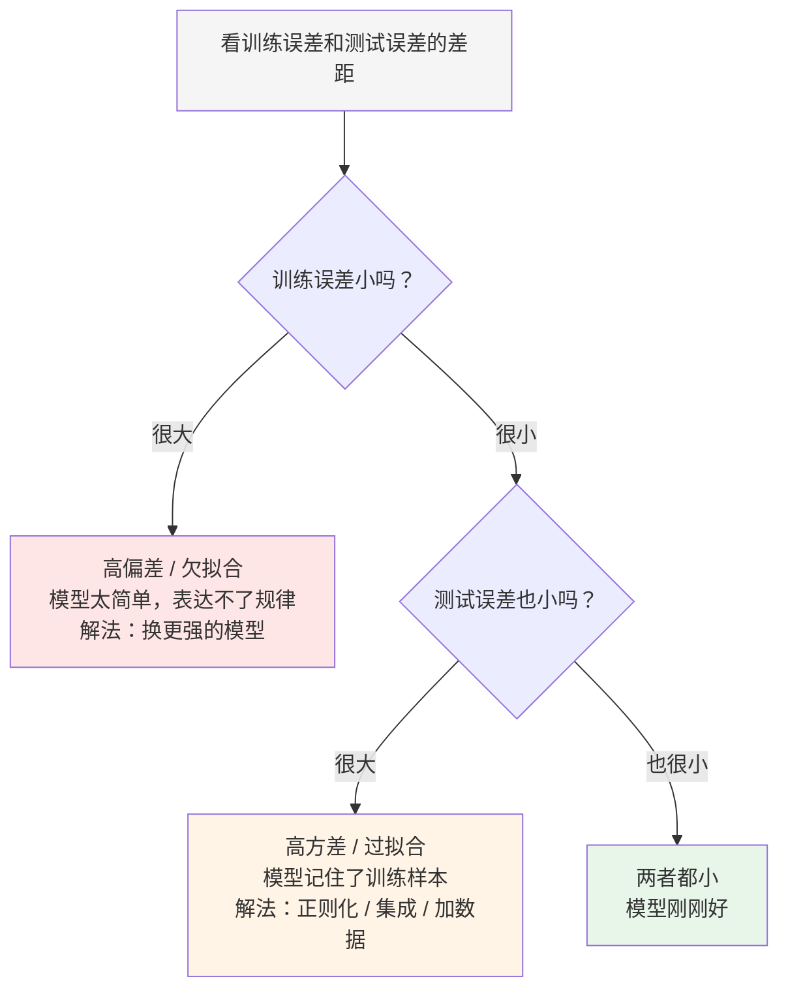
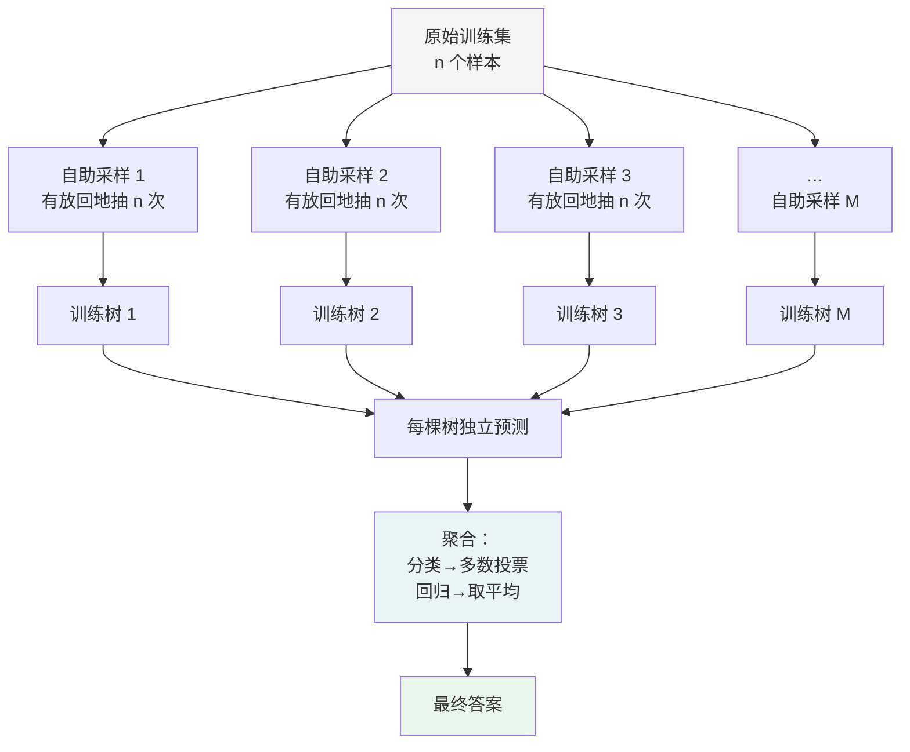
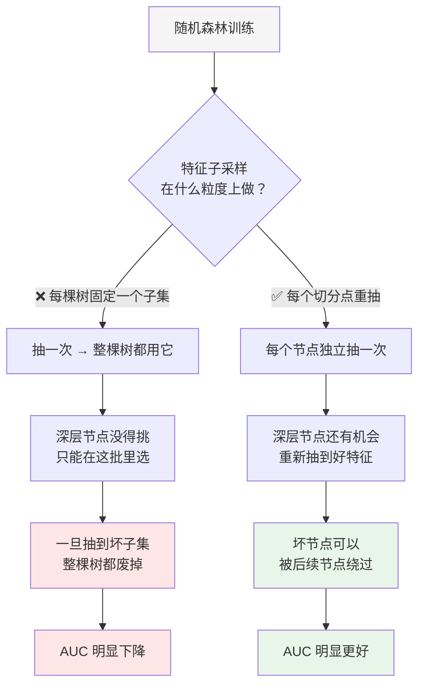
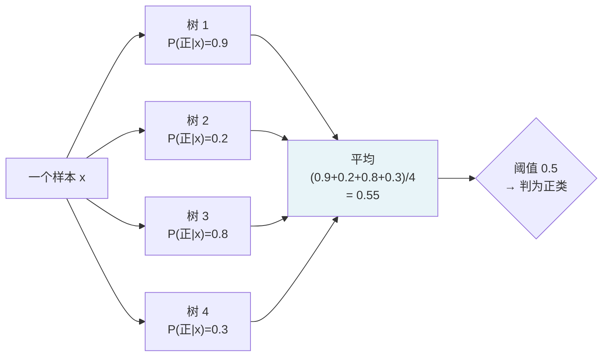
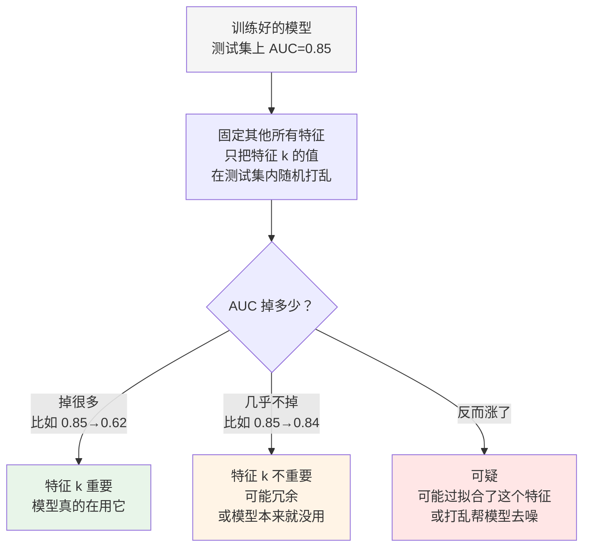
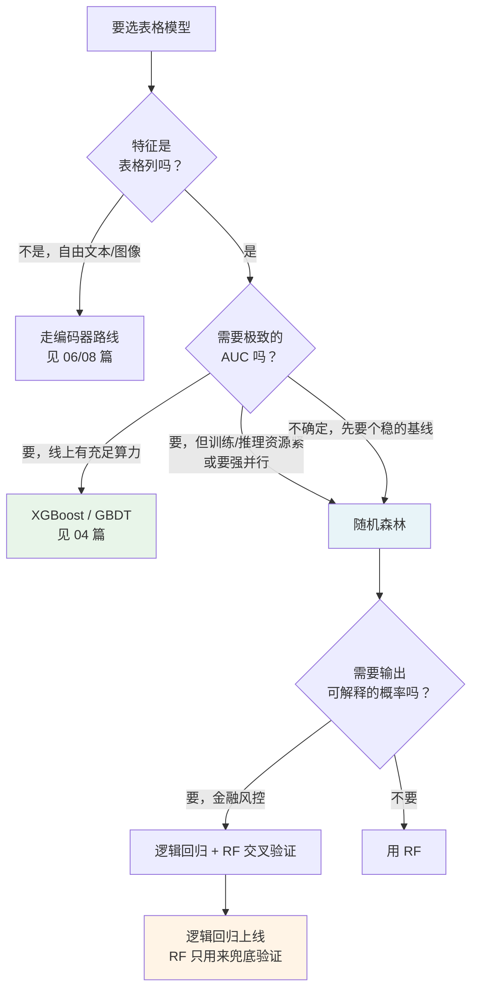

# 03 · 随机森林：把一堆"高方差"的树平均掉

> 读者假设：读过 [01 篇](01-从手写规则到机器学习.md) 和 [02 篇](02-决策树.md)。你已经知道一棵树是 if/else 嵌套，知道 CART、基尼系数、信息增益，也知道树有"高方差"这个软肋。
>
> 本文所有数字来自 [`examples/from_scratch_ml.py`](examples/from_scratch_ml.py) §2 和 [`examples/tabular_baselines.py`](examples/tabular_baselines.py) 的真实输出。§2 那个脚本**纯 numpy 手写**了随机森林的每一步——bootstrap、训练、袋外预测、投票——所以本文每个数字你都能自己重算。
>
> 复现环境：Python 3.12 · numpy 2.4.6 · scikit-learn 1.9.1 · xgboost 3.2.0。指标类数字在同版本下可完全复现；`pred_ms` 随机器变化，只当数量级看。

---

## 目录

- [1. 先看一眼"高方差"长什么样](#1-先看一眼高方差长什么样)
- [2. 高方差到底是什么](#2-高方差到底是什么)
- [3. 第一个随机性：Bagging](#3-第一个随机性bagging)
- [4. 第二个随机性：特征子采样](#4-第二个随机性特征子采样)
- [5. 一个容易做错的实现细节](#5-一个容易做错的实现细节)
- [6. 特征子采样什么时候真的有用](#6-特征子采样什么时候真的有用)
- [7. 森林怎么给出答案](#7-森林怎么给出答案)
- [8. 袋外估计 OOB：不切验证集也能估性能](#8-袋外估计-oob不切验证集也能估性能)
- [9. 树到底要多少棵](#9-树到底要多少棵)
- [10. 完整实测对比](#10-完整实测对比)
- [11. 特征重要性：RF 的强项和陷阱](#11-特征重要性rf-的强项和陷阱)
- [12. 随机森林的软肋](#12-随机森林的软肋)
- [13. 超参数清单](#13-超参数清单)
- [14. 什么时候用随机森林](#14-什么时候用随机森林)
- [15. 和 Laya、大模型的关系](#15-和-laya大模型的关系)
- [16. 检查清单](#16-检查清单)

---

## 1. 先看一眼"高方差"长什么样

在讲怎么解决之前，先看问题有多大。下面是 `tabular_baselines.py` 在两个真实数据集上的输出。

**乳腺癌数据集（n=569，正负比较均衡）：**

```
LogisticRegression     acc 0.9580  AUC 0.9960  logloss 0.0879  ECE 0.0273
DecisionTree(d=3)      acc 0.9441  AUC 0.9463  logloss 0.5549  ECE 0.0376
DecisionTree(unbounded)acc 0.9231  AUC 0.9234  logloss 1.5941  ECE 0.0769
RandomForest(300)      acc 0.9580  AUC 0.9949  logloss 0.1046  ECE 0.0481
```

注意 `DecisionTree(unbounded)` 这一行：**准确率 0.9231，看起来只比限深度的 0.9441 低一点，但 log-loss 高达 1.5941，是逻辑回归（0.0879）的 18 倍。**

准确率和 log-loss 为什么会差这么多？因为 log-loss 惩罚的是"自信地猜错"。不限深度的树在训练集上拟合到接近完美，遇到没见过的样本也敢给出 0.999 这样的极端概率，一旦猜错，代价 $-\ln(0.001) \approx 6.9$。累积起来，log-loss 就爆了。

**信用违约数据集（n=20000，正类率只有 0.106，严重不平衡）：**

```
DecisionTree(d=3)       acc 0.8938  bal_acc 0.5000  F1 0.0000  AUC 0.6861  logloss 0.3092
DecisionTree(unbounded) acc 0.8340  bal_acc 0.5877  F1 0.2602  AUC 0.5877  logloss 3.4401
RandomForest(300)       acc 0.8900  bal_acc 0.5037  F1 0.0248  AUC 0.8192  logloss 0.2710
```

不限深度的树 **AUC 竟然掉到 0.5877——比随机猜（0.5）高不了多少**。而限深度的树是 0.6861，随机森林是 0.8192。

这就是"高方差"的可观测形态：

| 现象 | 含义 |
|---|---|
| 训练集极准、测试集明显差 | 记住了训练样本，没学到规律 |
| log-loss 远高于 AUC 暗示的水平 | 对外输出过度自信 |
| AUC 接近 0.5 | 排序能力几乎全丢 |
| 换个随机种子结果就大变 | 模型结构本身不稳定 |

---

## 2. 高方差到底是什么

先解释两个术语，因为后面到处要用。

**偏差（bias）**：模型"系统性想错了"的程度。训练误差大、测试误差也大，而且加数据也没用——说明这个模型形式根本表达不了真实规律。比如用一条直线去拟合一个圆环，方差极低，但偏差极大。

**方差（variance）**：模型对"换一批训练数据"的敏感程度。用数据 A 训练一个模型，用数据 B 训练一个，两个模型差很多——这就是高方差。表现是：训练误差很小，测试误差很大，而且**换个随机种子结果就大变**。



**决策树为什么天然高方差？** 因为它每一步都做"局部最优"的贪心选择。第 1 篇讲过，树的构建是"在当前节点挑最能降低不纯度的那一刀"——它完全不考虑"这个决定会不会让后面的节点没得切"。

打个比方：像考试时每道题都选当前看起来最有把握的选项，但你的判断完全建立在这一次的题目分布上。题目分布稍微一变，选项顺序就全变了。

更具体地说，一棵深度不受限的树可以长到**每个叶子只有 1 个样本**（这时训练准确率必然 100%）。这等于它把整个训练集背下来了。背下来的东西当然不能泛化。

**降低方差的两种正交思路**：

1. **换个更稳的算法**（限深度、限叶子数、特征选择）——治标。
2. **把很多棵抖法不同的树平均掉**——治本。这就是集成学习（Ensemble Learning）。

**集成的直觉**：如果每棵树都是"一个 unbiased 但很吵的估计器"，把 $M$ 棵独立树的平均取出来，噪声会按 $1/M$ 衰减，而信号不衰减——这就是集成能降方差的原因。

**但"独立"是关键字。** 树与树之间并不独立，它们看的是同一份数据、同一个特征。相关性会毁掉平均的效果。这是下一节要解决的问题。

---

## 3. 第一个随机性：Bagging

**Bagging = Bootstrap Aggregating**，中文常叫"套袋法"或"自助聚合"。1995 年 Breiman 提出。

它的流程只有两步：



### 3.1 "有放回地抽"是什么

**Bootstrap（自助采样）**：从 $n$ 个样本里**有放回**地抽 $n$ 次，得到一个大小同样是 $n$ 的新样本集。

关键在"有放回"：抽到过的样本还能再被抽到。结果是——

- 约 63.2% 的原始样本至少出现过一次；
- 约 36.8% 的原始样本一次都没出现。

这个 36.8% 就是后面 OOB 估计的来源（[第 8 节](#8-袋外估计-oob不切验证集也能估性能)）。

为什么要放回？因为不放回就没法抽出大小相同样本集之外的新样本，Bagging 的多样性就没了。

### 3.2 数学：平均为什么能降方差

先看最理想的、完全独立的情况。设 $M$ 棵树的预测分别是 $f_1(x), f_2(x), \dots, f_M(x)$，最终预测取平均：

$$\hat{f}(x) = \frac{1}{M}\sum_{m=1}^{M} f_m(x)$$

如果每棵树都是"同一个函数 + 零均值噪声"，即 $f_m(x) = f(x) + \varepsilon_m$，其中 $\varepsilon_m$ 独立、均值为 0、方差为 $\sigma^2$，那么：

$$\mathrm{Var}\left[\frac{1}{M}\sum_{m=1}^{M}\varepsilon_m\right] = \frac{1}{M^2}\sum_{m=1}^{M}\mathrm{Var}[\varepsilon_m] = \frac{M\sigma^2}{M^2} = \frac{\sigma^2}{M}$$

**平均值的方差是单棵的 $1/M$。** 这就是"降方差"的全部数学。

但注意这里的代价：**偏差一点都没变**。平均不会让模型更"准"，它只是让模型的抖动小了一圈。所以 Bagging 降方差、不降偏差；这是 [04 篇](04-GBDT与XGBoost.md) 的 Boosting 登场的原因——Boosting 反过来降偏差。

### 3.3 现实里树不是独立的

上面 $1/M$ 的漂亮结论有个前提：树与树之间**独立**。现实不成立。

用带协方差的版本。如果第 $i$ 棵和第 $j$ 棵树输出之间的相关系数是 $\rho$，那么平均后的方差是：

$$\mathrm{Var}\left[\frac{1}{M}\sum_{m=1}^{M} f_m\right] = \frac{\sigma^2}{M}\left(1 + (M-1)\rho\right)$$

拆开看（除以 $\sigma^2$）：

$$\frac{1}{M}\left(1 + (M-1)\rho\right) = \underbrace{\frac{1}{M}}_{\text{平均带来的}} + \underbrace{\frac{M-1}{M}\rho}_{\text{相关性抵消掉的}}$$

**当 $\rho > 0$ 时，相关性带来的那项随 $M$ 增大而增大。** 树越多，"平均"这一项越微不足道，"相关性"那一项几乎等于 $\rho$ 本身。这就是所谓的**集成崩塌（ensemble collapse）**：树越加越多，性能却不再提升，因为大家犯的错一模一样。

$ $\rho = 0 $ 时 $M$ 棵能做到 $1/M$；$ \rho = 0.5 $ 时，$ M \to \infty$ 的极限是 $0.5$ 而不是 0。

**所以 Bagging 只做了两件事里的一件：它用 bootstrap 降低了数据相关性，但特征层面的相关性还在。补上这一块，就是特征子采样。**

---

## 4. 第二个随机性：特征子采样

### 4.1 它在做什么

**每次要在节点上选切分特征时，不是看全部 $m$ 个特征，而是随机抽 $m_{\text{try}}$ 个，只从这 $m_{\text{try}}$ 个里挑最好的那一个。**

常见设定：

| 任务 | 常用 $m_{\text{try}}$ | 理由 |
|---|---|---|
| 分类 | $\sqrt{m}$ | Breiman 的原始建议，分类特征信息量大 |
| 回归 | $m/3$ | 回归特征噪声相对更大，要更狠地抽 |

以 $m = 50$ 个特征、分类任务为例：$m_{\text{try}} = \sqrt{50} \approx 7$。每个切分点只看 7 个特征。

### 4.2 为什么这能降低树之间的相关性

关键在于**每个节点的最优选择变成随机的了**。

- 全部特征都能用时，所有树在根节点都会选那个"最能降低不纯度"的特征 A。根节点的选择在所有树上完全一致 → 高度相关。
- 只看 7 个随机特征时，树 1 可能选 A，树 2 可能选 D，树 3 可能选 F。**根节点就分岔了**，后面的所有决策都跟着分岔。

树与树之间从此走上不同的路径，犯的错也就不同。相关性下降。

实测数字（`from_scratch_ml.py` §2.1，50 个特征全部有用）：

```
单棵树              AUC=0.5130   树间平均相关=nan
Bagging only        AUC=0.7612   树间平均相关=0.0691
随机森林             AUC=0.7631   树间平均相关=0.0467
→ 随机森林 vs Bagging：AUC +0.0019，相关 0.069 → 0.047
```

**相关从 0.0691 降到 0.0467，降了约三分之一。** 去相关确实发生了。

但 AUC 只涨了 0.0019——几乎看不见。这是正常的，原因见 [第 6 节](#6-特征子采样什么时候真的有用)。

---

## 5. 一个容易做错的实现细节

这是本篇最重要的一个坑，而且实测能看出差别。

**问题**：特征子采样的粒度是什么？两种做法：

- ✅ **每个切分点重抽**（正确，也是 sklearn 的做法）
- ❌ **每棵树开头抽一个固定子集，整棵树都用它**（错误）



实测对比（`from_scratch_ml.py` §2.3）：

```
每个切分点重抽（正确做法）  AUC=0.7631
整棵树固定子集（错误做法）  AUC=0.7141
```

**差了 0.049。** 就这一个实现细节，在 50 棵树的规模上，差距比"加不加特征子采样"（0.0019）大 25 倍。

为什么？想象一棵深度 5 的树，如果开头抽到的子集里最好的特征很弱，那整棵树的**根节点就走错了**，而且后面所有子节点都只能在这个弱子集里挣扎。相反，如果每个节点独立抽，根节点选错了，但深层的某个节点仍有可能抽到真正有用的特征，纠正回来。

**记住这条：sklearn 的 `RandomForestClassifier` 是正确实现。如果你要自己手写，别写错了。**

---

## 6. 特征子采样什么时候真的有用

这是 §2 实验最值得讲的地方。脚本跑了两组对照：

**[2.1] 50 个特征全都有用**（$m_{\text{try}}=7$，每棵节点只用到 7/50 个）：

```
单棵树       AUC=0.5130  树间平均相关=nan
Bagging only  AUC=0.7612  树间平均相关=0.0691
随机森林      AUC=0.7631  树间平均相关=0.0467
```

**[2.2] 只有 3 个特征有用，其余 17 个是纯噪声**（$m_{\text{try}}=\sqrt{20}\approx 4$）：

```
单棵树       AUC=0.6566  树间平均相关=nan
Bagging only  AUC=0.7815  树间平均相关=0.3963
随机森林      AUC=0.7862  树间平均相关=0.2453
```

**读这两组数据：**

| 观察 | 含义 |
|---|---|
| 两组里"相关"都降了（0.069→0.047、0.396→0.245） | **去相关是无条件发生的机制** |
| 两组里 AUC 都只涨了一点点（+0.002、+0.005） | **但收益被别的因素抵掉了** |
| 2.2 的相关基数（0.40）远高于 2.1（0.07） | 噪声特征让树更容易"共识化" |

脚本给的解读是：

> 去相关照样发生，但收益被「白扔信号」抵掉了。

翻译一下。在 2.2 里，只有 3 个特征有信号，而每棵树的每个节点只抽 4 个特征。**一个节点有相当大的概率把这 3 个好特征全漏掉**，只能拿噪声特征切一刀。树与树之间确实更不相关了（这是好事），但每一棵树都变弱了，弱到把去相关的收益吃掉了。

**所以正确的理解是：**

1. 特征子采样的**首要价值不是"多砍几个噪声特征"**——那是特征选择干的事。
2. 它的首要价值是**去相关**（第 2 节证明过，相关性是 $1/M$ 收益的天敌）。
3. 在**高维、特征高度冗余/相关**的场景（基因、图像特征、embedding、文本 TF-IDF），去相关的收益最大——因为那里 $\rho$ 基数最大。
4. 在**低维、特征少而精**的场景，$m_{\text{try}}$ 会很小，误伤好特征的概率上升，收益就小了。

**工程推论**：你的特征只有 20 个、都很有用时，别指望特征子采样能救你。真正该做的是加特征或者换更强的模型（比如 [04 篇](04-GBDT与XGBoost.md) 的 XGBoost，它用直方图 + 精确的增益搜索来挑分裂点，没有"随机丢弃特征"这一步）。

---

## 7. 森林怎么给出答案

$M$ 棵树各自预测完，怎么合并？

**分类任务——概率平均（推荐）优于硬投票。**



**为什么不直接投票？** 硬投票会丢掉幅度信息。上例 4 棵树是 2:2 平票，无论如何都是"未决定"；而概率平均给出 0.55，还携带了"其实偏向正类，只是势均力敌"这个信息。

生产上更重要的是：**概率平均的输出是连续分数，可以调阈值、可以做 AUC、可以排序。** 硬投票只能给出 0/1，没法排序也算出 AUC。

sklearn 的 `predict_proba` 就是这么做的。

**回归任务——取平均**：

$$\hat{y}(x) = \frac{1}{M}\sum_{m=1}^{M} T_m(x)$$

**并行性**：随机森林的树之间没有依赖（Boosting 有），所以可以完全并行训练。10 核机器上，`n_estimators=300` 大约是单核 30 棵的时间。这是 RF 相对 GBDT 最大的工程优势。

---

## 8. 袋外估计 OOB：不切验证集也能估性能

### 8.1 原理

Bagging 有个副产品：**每棵树的训练数据里，都有 36.8% 的样本没被抽到。** 这些样本对这棵树来说是"没见过的新数据"。

把所有树都没见过的样本拿来投票，就是 OOB（Out-of-Bag，袋外）估计。**这相当于用整个训练集当验证集，但一个样本都没浪费在划分上。**

### 8.2 36.8% 是怎么来的

一个样本在 $n$ 次有放回抽样中一次都没被抽到的概率：

$$P(\text{一次都没抽到}) = \left(1 - \frac{1}{n}\right)^n$$

当 $n \to \infty$ 时：

$$\lim_{n\to\infty}\left(1 - \frac{1}{n}\right)^n = e^{-1} = \frac{1}{e} \approx 0.3679$$

所以约有 **36.8%** 的样本对某一棵树是 OOB 的。反过来说，63.2% 的样本至少被抽到一次——这 0.632 就是"大概 63% 的样本出现了"那个常数的来源。

### 8.3 实测验证

`from_scratch_ml.py` §2.4 的输出：

```
[2.4] 袋外估计 OOB：不用额外切验证集就能估性能
      OOB 准确率 = 0.6450    整片森林在测试集上的准确率 = 0.7200
      至少被一棵树留出的样本占比 = 1.000   每个 OOB 样本平均被 18.48/50 棵树投票
      理论：单次自助采样抽到某样本的概率 1-(1-1/n)^n ≈ 1-1/e ≈ 0.632，
            所以约 36.8% 的样本对某一棵树是 OOB —— 50 棵里约 18 棵，与实测一致。
```

**实测 18.48/50，与理论 50 × 0.368 = 18.4 完全吻合。** 这个 1-1/e 的推导第一次从"教科书常数"变成了"可复现的数字"。

### 8.4 一个必须知道的坑：口径

OOB 准确率 0.6450，真实测试集 0.7200。**OOB 偏低了 0.075。** 这不是 bug，是两个不同的口径。

脚本明确写了警告：

> ⚠ 口径：先把「没抽到该样本」的树预测取平均、再过一次阈值，得到的是**整片森林**在没见过的样本上的水平。
> 如果改成每棵树单独判对错再累加，量到的只是单棵树的水平，会低到 0.55 上下，看着像 bug，其实是量错了东西。

展开说：

- **正确口径**：对每个 OOB 样本，用"那些没训练过它的树"的平均概率过一次阈值。→ 量的是**整片森林**的无泛化性能。
- **错误口径**：每棵树单独判对错，把 $M$ 次判定的平均当准确率。→ 量的是**单棵树**的准确率，当然低很多。

**为什么每个 OOB 样本都参与投票的树只有 18.48 棵，而不是 50 棵？** 因为 OOB 样本只被那些"恰好没抽到它"的树预测。50 棵里平均只有 18 棵没抽到它。所以 OOB 估计的方差比测试集更大，这就是为什么 0.6450 和 0.7200 有差距——**OOB 用的是"18 棵树的森林"，测试集用的是"50 棵树的森林"。** 树越少，森林越弱，OOB 读数就越低。

**这就是为什么用 OOB 调 `n_estimators` 时，发现"OOB 说 50 棵够了"往往是对的**——它已经是个偏保守的估计了。

### 8.5 实现要点

脚本的警告值得单独抄下来：

> 实现要点：必须用 fit 时**真实**的 bootstrap 索引，不能事后重抽 —— 否则「袋外」样本其实是袋内，估出来的数是假的。

自己实现 OOB 时，如果只保留了 `X_train, y_train` 而没保留每次采样的索引，OOB 就是假的。sklearn 里对应的是 `oob_score_` / `oob_decision_function_` 参数，官方实现是对的。

### 8.6 OOB vs 验证集，怎么选

| | OOB | 独立验证集 |
|---|---|---|
| 数据利用率 | 高（不浪费任何样本） | 低（要切走一部分） |
| 估计方差 | 较大（平均只有 37% 的树投票） | 较小（所有树都在） |
| 能否早停 | 不能（要等所有树训完） | 能 |
| 样本量小时 | 不靠谱（OOB 样本可能太少） | 更可靠 |

**实践建议**：样本量少于几千时，用独立验证集或交叉验证，别用 OOB。样本量大（几万以上）时，OOB 是个很划算的省事选择。

sklearn 里还有个 `warm_start` + 逐轮调 `oob_score_` 的技巧：先训 50 棵看 OOB，再加到 100 棵看 OOB，画出 OOB 曲线找拐点。这等价于 RF 版的早停。

---

## 9. 树到底要多少棵

实测（`from_scratch_ml.py` §2.5）：

```
n_trees=1     AUC=0.4693
n_trees=5     AUC=0.6522
n_trees=20    AUC=0.6695
n_trees=50    AUC=0.7631
n_trees=100   AUC=0.7612
```

**从 20 棵到 100 棵，AUC 从 0.6695 变到 0.7612 再回到 0.7612 ——基本持平。** 脚本的读法是：

> 从 20 棵到 100 棵几乎没变化。生产上 RF 用几百棵就够，再往上加只是线性烧 CPU。

**关键洞察：加树是线性涨成本的。** $M$ 棵树的时间、内存、模型体积都是 $O(M)$，但收益是 $O(\log M)$ 甚至更早饱和。按第 3.2 节的公式，$\rho>0$ 时收益上限是 $\rho$——加再多的树也到不了 $1/M$。

**推荐做法**：

1. 从 300 棵起步（sklearn 默认值，对大多数任务已经过剩）。
2. 训练时开 `oob_score=True`，记录 OOB 曲线。
3. 看 OOB 什么时候不再提升，就定在那里。多数任务在 100–300 棵之间就平了。
4. **别默认写 1000。** 每多 100 棵，训练时间和模型体积都涨 10%，而你在生产里并没有换来 10% 的效果。

**还有一个更省的办法：调 `max_features` 而不是 `n_estimators`。** 如果你的特征是 200 个而数据量不大，把 `max_features='sqrt'` 提到 `'log2'` 或 0.3，通常比加树更有效——因为它在[第 6 节](#6-特征子采样什么时候真的有用)说过，减少"白扔信号"的概率才是关键。

---

## 10. 完整实测对比

`tabular_baselines.py` 在两个真实数据集上的完整输出。RF 那一行（300 棵）：

```
乳腺癌 n=569：
  LogisticRegression     acc 0.9580  AUC 0.9960  logloss 0.0879  ECE 0.0273  pred 0.068 ms
  DecisionTree(d=3)      acc 0.9441  AUC 0.9463  logloss 0.5549  ECE 0.0376  pred 0.055 ms
  DecisionTree(unbounded)acc 0.9231  AUC 0.9234  logloss 1.5941  ECE 0.0769  pred 0.056 ms
  RandomForest(300)      acc 0.9580  AUC 0.9949  logloss 0.1046  ECE 0.0481  pred 8.494 ms
  GradientBoosting       acc 0.9580  AUC 0.9925  logloss 0.1248  ECE 0.0380  pred 0.149 ms
  XGBoost                acc 0.9650  AUC 0.9964  logloss 0.0726  ECE 0.0223  pred 0.118 ms

信用违约 n=20000，正类率 0.106：
  LogisticRegression     acc 0.8938  bal_acc 0.5000  F1 0.0000  AUC 0.6816  logloss 0.3195
  DecisionTree(d=3)      acc 0.8938  bal_acc 0.5000  F1 0.0000  AUC 0.6861  logloss 0.3092
  DecisionTree(unbounded) acc 0.8340  bal_acc 0.5877  F1 0.2602  AUC 0.5877  logloss 3.4401
  RandomForest(300)      acc 0.8900  bal_acc 0.5037  F1 0.0248  AUC 0.8192  logloss 0.2710
  GradientBoosting       acc 0.8938  bal_acc 0.5008  F1 0.0038  AUC 0.8469  logloss 0.2541
  XGBoost                acc 0.8902  bal_acc 0.5104  F1 0.0518  AUC 0.8320  logloss 0.2592
```

**从这两张表能读出什么：**

1. **RF 修好了树的高方差。** 乳腺癌数据集上，log-loss 从 1.5941 降到 0.1046，AUC 从 0.9234 回到 0.9949。信用违约上，AUC 从 0.5877 回到 0.8192。
2. **RF 比单树慢 150 倍。** 8.494 ms vs 0.056 ms。这是 300 棵树的必然代价。
3. **RF 不是最好的。** 信用违约上 GBDT 的 AUC 0.8469 高于 RF 的 0.8192；乳腺癌上 XGBoost 的准确率 0.9650 高于 RF 的 0.9580。原因在 [第 12 节](#12-随机森林的软肋)。
4. **不平衡问题 RF 也没解决。** bal_acc 0.5037、F1 0.0248，说明 RF 在 10% 正类率下依然倾向于全判负类。要靠 `class_weight` 或改用 AUC/排序目标。
5. **5 折交叉验证（乳腺癌）：**
   ```
   LogisticRegression   0.9543 ± 0.0187
   DecisionTree(d=3)    0.9245 ± 0.0211
   RandomForest         0.9526 ± 0.0131
   GradientBoosting     0.9491 ± 0.0237
   ```
   注意 RF 的**标准差 0.0131 是四个里最小的**——这正是"降方差"在交叉验证层面的直接体现。稳定，是 RF 最被低估的优点。

---

## 11. 特征重要性：RF 的强项和陷阱

### 11.1 两种重要性

| 类型 | 怎么算 | 特点 |
|---|---|---|
| **不纯度重要度（MDI）** | 树里所有节点用这个特征切分带来的不纯度下降总和 | 快，RF 自带 `.feature_importances_` |
| **置换重要度（Permutation）** | 打乱某个特征的值，看指标掉多少 | 慢，但可信 |

### 11.2 MDI 的三个偏差

**偏差一：高基数特征天然占优。** 一个连续特征有 1000 个不同的值，可以切出 1000 个候选点；一个只有 2 个值的二值特征只能切一次。MDI 天然偏向高基数特征。**这和第 2 篇讲过的完全一样**——但 RF 没有解决它，因为树的基本切分方式没变。

**偏差二：偏向低基数类别的特征。** sklearn 官方的警告原文：

> They are also biased towards high cardinality features and low cardinality features... The impurity-based feature importance **should never be used to make any conclusion about feature importances**. This is mainly because they are biased towards features with high cardinality...

**偏差三（最要命）："重要"不等于"有用"。** 树上高度相关的两个特征，重要度会被随机分摊——它们单独看都不重要，但去掉哪一个模型都会崩。

### 11.3 怎么算置换重要度



**必须用测试集（或独立验证集），不能用训练集。** 在训练集上打乱一个特征，模型照样能猜出来（因为它已经记住了），重要度会全是 0。这是新手最常犯的错。

**要重复多次取平均**。单次打乱有随机性，sklearn 的 `permutation_importance` 默认重复 5 次。

### 11.4 强项：RF 的重要性比单树可信

单棵树的重要性有个致命问题：**它只反映"这棵树碰巧怎么长的"。** 数据抖一点，重要性排序就变。

RF 把几百棵树的重要性平均，排序稳定得多。这是 RF 相对单树的一个实打实的优势。

**但要用置换重要度。** 经验规则：**MDI 用来快速筛选候选，置换重要度用来做最终判断。**

---

## 12. 随机森林的软肋

### 12.1 弱点一：不能外推

这是最容易被忽略的一点。**树只能预测训练数据里出现过的值域。**


**用 RF 预测房价、销量、股价这类需要外推的任务，等于放弃了模型的全部能力。** 线性回归至少会顺着直线延伸，树不会。

### 12.2 弱点二：精度天花板

在两个数据集上，RF 都不是最好的：

| 数据集 | RF AUC | 更好的 |
|---|---|---|
| 信用违约 | 0.8192 | GBDT 0.8469 |
| 乳腺癌准确率 | 0.9580 | XGBoost 0.9650 |

**为什么？** 因为 Bagging 只能降方差，**降不了偏差**。每棵树都是在"浅层"（因为要靠集成来降方差，不能长太深），单棵的表达能力有限。把 300 个都不太聪明的模型平均一下，结果还是不太聪明。

[04 篇](04-GBDT与XGBoost.md) 的 Boosting 走的是另一条路：**不降方差，直接降偏差**——后面的树专门去拟合前面树的残差。

### 12.3 弱点三：模型体积与推理延迟

300 棵、深度不受限的树，模型文件可以到几十上百 MB。实测单次预测约 8.5 ms，是逻辑回归（0.069 ms）的 120 倍。

**在高 QPS 的线上服务里这是硬伤。** 一次请求 9 ms，1000 QPS 就是 9 个核只干这一件事。

缓解手段：
- 减小 `n_estimators`（但要有 OOB 依据）
- 增大 `min_samples_leaf`（树变浅，模型变小）
- 用 `warm_start` 训练后导出，再蒸馏成小模型

### 12.4 弱点四：类别不平衡

实测 `RandomForest(300)` 在信用违约上 `bal_acc 0.5037`——**几乎等于随机猜**。虽然 `AUC 0.8192` 看起来还行，但按 0.5 阈值切，全判负类。

RF 的默认目标是均匀对数损失，对少数类没有倾向。要靠：
- `class_weight='balanced'` 或 `'balanced_subsample'`
- 或者干脆不用 RF，用 GBDT 的 `scale_pos_weight`

### 12.5 弱点五：没有特征变换能力

RF 是**阶跃函数**的组合。它的预测是分段常数——在一个叶子里，所有样本的预测值完全一样。平滑的连续关系它表达得很吃力（需要很多很深的树）。

GBDT 也一样。神经网络的优势正在于它是**光滑函数**，能表达连续变化的决策面。

---

## 13. 超参数清单

按重要性排序（前三项定了，剩下基本是微调）：

| 参数 | 默认 | 怎么调 | 影响 |
|---|---|---|---|
| `n_estimators` | 100 | 用 OOB 曲线定，别乱加 | 只影响方差和成本，**最安全的旋钮** |
| `max_features` | 分类 `'sqrt'` | 高维时加大，低维时试 `'log2'` | **对性能影响最大的一个** |
| `min_samples_leaf` | 1 | 调到 5–20 试试 | 增大 → 树变浅 → 方差更大但模型更小 |
| `max_depth` | None | 通常**别设**，用 `min_samples_leaf` 间接控制 | 直接设会同时砍掉复杂模式 |
| `bootstrap` | True | 一般不动 | 关掉 = 不用 Bagging，全树相关，会变差 |
| `class_weight` | None | 不平衡时设 `'balanced'` | 修 §12.4 |
| `criterion` | `'gini'` | 试 `'entropy'` | 差异通常很小 |
| `oob_score` | False | 调 `n_estimators` 时开 | 省一次交叉验证 |

**一个反直觉但重要的建议：不要用 `max_depth`。**

`max_depth` 是"每个分支最多走几步"，它一刀切地砍掉所有深处的模式——不管是有效的还是噪声。`min_samples_leaf` 是"每个叶子至少要几个样本"，它只砍那些**明显是噪声的小叶子**，同时保留那些"样本多但仍有结构的"深分支。

一般规律：**`min_samples_leaf` 优先于 `max_depth`。** 如果你确实要限深，把它设成一个宽松的上限（比如 20），真正的精细控制交给 `min_samples_leaf`。

---

## 14. 什么时候用随机森林



**RF 的最佳适用场景：**

- ✅ 特征多、且互相冗余（去相关收益大）
- ✅ 需要稳定的基线，不想调参
- ✅ 数据非线性、交互复杂（树的强项）
- ✅ 训练资源紧张但推理可以慢（树能并行）
- ✅ 需要交叉验证的稳定性（实测标准差最小）
- ✅ 需要一份重要性排序来做初步探索

**RF 不适合：**

- ❌ 需要外推（回归任务）
- ❌ 高 QPS 线上服务（9 ms/次）
- ❌ 极度不平衡且要靠 F1（bal_acc 实测只有 0.50）
- ❌ 模型要能导出到嵌入式设备（体积大）
- ❌ 有大量文本/图像这类非表格特征（该用编码器）

---

## 15. 和 Laya、大模型的关系

### 15.1 在模型路由里 RF 是什么位置

[RAG 06 篇](../rag/06-意图识别与模型路由.md) 和 [jev/05](../jev/05-未知领域调优与模型路由实战.md) 讲过三级路由：规则 → 小模型 → LLM。RF 是**第二级里最稳的一个**。

| 场景 | 用什么 | 为什么 |
|---|---|---|
| 明确的边界检查（长度、格式、黑白名单） | 规则 | 毫秒级、零成本、可审计 |
| 表格化的中等复杂度判断 | RF / GBDT | 准确率接近 LLM，成本低 3 个数量级 |
| 自由文本理解、跨句推理 | 小型 LLM | 结构化特征做不了 |

### 15.2 RF vs Laya：同样是"输入 → 概率"

这是本系列反复出现的对照，值得再强调一次：

| | 随机森林 | Laya |
|---|---|---|
| 输入 | 结构化特征列 | 原始文本 |
| 内部表示 | 特征子集 + 决策路径 | 预训练编码器表示 |
| 能否处理自由文本 | **不能** | 能 |
| 能否自动学特征 | 不能（必须手工喂列） | **能** |
| 样本效率 | 高（几百条就能训） | 低（需要精调） |
| 延迟 | 毫秒级 | 毫秒级（编码器是一次前向） |
| 概率可信度 | 天然较好（平均平滑过） | **需要校准** |

[01 篇的实测](01-从手写规则到机器学习.md)给了一个非常反直觉的结论：

```
只有 2 个手工列 + LR   AUC 0.8013  Acc 0.7457   3 个参数
text + LR（1024 维）   AUC 0.8759  Acc 0.7929   1025 个参数
```

**在"模板化文本"上，2 个人工提取的列比 1024 维编码器表示还强。** 而在自由文本上结论完全反过来。

**所以 RF 和 Laya 不是竞争关系，是"你的数据长什么样"决定的。**

### 15.3 RF 的经验怎么迁移到大模型

有三条经验在 LLM 上完全成立：

1. **"去相关"是通用的。** 集成多个模型（多个 LLM、多个 prompt、多个采样）之所以有效，就是让它们的错误不相关。第 3.3 节那个 $\rho$ 公式，对 LLM 集成、对 self-consistency（让模型采样多次再投票）、对 multi-agent 辩论，一模一样。
2. **"打乱输入看效果掉多少"是通用的特征重要性方法。** Permutation importance 在 LLM 上对应的是输入消融（ablation）——去掉某段上下文，看输出质量掉多少。
3. **"OOB 免费估性能"对应 LLM 的 held-out 评测集。** 思路一致：拿模型没见过的数据估性能。

### 15.4 和大模型最本质的差别

**RF 永远不会"生成"东西，它只输出叶子均值。** 它的工作集是你给的那几列特征，没给的它一概不知道。

**LLM 有一个巨大的内置知识库**——它读过万亿 token，知道"银行"和"消费金融"的区别是制度性的，而不只是一个数值阈值。

所以：

- 你的问题是**"这些已知列的组合意味着什么风险"** → RF/GBDT。快、稳、可解释、便宜。
- 你的问题是**"这段话在说什么、有什么隐含信息"** → LLM。慢、贵、不可解释，但没有它做不了。

[01 篇](01-从手写规则到机器学习.md) 实测的那个"信息天花板"结论在这里同样适用：

```
8 个结构化特征 + 决策树(d=6)  acc 0.8114
加上 2 个原本没有的列 →        acc 1.0000
```

**1024 维的编码器表示输给了 2 列手工特征，因为那 2 列携带的是模型内部没有的信息。** 这不是模型能力问题，是信息量问题。

---

## 16. 检查清单

用随机森林之前：

- [ ] 特征是表格列吗？→ 自由文本请走 [06 篇](06-Embedding与word2vec.md) / [08 篇](08-Transformer全解.md)
- [ ] 数据是时间序列吗？→ **别用默认的 bootstrap**，它会泄漏未来信息。用 TimeSeriesSplit。
- [ ] 类别不平衡吗？→ `class_weight='balanced'`，且**看 AUC 不看 accuracy**（实测 bal_acc 只有 0.5037）。
- [ ] 需要外推吗（回归）？→ RF 不能，线性回归可以。
- [ ] 线上 QPS 高吗？→ 单次 9 ms，注意算一下核数。
- [ ] `n_estimators` 定了吗？→ 用 OOB 曲线定，别默认。
- [ ] 重要性要用来做决策吗？→ 用置换重要度，别信 `.feature_importances_`。
- [ ] 要找更好的准确率吗？→ 直接上 [04 篇](04-GBDT与XGBoost.md) 的 XGBoost，实测在两个数据集上都更好。
- [ ] 模型要进强监管场景吗？→ RF 不提供合规的解释。判别层用逻辑回归，解释层用 SHAP。

---

## 下一篇

**[04 · GBDT 与 XGBoost：不降方差，直接降偏差](04-GBDT与XGBoost.md)** —— 残差是什么、函数梯度下降、二阶泰勒展开、增益公式的每一项在干什么、直方图算法为什么快、$\lambda$ 和 $\gamma$ 到底控制什么。附 `from_scratch_ml.py` §3 的纯 numpy 手算和 `tabular_baselines.py` 的三模型对比。

---

## 相关文档

- [`examples/from_scratch_ml.py`](examples/from_scratch_ml.py) §2 —— 本篇所有随机森林数字的纯 numpy 实现
- [`examples/tabular_baselines.py`](examples/tabular_baselines.py) —— 真实数据集上的六模型完整指标
- [02 篇](02-决策树.md) —— 树的构建、基尼系数、信息增益（本篇的前提）
- [01 篇](01-从手写规则到机器学习.md) —— 指标体系与"信息天花板"结论
- [`lm_vs_laya_demo.py`](examples/lm_vs_laya_demo.py) —— RF / XGBoost / 逻辑回归 / Laya 的同场对比
- [jev/05-未知领域调优与模型路由](../jev/05-未知领域调优与模型路由实战.md) —— RF 在生产路由中的位置
- [rag/06-意图识别与模型路由](../rag/06-意图识别与模型路由.md) —— 三级路由的方法谱系
