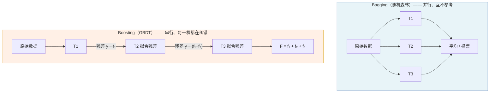
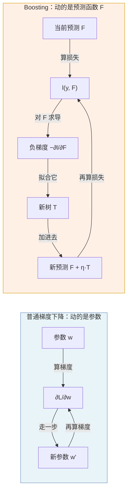
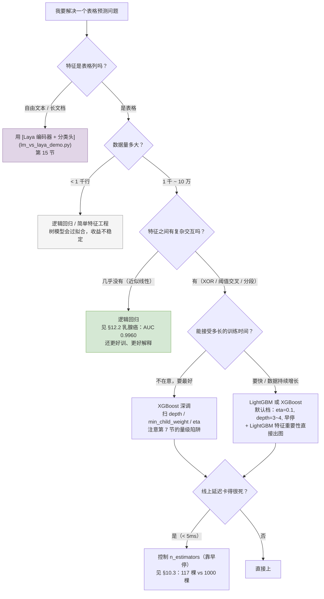

# 04 · GBDT 与 XGBoost：不降方差，直接降偏差

> 读者假设：读过 [01 篇](01-从手写规则到机器学习.md)、[02 篇](02-决策树.md) 和 [03 篇](03-随机森林.md)。你已经知道一棵树怎么长出来，知道随机森林用「并行 + 重采样」来降方差，也知道方差是怎么被平均掉的。
>
> 这一篇要讲的是**另一条完全相反的路**：不靠平均降方差，靠「认错」降偏差。这是 XGBoost / LightGBM / CatBoost 这一整族模型的共同骨架，也是 Kaggle 表格竞赛里最常见的选择。
>
> 本文所有数字来自两个脚本的真实输出：
> - [`examples/from_scratch_ml.py`](examples/from_scratch_ml.py) §3 —— **纯 numpy 手写**了 GBDT 的每一步，所以第 3、5、6 节的公式你都能自己拿笔算一遍
> - [`examples/xgb_details_demo.py`](examples/xgb_details_demo.py) —— XGBoost 专项实测（$\lambda$ / $\gamma$ / 早停 / 直方图 / 线程数）
>
> 复现环境：Python 3.12 · numpy 2.4.6 · scikit-learn 1.9.1 · xgboost 3.2.0，`seed=42`。
> **指标类数字（AUC / logloss / 节点数）在同版本下可完全复现；`fit_s` 随机器和线程数变化，只当数量级看。**

---

## 目录

- [1. 一句话说清两者的区别](#1-一句话说清两者的区别)
- [2. 残差是什么：从「预测错了」到「该往哪挪」](#2-残差是什么从预测错了到该往哪挪)
- [3. Boosting = 函数空间里的梯度下降](#3-boosting--函数空间里的梯度下降)
- [4. 手算验证：平方损失下负梯度就是残差](#4-手算验证平方损失下负梯度就是残差)
- [5. 为什么需要二阶信息：泰勒展开到二次项](#5-为什么需要二阶信息泰勒展开到二次项)
- [6. 增益公式：节点该不该切的唯一判据](#6-增益公式节点该不该切的唯一判据)
- [7. 四个旋钮逐项实测](#7-四个旋钮逐项实测)
- [8. 直方图算法：XGBoost 快的真正原因](#8-直方图算法xgboost-快的真正原因)
- [9. 线程数陷阱：n_jobs=-1 可能是负优化](#9-线程数陷阱n_jobs--1-可能是负优化)
- [10. 早停：扫到多少棵树该停](#10-早停扫到多少棵树该停)
- [11. 同一个超参，两种语义](#11-同一个超参两种语义)
- [12. 完整实测对比](#12-完整实测对比)
- [13. 超参数清单](#13-超参数清单)
- [14. 什么时候该用 XGBoost](#14-什么时候该用-xgboost)
- [15. 和 Laya、大模型的关系](#15-和-laya大模型的关系)
- [16. 检查清单](#16-检查清单)

---

## 1. 一句话说清两者的区别

[03 篇](03-随机森林.md) 的随机森林是这么干的：每棵树**独立**训练，训练完一起投票。
GBDT（Gradient Boosting Decision Tree，梯度提升决策树）是这么干的：每棵树**专门**去纠正前面所有树的错。

这两种做法在代码上的差别，一眼就能看出来：



**关键差别只有一句话：T2 在 Bagging 里是「T1 的同胞」，在 Boosting 里是「T1 的错别字修正」。**

这一句话往下推出所有区别：

| | 随机森林（Bagging） | GBDT（Boosting） |
|---|---|---|
| 树之间关系 | 独立、并行 | 严格串行 |
| 能不能多核 | **能**，每棵树一个进程 | **不能**，第 t 棵必须等第 t−1 棵 |
| 主要治什么病 | 高**方差**（换个训练集就变） | 高**偏差**（系统性地预测得不够好） |
| 树通常多深 | 深（6~15） | 浅（2~4） |
| 树的数量 | 多（100~500） | 少（50~500，且要早停） |
| 调大树数的后果 | 收益递减，但**不会变差** | 收益递减，**过头会过拟合** |

最后一行是新手最容易踩的坑：**在 GBDT 里把 `n_estimators` 调大是有风险的**，不像 RF 那样"多加点总没坏处"。为什么，第 10 节会实测给你看。

### 实测：这套差别值多少钱

`xgb_details_demo.py` §1 用同一份数据、同样 60 棵树量出来的：

```
    数据 (n=20000, d=8)  正类率=0.106  训练/测试=15000/5000

    模型                                     AUC   logloss    fit_s
    RandomForest(60,d=6) 并行             0.8322    0.2870     0.10
    GradientBoosting(60,d=3) 串行         0.8475    0.2569     0.60
    XGBoost(60,d=3) 串行+直方图              0.8437    0.2632     0.17
```

**Boosting 的 AUC 高出 0.0153，而且它只用了深度 3，RF 用了深度 6。**

少一半的树深还赢 —— 说明「串行纠错」换来的不是虚的。
代价是训练时间：RF 0.10 秒能吃满多核，GBDT 0.60 秒必须串行（XGBoost 靠直方图把它压到 0.17 秒，第 8 节）。

这就是选型时算得清的成本：**用训练时间换排序质量**。

---

## 2. 残差是什么：从「预测错了」到「该往哪挪」

「残差（residual）」这个词你可能听过，但这里要精确一下。

**残差 = 真实值 − 当前预测值**

$$
r_i = y_i - f_i
$$

用大白话说：**你预测 0.8，真实是 1.0，那么残差是 +0.2，意思是"你低估了，往上抬一点"。**

符号很重要，因为方向不能搞反：

| 情况 | 残差 | 含义 |
|---|---|---|
| 真实 1.0，预测 0.8 | +0.2 | 低估了，**往上**调 |
| 真实 0.0，预测 0.3 | −0.3 | 高估了，**往下**调 |

Boosting 的整个思路就是：**新树去拟合残差。** 拟合完之后把新树**加**到当前预测上：

$$
f_{\text{new}} = f_{\text{old}} + \eta \cdot T_{\text{new}}(x)
$$

那个 $\eta$ 叫**学习率（learning rate，也叫 eta、步长）**，是这一章最重要的超参数，第 10 节专门讲它。

### 逐轮看残差怎么被吃掉

`from_scratch_ml.py` §3 用手写的 GBDT 逐轮记录训练集和测试集的 logloss（`eta=0.1`，60 棵深度 3 的树）：

```
        轮数      训练 logloss      测试 logloss
         1          0.3344          0.3344
        26          0.2602          0.2609
        51          0.2535          0.2580
        76          0.2473          0.2552
       101          0.2430          0.2541
       126          0.2398          0.2540
       151          0.2363          0.2536
       176          0.2334          0.2535
       201          0.2306          0.2535
       226          0.2282          0.2538
       251          0.2256          0.2548
       276          0.2224          0.2545
```

**这张表是本篇最重要的一张实据图，请看两列的差：**

- 前 25 轮：训练 0.3344 → 0.2602，测试 0.3344 → 0.2609，**几乎一样**。模型在实实在在地学东西，学到的东西是真规律。
- 第 176 轮开始：训练 0.2334，测试 0.2535，**差 0.02 了**。测试集的收益已经停了，训练集还在降。
- 第 276 轮：训练 0.2224，测试 0.2545，**训练集比测试集低了 0.032**。这个差就是**过拟合的量**——模型开始记住训练集的噪声了。

注意第 251 行那里有个小拐点：测试 logloss 从 0.2536 涨到 0.2548，这就是"该停了"的信号。第 10 节的早停就是自动找这个点。

---

## 3. Boosting = 函数空间里的梯度下降

现在要说清楚这件事，因为它是 GBDT 全部理论的地基。

### 3.1 你已经会的梯度下降

传统梯度下降长这样：你要最小化 $L(w) = \sum_i l(y_i, f_w(x_i))$，然后对**参数** $w$ 求导：

$$
w \leftarrow w - \eta \frac{\partial L}{\partial w}
$$

这里 $\frac{\partial L}{\partial w}$ 是"**参数**要往哪个方向挪"。

### 3.2 Boosting 换了个东西求导

Boosting 的想法是：**先不管参数是什么，直接对"预测值" $F$ 求导。**

$$
F(x) = \sum_{i} l(y_i, F(x_i)) \quad \text{对 } F \text{ 求导，而不是对 } w
$$

于是"梯度"变成了 $\frac{\partial l}{\partial F}$ —— **"当前这个预测值，往哪个方向挪能让损失变小"**。

更新规则还是那个：

$$
F_{\text{new}}(x) = F_{\text{old}}(x) - \eta \cdot \frac{\partial l}{\partial F}\Big|_{F = F_{\text{old}}}
$$

但每一步的具体数值是这样得到的：**让一棵树去拟合 $-\frac{\partial l}{\partial F}$，也就是"负梯度"。**

### 3.3 关键洞察

"让树去拟合负梯度" —— 这句话对刚开始的人有点抽象。换个说法：

> 梯度下降说"往这个方向走一小步"。
> Boosting 把**"一小步"这个方向本身**交给一棵树去算。
> 你可以理解为：**把梯度下降的每一步外包给了一棵决策树。**



这个视角很重要，因为它解释了 Boosting 的两个"怪脾气"：

1. **为什么必须串行？** 因为 $F$ 变了才能算下一个梯度，梯度变了才能定下一棵树长什么样。数学上无法并行。
2. **为什么树要浅？** 因为梯度下降是"一小步一小步"走的，每棵树只负责一小段路。树太深就相当于一步跨了太远，容易冲过头（过拟合）。

---

## 4. 手算验证：平方损失下负梯度就是残差

上面说的"负梯度"，在平方损失下有一个**非常好记的特例**。

损失函数取平方损失 $l(y, f) = \frac{1}{2}(y - f)^2$，对 $f$ 求导：

$$
\frac{\partial l}{\partial f} = f - y
$$

取负：

$$
-\frac{\partial l}{\partial f} = y - f = \text{残差}
$$

**负梯度 = 残差。** 不是"近似"，是**严格相等**（因为 $\frac{1}{2}$ 这个系数正好把求导的 2 消掉了）。

`from_scratch_ml.py` §3.1 和 `xgb_details_demo.py` §1.2 都在代码里验证了这一点。`xgb_details_demo.py` 的手算输出：

```
    y          = [1. 0. 1. 0.]
    f（当前预测）= [0.8 0.3 0.5 1.2]
    dL/df      = [-0.2  0.3 -0.5  1.2]
    负梯度      = [ 0.2 -0.3  0.5 -1.2]
    残差 y - f  = [ 0.2 -0.3  0.5 -1.2]
    负梯度 == 残差：True
```

**所以你可以把 Boosting 记成一句话：**

> 「用平方损失做 Boosting，就是反复让树去拟合残差，然后把树加到预测上。」

这个简化是合法的，因为平方损失下两者严格相等。但要记住**换损失函数就不一样了**：

| 损失函数 | 负梯度 $\;-\partial l/\partial f$ | 是不是残差？ |
|---|---|---|
| 平方损失 $\frac{1}{2}(y-f)^2$ | $y - f$ | ✅ 是 |
| 绝对值损失 $\lvert y-f \rvert$ | $\text{sign}(f - y)$ | ❌ 只看方向 |
| 对数损失（逻辑回归用） | $\frac{f - y}{f(1-f)}$，$f$ 是概率 | ❌ 但正比于残差 |

表格竞赛里的分类任务基本都用**对数损失（logloss）**而不是平方损失，因为它对"自信地犯错"的惩罚更重。所以真实场景里你看到的 Boosting 比"拟合残差"要复杂一点。

**但推导的骨架完全一样**——都是"算负梯度 → 让树去拟合它"。这叫**函数空间的梯度提升（functional gradient boosting）**，是所有 Boosting 变体（AdaBoost、XGBoost、LightGBM、CatBoost）的共同祖先。

---

## 5. 为什么需要二阶信息：泰勒展开到二次项

上面说"负梯度"，够用了。但真正决定"一个节点该不该切"的那个公式里，出现的是**负梯度和 Hessian**。

### 5.1 为什么一阶不够

一阶泰勒展开只告诉我们"往哪走"，但没告诉我们"走多远安全"。

举个例子：你站在山坡上，梯度告诉你下坡方向。但如果这个坡：

- 一处是缓坡（梯度 0.1）
- 一处是断崖（梯度 10）

只按梯度走，你会在缓坡上磨蹭很久，在断崖上一头栽下去。

**Hessian（二阶导数，H）衡量的就是"这个坡有多陡"。**

### 5.2 二阶泰勒展开

把损失在 $f + \Delta$ 处展开到二次项：

$$
l(y, f + \Delta) \approx l(y, f) + \Delta \cdot \underbrace{\frac{\partial l}{\partial F}}_{g} + \frac{1}{2}\Delta^2 \cdot \underbrace{\frac{\partial^2 l}{\partial F^2}}_{h}
$$

其中：

$$
g_i = \frac{\partial l}{\partial F}\Big|_{F=f_i} \quad \text{（一阶梯度，} g_i = f_i - y_i \text{ 于平方损失）}
$$

$$
h_i = \frac{\partial^2 l}{\partial F^2}\Big|_{F=f_i} \quad \text{（二阶梯度，Hessian）}
$$

$$\boxed{\ \text{我们要最小化}\quad \frac{1}{2}\sum_{i \in \text{节点}} h_i \Delta^2 + \left(\sum_{i \in \text{节点}} g_i\right) \Delta\ }$$

### 5.3 解出叶子的最优值

这是一个关于 $\Delta$ 的一元二次函数。配方求极小：

$$
\Delta^* = -\frac{\sum_i g_i}{\sum_i h_i} = -\frac{G}{H}
$$

$\Delta$ 就是**这棵树的叶子上应该加多少修正**。分母 $H$ 越大，同样一份梯度 $G$ 能加的修正就越小——**这正是"坡陡就少走"的数学表达**。

**这套 $G$ / $H$ 的算法名字叫 XGBoost**，不是 GBDT 的专利。GDBT 原始论文（Friedman 2001）用的只有一阶（每棵树拟合残差的均值）；XGBoost（Chen & Guestrin 2016）加上了二阶。

XGBoost 官方文档里管 $h$ 叫 **hessian**，但对初学者来说，把它理解成"**这个样本的权重**"更直观：

- 平方损失下 $h = 1$（每个样本权重一样）
- 对数损失下 $h = p(1-p)$，$p$ 是预测概率。$p=0.5$（最不确定）时 $h=0.25$ 最大；$p \approx 0$ 或 $1$ 时 $h \approx 0$

含义很直白：**模型越不确定的样本，权重越高，多听它的。** 那些模型已经很有把握的样本，它说错了一点也不重要。

### 5.4 这个"权重"和 02 篇的 `min_samples_leaf` 有什么区别

这是一个值得说清的点。02 篇讲决策树时有个参数 `min_samples_leaf`（叶子至少要有几个样本）。XGBoost 的 `min_child_weight` 看起来像它，其实不一样：

| | `min_samples_leaf`（sklearn） | `min_child_weight`（XGBoost） |
|---|---|---|
| 约束的是 | **样本个数** | **hessian 之和** |
| 是不是所有样本等价 | 是 | **否**，不确定的样本算得更多 |
| 换个损失函数 | 不变 | **会变** |

所以 `min_child_weight` 更贴"这个叶子该不该信"这个问题——它自动给靠谱的样本更高的发言权。实测数据在第 7 节。

---

## 6. 增益公式：节点该不该切的唯一判据

有了 $G$ 和 $H$，就能问：**把一个节点切成左右两半，值不值？**

### 6.1 推导

一个节点的"可拟合量（reduction）"定义为：

$$
R = \frac{G^2}{2(H + \lambda)}
$$

这来自动理：某个叶子取最优值 $\Delta = -G/(H+\lambda)$ 时，这个叶子**降低的损失**是 $-\frac{1}{2}\frac{G^2}{H+\lambda}$。$R$ 是它的正值版本，即"**这个节点上的样本，最多还能被修正掉多少损失**"。

那么"切一刀值不值"就是：**切完之后能少损失多少。**

$$
\boxed{\ \text{Gain} = R(\text{左}) + R(\text{右}) - R(\text{父}) - \gamma\ }
$$

- **$\text{Gain} > 0$ → 切。**
- $\text{Gain} \le 0$ → 不切，整棵子树留作一个叶子。

（$\lambda$ 叫 `reg_lambda`，$\gamma$ 叫 `gamma`。）

### 6.2 长得和 02 篇的 CART 不一样，但目的相同

02 篇的 CART 是这样判的：

$$
\text{Gini}(\text{左}) + \text{Gini}(\text{右}) < \text{Gini}(\text{父}) \ \Rightarrow \ \text{切}
$$

**同样是"切完之后有没有变好"，但"变好"被量化成了两个不同的量：**

| | 决策树（CART） | XGBoost |
|---|---|---|
| 衡量什么 | 标签的**纯度**（"这个节点里的样本标签有多一致"） | **损失能少多少**（"这个节点上的预测还能被修正多少"） |
| 判据 | Gini 或 熵 下降 | $\text{Gain} = R_L + R_R - R_P - \gamma$ |
| 天然考虑 | 标签分布 | **预测误差** |
| 天然处理 | 不处理 | 样本权重（hessian）天然进来了 |

关键区别：CART 只看"标签乱不乱"，**完全不知道当前预测错得有多严重**。
XGBoost 直接优化损失函数，所以它知道"第 3 个样本预测错了 0.5，第 7 个错了 0.01"—— 它会优先照顾前者。

### 6.3 手算一张表

`from_scratch_ml.py` §3.2 和 `xgb_details_demo.py` §2.5 用同一组数（`xgb_details_demo.py` 里的表多带了 $\gamma$ 那一维）：

```
左 20 条 g=+0.35 h=0.80 → G_L=+7.0 H_L=16.0
右 18 条 g=-0.20 h=0.80 → G_R=-3.6 H_R=14.4
父 38 条              → G=+3.4 H=30.4

     lam    gam        R(父)     R(左)+R(右)        Gain   切?
       0    0.0     0.19013       1.98125     1.79112   切
       1    0.0     0.18408       1.86196     1.67788   切
       5    0.0     0.16328       1.50069     1.33741   切
      20    0.0     0.11468       0.86893     0.75425   切
       1    0.5     0.18408       1.86196     1.17788   切
       1    1.0     0.18408       1.86196     0.67788   切
       1    1.5     0.18408       1.86196     0.17788   切
       1    2.0     0.18408       1.86196    -0.32212   不切
```

**这张表就是全篇公式的落点。请横着看、竖着看。**

**横着看（$\gamma = 0$ 那一列）—— $\lambda$ 的作用：**

$\lambda$ 越大 → 分母 $2(H+\lambda)$ 越大 → 每一项 $R$ 都变小 → Gain 一路掉下去（1.79 → 0.75）→ 树越来越浅。

$\lambda$ 是**连续**地压，没有断点。

**竖着看（$\lambda = 1$ 那一列）—— $\gamma$ 的作用：**

$\gamma$ 每加 0.5，Gain 就**正好**减 0.5。这是纯减法，和别的无关。

$\lambda=1$ 时 Gain 是 1.678，所以 $\gamma$ 加到 2.0 就越过它了—— 那一刀不划算，整棵子树被剪掉。

$\gamma$ 是**一道硬门槛**：跨过去是断崖式的。

**一句话记住这两个数：**

$$
\boxed{\ \lambda \text{ 调「树的胖瘦」，}\ \gamma \text{ 调「要不要长这一刀」}\ }
$$

### 6.4 一个必须注意的实践陷阱

上面这张表里 Gain 的量级是 **1.68**。记住这个数，因为第 7 节的实测会让你惊讶：

**$\lambda$ 和 $\gamma$ 的默认值都是 1.0，而"有没有用"完全取决于这个 1.0 相对你的 Gain 来说是大了还是小了。**

- 如果你的 Gain 是 1.68，那么 $\gamma = 0.1$ 罚得根本不痛（1.678 - 0.1 仍然 > 0，切），等于没设
- 如果你的 Gain 是 0.05，那么 $\gamma = 0.1$ 直接把整棵树砍成一根桩

**所以从别的项目抄超参是很危险的。** 标签尺度换了、损失函数换了，Gain 的量级就变了，得回去重算。这一点在第 7 节有硬证据。

---

## 7. 四个旋钮逐项实测

`xgb_details_demo.py` §2 用固定的配置（`n_estimators=200, max_depth=4, eta=0.1`，20000 条信贷数据，15000 训练 / 5000 测试）只动一个超参，逐一扫描。**「首棵树节点数」这一列是看复杂度的直接窗口。**

### 7.1 reg_lambda（L2 正则）

| lambda | AUC | logloss | 首棵树节点数 |
|---|---|---|---|
| 0 | 0.8399 | 0.2554 | **31** |
| 1 | 0.8407 | 0.2537 | 25 |
| 5 | 0.8397 | 0.2551 | 25 |
| 20 | 0.8420 | 0.2534 | 25 |
| 100 | 0.8431 | 0.2544 | 25 |

**读法：节点数在 $\lambda = 1$ 就从 31 掉到 25，之后 1→100 一直是 25 不动了。**

这看起来很反直觉——$\lambda$ 加了 100 倍，怎么一点用都没有？

原因是**量级问题，不是形状问题**。第 6.3 节那张表里 Gain 的量级是 1.68。$\lambda$ 抬到 100，分母从 $2(30.4+1)$ 变成 $2(30.4+100)$，大约 3.8 倍，压缩比 1.68 压到 1.68/3.8 ≈ 0.44 —— 但 0.44 仍然远大于 0，这一刀还是划算的。**要压住它，$\lambda$ 得大到几百上千。**

另一个观察：**AUC 反而从 0.8399 微升到 0.8431。** 越正则越不容易在这份数据上过拟合。

**所以 $\lambda$ 调大不是坏事，是好事**——前提是你知道自己的 Gain 量级。

### 7.2 gamma（复杂度罚分）

| gamma | AUC | logloss | 首棵树节点数 |
|---|---|---|---|
| 0.0 | 0.8407 | 0.2537 | 25 |
| 0.1 | 0.8407 | 0.2537 | 25 |
| 0.5 | 0.8399 | 0.2544 | 25 |
| 2.0 | 0.8427 | 0.2572 | 25 |
| 10.0 | 0.8397 | 0.2626 | **21** |

**读法：gamma 从 0 到 10，节点数只从 25 掉到 21。** 又一个量级问题。

中间 0.5 和 2.0 那一段节点数纹丝不动（都是 25），只有跳到 10 才真正压下去—— 因为 Gain 最小的那一刀也有 1.678，罚 2.0 还是不痛。

**这就是「硬门槛」的形状：不痛则已，痛则断崖。**

**实践建议：$\gamma$ 要么设 0，要么给一个跟 Gain 同量级的数。** 0.1 这种"意思一下"的值等于没设，还给你一种"我调过了"的错觉。

### 7.3 min_child_weight（叶子最小 hessian 和）

| mcw | AUC | logloss | 首棵树节点数 |
|---|---|---|---|
| 0 | 0.8401 | 0.2545 | 25 |
| 1 | 0.8407 | 0.2537 | 25 |
| 5 | 0.8417 | 0.2537 | 25 |
| 20 | 0.8403 | 0.2536 | 25 |
| 100 | 0.8435 | 0.2541 | **17** |

同样是"不痛则已"：1→20 之间节点数一直是 25，到 100 才压到 17。

AUC 在 100 的时候最高（0.8435），logloss 0.2541，也在前列。

**这是四个旋钮里最值得往上调的一个**，因为它对应的是 02 篇里 `min_samples_leaf` 的角色（"防止靠几个极端样本长出一条假规律"），而且如第 5.4 节所说，它比 `min_samples_leaf` 更聪明——它按"模型有多不确定"给样本定权重。

### 7.4 max_depth（树深）

| depth | AUC | logloss | 首棵树节点数 |
|---|---|---|---|
| 2 | 0.8319 | 0.2771 | 7 |
| **3** | **0.8431** | 0.2559 | 13 |
| 4 | 0.8407 | 0.2537 | 25 |
| 6 | 0.8382 | 0.2559 | 81 |
| 8 | 0.8324 | 0.2619 | **199** |

**这张表是本篇最值得盯的一张。**

**节点数随深度指数膨胀**：深度 8 是 199 个节点，是深度 2 的 **28 倍**。

**但 AUC 在深度 3 见顶（0.8431）之后就一路往下掉**（到深度 8 变成 0.8324）。

> **树越多不等于越好。多出来的那些节点是在记训练集的噪声。**

这跟 02 篇讲决策树过拟合是同一回事，只是 Boosting 里它来得更隐蔽——因为加树是渐进的，第 101 棵树比第 100 棵树只差一点点，你不会像"把树深从 3 调到 8"那样立刻看到崩盘。

顺便印证 02 篇的一个说法：`min_samples_leaf` 通常比 `max_depth` 更温和。**在 GBDT 里也一样** —— XGBoost 的对应旋钮就是 `min_child_weight`，而 7.3 那张表显示它在 1→20 区间完全不改变树的形状。

---

## 8. 直方图算法：XGBoost 快的真正原因

02 篇说过决策树找最优切分要 $O(n^2)$：$n$ 个样本两两比一遍。$n = 20000$ 就是 4 亿次比较，一棵树。

XGBoost 的 **histogram（直方图）** 做法是：

1. 把每个特征的所有取值**排序**
2. 划成固定数量的**桶**（默认 `max_bin = 256`）
3. 桶内的具体数值**不再区分**，只按"桶边界"当候选切分点


**两处优化，第二处才是关键：**

1. **候选点数**：从 $n$ 降到 `max_bin`
2. **累加方式**：预先把每个桶的 $G/H$ 累好，之后切分就是**前缀和减法**，而不是每次重新扫一遍样本

第 2 点是被低估的。如果只做第 1 点（候选点少了，但每个候选点还是要扫 $n$ 个样本），省不了多少。**两件事一起做才有质变。**

### 8.1 候选点压缩了多少

`xgb_details_demo.py` §3.1 的表（纯计算，不涉及训练）：

| n | 精确候选数 | 直方图候选（256 桶） | 压缩倍数 |
|---|---|---|---|
| 1,000 | 999 | 256 | 4× |
| 10,000 | 9,999 | 256 | 39× |
| 20,000 | 19,999 | 256 | 78× |
| 100,000 | 99,999 | 256 | 391× |
| 1,000,000 | 999,999 | 256 | **3,906×** |

### 8.2 实测计时

§3.2 用同一份数据、同样 200 棵树、`n_jobs=4`：

| tree_method | max_bin | AUC | logloss | fit_s |
|---|---|---|---|---|
| exact | - | 0.8374 | 0.2587 | 0.33 |
| hist | 16 | 0.8296 | 0.2654 | 0.15 |
| hist | 64 | 0.8340 | 0.2619 | 0.10 |
| hist | **256** | 0.8337 | 0.2622 | 0.10 |
| hist | 1024 | 0.8358 | 0.2603 | 0.12 |

**直方图快约 3 倍（0.33s → 0.10s）。**

**注意一个反直觉的点：时间收益（3 倍）远小于搜索空间收益（78 倍）。** 原因是建桶本身要花固定开销，$n=20000$ 时这点开销还没摊薄。**n 越大，两者才会越接近。**

再看精度：`hist(256)` 的 AUC 0.8337 和 `exact` 的 0.8374 只差 0.0037，说明 **256 个桶在这个数据上没丢信息**。分桶的精度代价是可接受的。

> ⚠️ **别把"大数据上直方图快 3906 倍"读成"任何数据都快"。** 这张表里的压缩倍数是**搜索空间**的倍数，不是时间的倍数。实际时间收益要打很大折扣（这里就是 78 → 3）。

### 8.3 max_bin 要不要调

上表 16→64→256→1024 四行的耗时是 0.15 / 0.10 / 0.11 / 0.12 秒—— **桶数翻 64 倍，耗时基本没动**。因为建桶的开销被每桶的样本数摊薄了。

AUC 上 16 桶 0.8296 vs 1024 桶 0.8358，只差 0.0062。

**结论：256 是默认值，也是这个数据上性价比最高的点，一般不用调。** 这是 XGBoost 少数可以完全不管的参数之一。

只有当你的特征是那种"桶边界切在中间会改变语义"的类型（金额、坐标、时间戳），才值得往上调。

### 8.4 内存账

每个节点、每个特征，存 256 个桶的 $(G, H)$ 两个 float：

$$
20000 \times 8 \times 256 \times 2 \times 8\ \text{字节} = 625\ \text{MiB/层（粗估上界）}
$$

真实实现只在当前需要分裂的节点上建直方图，且**用完即弃**，所以瞬时占用远小于这个数。

这就是为什么 XGBoost 能在单机上把百万级样本的训练压到分钟级。

---

## 9. 线程数陷阱：n_jobs=-1 可能是负优化

这一节是实测出来的，**跟"XGBoost 很适合多核"这条广为流传的说法是矛盾的**，值得单独讲。

`xgb_details_demo.py` §3.5，20 核机器、15000×8 的小数据、200 棵树：

| n_jobs | fit_s | 相对 n_jobs=4 |
|---|---|---|
| 1 | 0.124 | 1.2× |
| 2 | 0.122 | 1.2× |
| **4** | **0.104** | **1.0×** |
| 8 | 0.107 | 1.0× |
| 20 | **49.173** | **≈ 470×** |

**线程从 4 加到 20，慢了 470 倍。** 单线程反而和 4 线程一样快。

**这不是 XGBoost 有 bug，是线程派发开销压过了并行收益。** 原因是 Boosting 严格串行：每加一棵树都要等所有线程汇合才能进下一轮（同步屏障）。一轮的计算量就那么点，同步开销完全盖过了并行。

> **工程结论：n_jobs 要按数据量选，不是按核数选。**
>
> | 行数 | 建议 |
> |---|---|
> | < 1 万 | 单线程通常就是最快的，别并行 |
> | 1 万 ~ 100 万 | 4-8 线程通常是最优点 |
> | 100 万以上 | 才真正吃满多核 |
>
> 这也是本文件开头把 `NJOBS` 钉成 4 而不是 `-1` 的原因。**照抄 `n_jobs=-1` 是个能让你以为"程序卡死了"的坑。**
>
> 顺便说：随机森林没有这个问题。[03 篇](03-随机森林.md) 说过 RF 的树之间完全独立，可以真正并行——所以 RF 的 `n_jobs=-1` 是安全的。**这又是"同一个参数两种语义"的例子，第 11 节专门讲这类事。**

---

## 10. 早停：扫到多少棵树该停

### 10.1 为什么 GBDT 特别需要早停

02 篇讲过过拟合。但 GBDT 的过拟合**来得更隐蔽**：

- 决策树：把深度从 3 调到 8，测试指标**当场崩盘**，你一眼就能发现
- GBDT：第 1 棵树到第 1000 棵树，测试指标**平滑地、缓慢地**变差

看第 2 节那张表：训练 logloss 从 0.3344 一路降到 0.2224，测试 logloss 从 0.3344 降到 0.2536（第 176 轮）之后就不再改善了。**这个"不再改善"的点，人眼看曲线很难判断准，必须自动化。**

这就是 **early stopping（早停）**：

```
每隔若干轮，在验证集上算一次 logloss（或 AUC）
连续 early_stopping_rounds 轮没有改善，就停
```

### 10.2 eta 和 n_estimators 是一对

XGBoost 官方 README 的明确建议是：

> **先固定其他超参，只扫 learning_rate 与 n_estimators，配 early stopping。**

`xgb_details_demo.py` §4.1 训练 16000 条、留出 4000 条做早停监控（不参与训练），`n_estimators=2000`，`early_stopping_rounds=30`：

| eta | best_iter | 总树数 | 验证 AUC | 验证 logloss | fit_s |
|---|---|---|---|---|---|
| 0.30 | 18 | 2000 | 0.8393 | **0.2546** | 0.11 |
| 0.10 | 58 | 2000 | 0.8374 | 0.2560 | 0.14 |
| 0.03 | 130 | 2000 | 0.8381 | 0.2566 | 0.18 |

**读法：**

- $\eta$ 越小，最优点越靠后（18 → 58 → 130）
- **但验证 logloss 几乎没差别**（最好 0.2546，最差 0.2566，差 0.0020）

**这说明 eta 主要决定训练成本，不决定最终精度。** 官方建议"先只扫这两个"的原因就在这里：**它们是互相补偿的一对。**

- 想训得快 → 调大 eta（0.3），早停会自动砍掉后面的树
- 想榨最后一点 → 调小 eta（0.03），但要多花 1.6 倍的时间

### 10.3 多跑的树都是纯浪费

§4.2 记录了 eta=0.1 跑满 1200 棵的完整曲线：

```
        轮数      验证 logloss         相对上一轮
         50         0.25738
        100         0.25583     -0.001545
        150         0.25513     -0.000704
        200         0.25643     +0.001300
        250         0.25853     +0.002101
        500         0.26627     +0.001226
       1000         0.27831     +0.001189
       1200         0.28363     +0.001229

    最低点在第 117 轮，logloss=0.25490
```

**从最低点（第 117 轮）到第 1000 轮，多跑了 8.5 倍的树，验证 logloss 反而高了 0.02341。**

差距看着不大（约 9%），但**方向是单向的"变差"，不会好转**。

**这 850 棵树的代价是三重：**

1. 训练时的算力
2. **线上预测延迟**（每条样本要过 1000 棵树而不是 117 棵——和 [03 篇](03-随机森林.md) §12 讲的 RF 延迟是同一个问题）
3. 模型体积和部署成本

`early_stopping_rounds=30` 会在连续 30 轮不再改善时停下。**这就是"早停"真正在省的东西。**

### 10.4 没有验证集怎么办

`early_stopping` 需要一个不参与训练的数据集。工程上有三种选择：

| 做法 | 说明 |
|---|---|
| 从训练集切出验证集 | 最简单，但训练数据少了一份 |
| **K 折交叉验证** | 每折轮流做验证，训练时间 ×K，换来更稳的停止点 |
| 用固定的历史时间窗 | 数据有时间性时的自然选择（但绝不能用未来数据） |

**注意别犯 [03 篇](03-随机森林.md) §16 那个错**：时间序列数据用随机划分做早停，会把未来信息泄漏进训练，导致线上翻车。这类数据必须用 `TimeSeriesSplit`。

---

## 11. 同一个超参，两种语义

这是本篇最容易让人从 RF 跳到 GBDT 时翻车的地方，第 9 节已经埋了一个伏笔，这里系统性讲清楚。

### 11.1 subsample 的语义完全不同

`xgb_details_demo.py` §4.3 的实测（`colsample_bytree=0.8` 固定）：

| subsample | AUC | logloss |
|---|---|---|
| 0.6 | 0.8233 | 0.26422 |
| 0.8 | 0.8198 | 0.26499 |
| **1.0** | **0.8254** | **0.26119** |

**三档全在 0.82 上下，没有单调趋势，1.0 反而最好。**

**这不是 subsample 有用，是它没用。**

为什么？回到第 1 节和 [03 篇](03-随机森林.md)：

- **在 RF 里，子采样是必需品。** 因为 RF 的树是独立的，如果所有树都看到全部数据、用同样的分裂规则，它们会长得**一模一样**——平均起来等于一棵，集成直接塌掉。03 篇算过：$\frac{\sigma^2}{M}(1+(M-1)\rho)$，$\rho$（树之间的相关性）就是敌人。子采样的唯一作用就是**把 $\rho$ 压下去**。
- **在 GBDT 里，树已经串行了。** 第 $t$ 棵树本来就是在纠正前 $t-1$ 棵的错，**每一轮天然就不一样**，不需要额外机制去制造差异。

所以：

> **同一个参数在 RF 里是必需品，在 GBDT 里是装饰品。**
>
> 在 GBDT 里 subsample 是**可选的噪声注入**（给这一轮加随机性防过拟合），用不用都行；真正的主要旋钮是 `colsample_bytree`（列采样）。

### 11.2 三个"照搬超参会翻车"的例子

| 超参 | 在 RF 里的作用 | 在 GBDT 里的作用 | 照搬的后果 |
|---|---|---|---|
| `subsample` | **必需**，制造树间差异 | 可选，噪声注入 | 少了它效果不会变差——但你以为"调过了" |
| `n_estimators` | 越多越好，收益递减不伤性能 | **有风险**，过头会过拟合 | 直接把过拟合调进来 |
| `n_jobs=-1` | 安全（树完全独立） | **危险**（同步屏障 × 9 节） | 训练慢 500 倍 |

**这就是为什么"照搬 RF 的超参"是个常见的坑**：超参的含义依赖于算法怎么组织它的基学习器。

---

## 12. 完整实测对比

`tabular_baselines.py` 在两个真实/半真实数据集上的六模型完整指标。**信贷数据是 20000 条合成数据（正类率 0.106，XOR 结构），乳腺癌是 sklearn 内置的真实医疗数据（n=569）。**

### 12.1 信贷违约（n=20000，正类率 0.106）

```
  模型                        acc  bal_acc     F1     AUC  logloss     ECE
  LogisticRegression     0.8938   0.5000 0.0000 0.6816   0.3195  0.0112
  DecisionTree(d=3)      0.8938   0.5000 0.0000 0.6861   0.3092  0.0014
  RandomForest(300)      0.8900   0.5037 0.0248 0.8192   0.2710  0.0292
  GradientBoosting       0.8938   0.5008 0.0038 0.8469   0.2541  0.0158
  XGBoost                0.8902   0.5104 0.0518 0.8320   0.2592  0.0201
```

**四个观察：**

1. **Boosting 家族明显好于 Bagging 家族**：AUC 0.8469 / 0.8320 vs 0.8192。这个数据是 XOR 结构，串行纠错正好对症。

2. **⚠️ 但 sklearn 的 `GradientBoosting` 在 AUC 上赢了 XGBoost（0.8469 vs 0.8320）。** 这跟"XGBoost 更强"的普遍印象相反，但完全合理——这份数据只有 8 个特征、直方图分桶的收益很小（第 8 节测过：只有 3 倍，而建桶要花固定开销），XGBoost 的主要优势在这里用不上。**XGBoost 的优势要到高维、大样本、多类别特征时才兑现。** 这个诚实的结果比硬吹 XGBoost 有用得多。

3. **accuracy 六个模型全在 0.89 上下**，看起来没差别。这是正类只有 10.6% 导致的，[01 篇](01-从手写规则到机器学习.md) §7 专门讲过——**永远别看 accuracy**。看 AUC 从 0.68 到 0.85，那才是真实差距。

4. **XGBoost 的 F1 最高（0.0518），是 GradientBoosting（0.0038）的 13 倍。** 在极度不平衡的数据上，能输出非平凡预测的模型更实用。

### 12.2 乳腺癌诊断（真实，n=569）

```
  模型                        acc  bal_acc     F1     AUC  logloss     ECE   fit_s  pred_ms
  LogisticRegression     0.9580   0.9473 0.9674 0.9960   0.0879  0.0273    0.12    0.068
  DecisionTree(d=3)      0.9441   0.9362 0.9560 0.9463   0.5549  0.0376    0.00    0.055
  DecisionTree(不限制)      0.9231   0.9234 0.9379 0.9234   1.5941  0.0769    0.00    0.056
  RandomForest(300)      0.9580   0.9512 0.9670 0.9949   0.1046  0.0481    0.23    8.494
  GradientBoosting       0.9580   0.9473 0.9674 0.9925   0.1248  0.0380    0.21    0.149
  XGBoost                0.9650   0.9567 0.9727 0.9964   0.0726  0.0223    0.20    0.118
```

**四个观察：**

1. **XGBoost 综合最好**：AUC 0.9964、logloss 0.0726、ECE 0.0222、延迟 0.118 ms。**每一项都是全场最优或接近最优**，包括 ECE——**意味着它的置信度最可信**（[01 篇](01-从手写规则到机器学习.md) 讲过 ECE 是干什么的）。

2. **⚠️ 逻辑回归的 AUC 是 0.9960，几乎追平 XGBoost 的 0.9964。** 这个数据集几乎是线性的。对照信贷数据上 LR 只有 0.6816。

   > **同一个算法，在不同数据上差距是 0.31。**
   >
   > **这就是为什么"哪个模型更好"没有答案，只有"你的数据长什么样"。** 这一条是本系列反复要说的。

3. **不限深度的决策树 logloss 高达 1.5941**（比 0 附近的随机猜测还差）。过拟合当场可见——[02 篇](02-决策树.md) 的核心结论。

4. **随机森林单条预测 8.5 ms，是其他模型的 70 多倍。** 因为一条样本要过 300 棵树。**延迟是生产选型的一等公民**，第 10 篇会把它变成硬约束。XGBoost 只用 0.118 ms。

### 12.3 两个数据集的交叉验证

| | 信贷（结构化 XOR） | 乳腺癌（近似线性） |
|---|---|---|
| 最优模型 | GradientBoosting | XGBoost |
| 树模型 vs 线性模型 | 树赢 **0.165** AUC | 树赢 **0.0004** AUC |
| 建议 | **上 GBDT/XGBoost** | **逻辑回归可能就够了** |

**这张表是全文最实用的结论。**

`lm_vs_laya_demo.py` 里还有一个四模型（RF / XGBoost / 逻辑回归 / Laya）的同场对比，第 15 节会提到。

---

## 13. 超参数清单

| 超参 | 默认 | 作用 | 本篇实测的结论 |
|---|---|---|---|
| `n_estimators` | 100 | 树的数量 | **必须配早停**，不然会过拟合 |
| `learning_rate` (eta) | 0.3 | 每棵树的步长 | 主要决定**训练成本**，不决定精度；和 n_estimators 是一对 |
| `max_depth` | 6 | 树深 | Boosting 里**建议 2~4**；本数据 3 最优，再深就记噪声 |
| `min_child_weight` | 1 | 叶子最小 hessian 和 | 四个旋钮里**最值得往上调**的；对应 `min_samples_leaf` 的角色 |
| `reg_lambda` | 1 | L2 正则 | 要到几百才有效果（取决于 Gain 量级）；调大通常不坏 |
| `gamma` | 0 | 复杂度硬门槛 | **要么 0，要么给同量级的数**；0.1 这种值等于没设 |
| `subsample` | 1.0 | 行采样 | **在 GBDT 里基本没用**（实测 1.0 最好） |
| `colsample_bytree` | 1.0 | 列采样 | GBDT 里**主要的多样性旋钮** |
| `tree_method` | auto | 切分算法 | `hist` 是 XGBoost 的招牌 |
| `max_bin` | 256 | 直方图桶数 | **一般不用调** |
| `early_stopping_rounds` | — | 早停耐心 | **必备件**，建议 30 |
| `n_jobs` | 全部核 | 线程数 | **按数据量选，不按核数选**（第 9 节） |

**官方推荐调参顺序**（XGBoost README）：

1. 先固定其他超参，**只扫 `learning_rate` 和 `n_estimators`，配 early stopping**
2. 之后再调 `max_depth`、`min_child_weight`
3. 最后才碰正则项

**原因就是第 7 节那个量级问题**：正则项的"有效区间"依赖 Gain 的量级，在你没有把数据摸熟之前，调它们基本是在碰运气。

---

## 14. 什么时候该用 XGBoost



**一句话版本：**

> **表格数据 + 有非线性交互 + 数据量过千 + 精度比延迟重要 → XGBoost。**
>
> 其他任何一条不满足，都要重新想。

---

## 15. 和 Laya、大模型的关系

### 15.1 三者的定位

| | XGBoost | Laya | 大模型（LLM） |
|---|---|---|---|
| 是什么 | 判别式表格模型 | 判别式文本编码器 | 生成式语言模型 |
| 输入 | 结构化数值列 | 文本/字段值序列 | token 序列 |
| 输出 | 一个概率或数值 | 一个分类分数 | 下一个 token 的分布 |
| 树/层的结构 | 多棵浅树串行 | 若干层 Transformer | 几十上百层 Transformer |
| 训练信号 | 标签（0/1） | 标签（分类） | **文本本身**（自监督） |
| 需要的标注量 | 大 | 中 | **几乎为零** |
| 延迟 | 亚毫秒 | 毫秒级 | 百毫秒~秒级 |
| 可解释性 | 特征重要性、SHAP | 注意力权重 | 最弱 |

**关键的一条：XGBoost 和 Laya 都是"判别式"——它们需要标签；LLM 是"生成式"——它从文本本身学。** 这决定了它们能替代彼此的部分：让 LLM 去填结构化表格的分类任务，往往不如一个训好的判别模型。

### 15.2 Boosting 的思想在别处也成立

Boosting 的核心是"**让下一个模块专门去纠正上一个的错误**"，这个模式在 LLM 时代到处都是：

| 场景 | 对应关系 |
|---|---|
| 集成学习 | LLM ensemble：多个模型投票（但注意 [03 篇](03-随机森林.md) 的"集成塌缩"陷阱——模型太像，平均了等于没平均） |
| 模型迭代 | 用测试集错误去 prompt 迭代（这就是**逐轮修正残差**） |
| RLHF | 奖励模型（RM）就是"专门学人类偏好这个残差"的 GBDT/网络；PPO/DPO 是"往这个方向走一小步" |
| 分治 | 长文档切块各自编码 → 池化 → 这就是 Boosting 的"累积"结构 |

**具体到"学习率 $\eta$"这个概念**，它在 DPO/RLHF 里也有对应物——KL 惩罚项的系数。**小 $\eta$ = 慢慢改、别偏离原模型太远**，和 GBDT 里"小 eta 树要多"是同一个权衡。

### 15.3 一个能直接用的判断

`lm_vs_laya_demo.py` 把 RF / XGBoost / 逻辑回归 / Laya 放在同一个任务上对账。结论是：

> **结构化表格优先 XGBoost。** 延迟更低、精度相当、更好解释、成本低一个数量级。
>
> **自由文本优先 Laya。** 结构化表格模型对文本只能做词袋/统计特征，会丢掉语义。
>
> **只有当你的特征是"表格里塞了长文本"这种混合形态时**，才需要考虑 LLM。

第 10 篇会给一个更完整的选型矩阵。

---

## 16. 检查清单

用 XGBoost 之前：

- [ ] 特征是**结构化数值列**吗？→ 自由文本请走 [06 篇](06-Embedding与word2vec.md) / [08 篇](08-Transformer全解.md)
- [ ] 数据量过千了吗？→ 几百行的话逻辑回归更稳
- [ ] 特征之间有非线性交互吗？→ 近似线性的话逻辑回归 AUC 可能一样（§12.2）
- [ ] **配了 `early_stopping` 吗？** → GBDT 必备件（§10）
- [ ] **`n_jobs` 是按数据量选的吗？** → 别照抄 `-1`（§9）
- [ ] **`max_depth` 限制了吗？** → Boosting 里 2~4 就够，别用默认的 6
- [ ] **`subsample` 你设了吗？** → 设了大概率没用（§11.1），不如省下来调 `colsample_bytree`
- [ ] **正则项你知道 Gain 量级吗？** → 不知道就先别动（§6.4）
- [ ] 数据有时间性吗？→ 早停必须用 `TimeSeriesSplit`，不能随机划分
- [ ] 类别不平衡吗？→ `scale_pos_weight` 或 `is_unbalance`，且**看 AUC 不看 accuracy**
- [ ] 线上 QPS 卡得住吗？→ 每棵树每条样本都要走一遍，n_estimators 是延迟的线性因子
- [ ] 模型要进强监管场景吗？→ 用 SHAP；需要合规解释的话考虑判别层用逻辑回归
- [ ] 试过 [LightGBM](https://lightgbm.readthedocs.io/) 吗？→ 大多数表格任务上和 XGBoost 互有胜负，训练更快、特征重要性直接出图

---

## 下一篇

**[05 · 神经网络与反向传播：从链式法则到训练循环](05-神经网络与反向传播.md)** —— 神经元、权重矩阵、激活函数、损失函数，以及"梯度下降"到底在参数空间里怎么走。第一篇真正需要你动手写代码的文章。

---

## 相关文档

- [`examples/xgb_details_demo.py`](examples/xgb_details_demo.py) —— 本篇所有 XGBoost 实测数字的来源（§1~§4）
- [`examples/from_scratch_ml.py`](examples/from_scratch_ml.py) §3 —— GBDT 的纯 numpy 手写实现，公式可逐行对账
- [`examples/tabular_baselines.py`](examples/tabular_baselines.py) —— 两个数据集上的六模型完整指标（§12）
- [`examples/lm_vs_laya_demo.py`](examples/lm_vs_laya_demo.py) —— XGBoost / Laya / 逻辑回归同场对比
- [03 篇](03-随机森林.md) —— Bagging 这一条路（降方差）
- [02 篇](02-决策树.md) —— CART、基尼系数、剪枝（本篇增益公式的前提）
- [01 篇](01-从手写规则到机器学习.md) —— 指标体系与"信息天花板"结论
- [jev/05-未知领域调优与模型路由实战](../jev/05-未知领域调优与模型路由实战.md) —— XGBoost 在生产路由中的位置
- [rag/06-意图识别与模型路由](../rag/06-意图识别与模型路由.md) —— 三级路由的方法谱系
