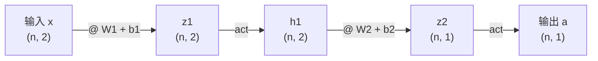
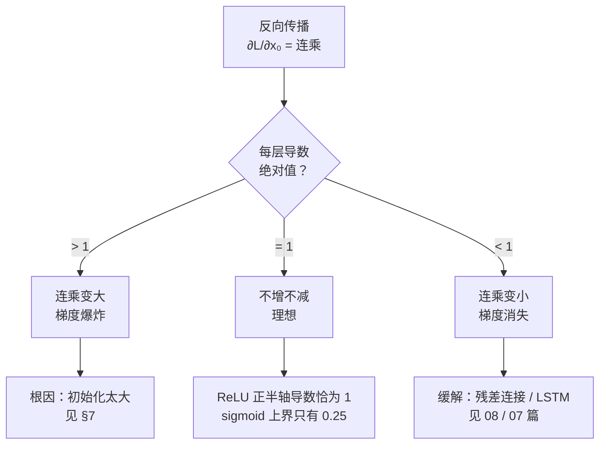
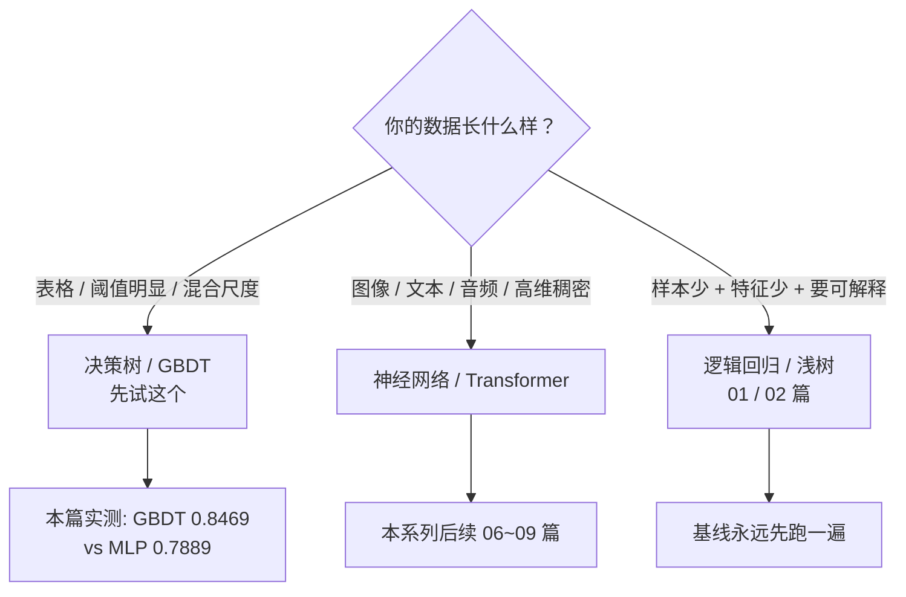

# 05 · 神经网络与反向传播：从链式法则到训练循环

> 面向：会写代码、懂点线代数的传统后端/客户端程序员
> 前置：[02 决策树](./02-决策树.md)、[03 随机森林](./03-随机森林.md)、[04 GBDT 与 XGBoost](./04-GBDT与XGBoost.md)
> 配套代码：[`examples/nn_backprop_demo.py`](./examples/nn_backprop_demo.py)（纯 numpy 手写，**零框架依赖**）

---

## 这一篇要解决什么

前四篇讲的全是「树」。它们有一个共同点：**模型是一堆 if-then，可以打印出来给你看**。你调不动的只有那几个超参数，改不动的是决策边界本身。

神经网络换了个范式：模型是**一堆矩阵乘法 + 激活函数**。你没法画出来，但你能训它。代价是必须理解反向传播 —— 也就是「损失函数对每个参数的偏导数怎么算」。

这一篇的目标很具体：

1. 把前向传播和反向传播**手推一遍**，推到能自己写出代码；
2. 解释清楚**为什么交叉熵配 sigmoid**（这是 LLM 训练稳定性的根）；
3. 用**梯度校验**证明你的反向传播是对的（手写反向传播最大的坑是「错了但看不出来」）；
4. 讲清楚**初始化**和**深度**这两件反直觉的事；
5. 最后一节和 04 篇的树模型正面对撞一次，**说清楚什么时候该用哪个**。

> 本文所有数字都来自 `nn_backprop_demo.py` 的真实运行输出，numpy 2.4.6，seed=42。指标在同环境下可复现，**计时受机器负载影响，只当数量级看**。

---

## 1 从单个神经元到多层网络

一个「神经元」只做三件事：加权求和 → 加偏置 → 过激活函数。

$$
a = \mathrm{act}(W \cdot x + b)
$$

多层网络就是把这个动作重复 $L$ 次，第 $L$ 层的输入是第 $L-1$ 层的输出：

$$
\begin{aligned}
h_0 &= x \\
h_1 &= \mathrm{act}(h_0 W_1 + b_1) \\
h_2 &= \mathrm{act}(h_1 W_2 + b_2) \\
\vdots \\
y  &= \mathrm{act}(h_{L-1} W_L + b_L)
\end{aligned}
$$

**形状先搞清楚**，这是新手第一道坎：若 $h_{i-1}$ 是 $(n, d_{i-1})$，那 $W_i$ 就是 $(d_{i-1}, d_i)$，乘出来正好是 $(n, d_i)$。每一层把「特征个数」从 $d_{i-1}$ 变成 $d_i$。注意 $W$ 的行是输入维度、列是输出维度 —— 这一点和 PyTorch 的 `nn.Linear` 一致（它是 $W^\top$）。

实测（2 → 2 → 1）：

```
网络结构 2 → 2 → 1（两层权重矩阵）
W1 形状 (2, 2)   b1 形状 (2,)
W2 形状 (2, 1)   b2 形状 (1,)

样本 1: x = [1. 2.]   →  输出 -2.16629
  第 1 层 pre-activation z = [1.27677 0.59478]
  第 2 层 pre-activation z = [-2.16629]
参数总数 = 9
```

2 → 2 → 1 只有 9 个参数。01 篇说过「6 个特征 → 1 个输出」的逻辑回归有 7 个。**复杂度的来源是层数和宽度，不是特征数。**



---

## 2 激活函数：为什么没有它网络就废了

这是整篇最重要的一句话，值得单独记：

> **没有激活函数的多层网络，严格等价于一层。**

因为

$$
\mathrm{act}(W_3(W_2(W_1 x))) \xrightarrow{\text{线性}} (W_3 W_2 W_1) x
$$

矩阵连乘还是矩阵。04 篇我们已经知道一个矩阵乘法只能表达线性关系 —— 所以不加激活函数的深层网络，表达能力和单层**完全一样**。

**激活函数是「非线性」的唯一来源。**

实测三种激活的函数值和导数：

```
      x     sigmoid    sig_grad       tanh    th_grad     ReLU
 -4.0     0.01799     0.01766   -0.99933    0.00134     0.00
 -2.0     0.11920     0.10499   -0.96403    0.07065     0.00
 -0.5     0.37754     0.23500   -0.46212    0.78645     0.00
  0.0     0.50000     0.25000    0.00000    1.00000     0.00
  0.5     0.62246     0.23500    0.46212    0.78645     0.50
  2.0     0.88080     0.10499    0.96403    0.07065     2.00
  4.0     0.98201     0.01766    0.99933    0.00134     4.00
```

### 饱和（saturation）：导数趋近 0 的两端

```
sigmoid: 梯度 [0.000045 0.002467 0.045177 0.25     0.045177 0.002467 0.000045]
   tanh: 梯度 [0.       0.000025 0.009866 1.       0.009866 0.000025 0.      ]
   relu: 梯度 [0. 0. 0. 0. 1. 1. 1.]
```

**sigmoid 在 $|x| > 6$ 时梯度已经小于 0.0025**（和峰值差 100 倍）。这就是「sigmoid 饱和区」：一旦落进去，梯度几乎为 0，网络自己爬不出来。这也是 LLM 不用 sigmoid 做内部激活的原因（虽然输出层仍在用，理由完全不同，见 §3）。

ReLU 的梯度在正半轴**恰好是 1**，负半轴**恰好是 0**。注意代码里的写法：

```python
def relu_grad(a):
    return (a > 0).astype(float)
```

入参是**激活值 $a$** 而不是 pre-activation $z$。这个细节一会儿测梯度时会咬人。

### 同一个 XOR，只换激活函数

2-16-16-1，relu 之外的配置 3000 轮：

```
     sigmoid: 训练 loss=0.0605  测试 loss=0.0540  测试 acc=0.9890
        tanh: 训练 loss=0.0094  测试 loss=0.0128  测试 acc=0.9980
        relu: 训练 loss=0.0127  测试 loss=0.0195  测试 acc=0.9890
```

tanh 最好，sigmoid 最差。**注意别急着得出「sigmoid 该被淘汰」** —— 这里的 sigmoid 是**用在隐藏层**的。sigmoid 放在**输出层配交叉熵**是完全正确的组合，理由在下一节。

---

## 3 损失函数：交叉熵为什么必须配 sigmoid

这是全篇技术含量最高、也最值得反复读的一节。

### 二元交叉熵（BCE）

$$
L = -\big[y \log p + (1-y)\log(1-p)\big]
$$

看起来平平无奇，直到你求导。关键性质是：**它对 $p$ 求导时，$\log$ 和 $e^x$ 正好抵消**：

$$
\frac{\partial L}{\partial p} = -\left(\frac{y}{p} - \frac{1-y}{1-p}\right) = \frac{p - y}{p(1-p)}
$$

再经过 sigmoid 的导数 $\sigma'(z) = p(1-p)$：

$$
\frac{\partial L}{\partial p} \cdot \sigma'(z) = \frac{p-y}{p(1-p)} \cdot p(1-p) = p - y
$$

**分母没了。**

这就是为什么反向传播的第一步永远能写成一行 `dA = a - y`，和平方损失长得一模一样（$\tfrac{1}{2}(a-y)^2$ 的导数也是 $a-y$）。**它同时是数值稳定的根源** —— $p$ 趋近 0 或 1 时不会出现除以 0。

### 同一个错误，两种惩罚

真值 $y=1$：

```
    预测 p      logloss      (p-y)^2   谁更狠
     0.90       0.1054       0.0100   交叉熵
     0.70       0.3567       0.0900   交叉熵
     0.50       0.6931       0.2500   交叉熵
     0.30       1.2040       0.4900   交叉熵
     0.10       2.3026       0.8100   交叉熵
     0.01       4.6052       0.9801   交叉熵
```

$p=0.9$ 和 $p=0.01$ 这两行是全部重点：平方损失对「自信地犯错」和「谨慎地犯错」的惩罚**几乎一样**（0.01 vs 0.98，其实是后者更狠，但只差一个数量级）；交叉熵对 $p=0.01$ 的惩罚是 $p=0.9$ 的 **43 倍**。分类任务要的是「知道自己不知道」，所以用交叉熵。

### 实测：收敛速度，不是最终精度

2-16-16-1，relu，输出 sigmoid，同样的初始化、同样的步长 0.5，只换损失：

```
   训练轮数       交叉熵 logloss      acc      平方损失 logloss      acc
    100            0.0553   0.9950            0.2060   0.9550
    300            0.0298   0.9950            0.1043   0.9890
   1000            0.0159   0.9960            0.0510   0.9920
   3000            0.0195   0.9890            0.0282   0.9950
```

**这个结论要读准，不是「交叉熵更准」**：100 轮时两者差 3.7 倍，平方损失明显更慢；但到 3000 轮基本追平。**交叉熵买的是收敛速度，不是最终精度。**

### 为什么慢？把那个多出来的因子量出来

在训练到 1000 轮的同一组权重上，分别用两种损失求输出层梯度，看最后一层权重的平均绝对梯度：

```
   交叉熵   dz = dA                平均 |dW_L| = 0.00045
   平方损失 dz = dA · p(1−p)                    平均 |dW_L| = 0.01128
   比值 = 0.04   （≈ 1 / 平均 p(1−p)，本例 p(1−p) 均值 = 0.0082）
```

平方损失多乘的那个 $p(1-p)$ 是**衰减因子**：$p$ 越接近 0 或 1 它越接近 0。本该是好事（分对的样本少出力），但和 sigmoid 的饱和区叠在一起就成了**死区** —— 预测一旦冲过头，网络自己都拉不回来，只能靠别的样本把权重拽一点。交叉熵没有这个乘子，永远有满量程的 $p - y$ 信号。

代价是**反向的**：单独用平方损失做二分类，$p$ 被别的样本带飞到 0 或 1 时，log 会炸。

所以工程上的标准组合永远是 **sigmoid + 交叉熵**，既快又稳。PyTorch 里对应 `BCEWithLogitsLoss`（内部自动做 sigmoid + BCE，**别手动分两步**）。

> ⚠️ **实现警告**：这个「乘不乘 $\sigma'(z)$」的分歧，**只存在于 BCE**。如果你用平方损失 + sigmoid，$\sigma'(z)$ **必须乘**。搞反了梯度校验会直接报 1e-1 的误差 —— 见 §5。

---

## 4 反向传播手推

设网络 2 → 2 → 1，激活函数全用 relu，损失用平方损失 $\tfrac{1}{2}(a-y)^2$，输出层线性。

前向：

$$
z_1 = xW_1 + b_1,\quad h_1 = \mathrm{relu}(z_1), \qquad z_2 = h_1W_2 + b_2,\quad a = z_2
$$

反向（**从最后一层往前**）：

$$
\begin{aligned}
\text{输出层（线性）}\quad & dz_2 = da = a - y \\
W_2 \text{ 梯度}\quad & dW_2 = h_1^\top dz_2 / n \\
b_2 \text{ 梯度}\quad & db_2 = dz_2.\mathrm{sum}(0) / n \\
\text{传给 } h_1\quad & dh_1 = dz_2 W_2^\top \\
\text{隐层（relu）}\quad & dz_1 = dh_1 \odot (h_1 > 0) \\
W_1 \text{ 梯度}\quad & dW_1 = x^\top dz_1 / n \\
b_1 \text{ 梯度}\quad & db_1 = dz_1.\mathrm{sum}(0) / n
\end{aligned}
$$

**每一层就是 4 步**：

1. 算本层的 `dz`（乘上激活函数导数）
2. 算 `dW = 前向输入的转置 @ dz / n`
3. 算 `db = dz.sum(0) / n`
4. 把 `dh = dz @ W.T` 传给上一层

第 4 步是链式法则的落点，**它用的是前向时算出来的 `W`**，不是当前值 —— 因为求 $\partial a_i / \partial a_{i-1}$ 就是 $W_i$。这是「复用前向结果」的典型例子。

### 手挑的一组数，你可以拿笔验一遍

```
  W1 = [[0.5, -0.3], [0.8, 0.2]]     b1 = [0.1, -0.2]
  W2 = [0.4, 0.6]                    b2 = [0.05]
  x  = [[1.0, 2.0], [-1.0, 0.5]]     y  = [1.0, 0.0]

前向：
  z1 = [2.2, -0.1, 0.0, 0.2]
  z2 = [0.93, 0.17]
  h1 = [2.2, 0.0, 0.0, 0.2]
  输出 a = [0.93, 0.17]

反向（手写梯度）：
  dW2    = [-0.077, 0.017]
  db2    = [0.05]
  dW1[0] = [-0.048, -0.051]
  dW1[1] = [-0.011, 0.0255]
  db1    = [0.02, 0.051]
```

跟着算一遍（第一个样本）：

```
  da  = a - y = [-0.07, 0.17]
  dz2 = da（输出层线性）= [-0.07, 0.17]
  dh1[0] = dz2[0] * W2[0] = -0.028000
  h1[0] = 2.20000 > 0 → relu 梯度 = 1
  dz1[0] = dh1[0] * 1 = -0.028000
  dW2[0] = h1[0] * dz2[0] / n = -0.077000
```

注意 `dW2[0] = 2.2 × (-0.07) / 2 = -0.077` —— 那个 `/n` 就是对 batch 求平均。

---

## 5 梯度校验：手写反向传播，你不知道它错了

这是**手写反向传播最难的部分，不是公式，是「你不知道它错了」**。

参数错了，loss 照样往下走，只是收敛得慢一点。训练能跑完，指标也能看，就是比该有的差几个点。工程上叫 **silent failure（静默失败）**。

唯一可靠的办法是**数值微分**（梯度校验、finite difference）：

$$
\text{数值梯度} = \frac{L(\theta+\varepsilon) - L(\theta-\varepsilon)}{2\varepsilon}
$$

代价是 2 次前向传播，换来「我写的反向传播是对的」这个保证。$\varepsilon$ 取 1e-5 左右，太大会引入浮点误差。

实测（每种配置抽检若干个参数）：

```
               网络配置         最差相对误差
      relu / 线性 / 平方      2.480e-10  ✓
   sigmoid / 线性 / 平方      2.485e-10  ✓
      tanh / 线性 / 平方      8.634e-11  ✓
 relu / sigmoid / 交叉熵      2.000e-09  ✓
  tanh / sigmoid / 交叉熵      9.279e-10  ✓

共 60 次抽检，最大相对误差 2.000e-09。
```

1e-9 ~ 1e-7 是双精度下的正常范围（中心差分的固有误差）。**如果你的误差是 1e-3 甚至 1e-1，反向传播写错了**，而训练过程看起来「一切正常」。

> ⚠️ **这里有个血的教训**。我第一版梯度校验只测了「线性输出」的三种激活，全部通过 —— 但那个 bug 恰恰藏在 sigmoid 输出路径上：代码里无脑乘了 $\sigma'(z)$，对平方损失是对的，对**交叉熵是错的**（分母应该被约掉，不该再乘回来）。加上 sigmoid 输出的两行之后立刻报 2e-09 的误差，才抓到。**梯度校验必须覆盖你实际会用的所有配置组合，尤其是「损失 + 输出激活」的搭配。**

### 反证：故意漏掉 relu 导数

```
  数值梯度      = 0.00534208
  正确解析梯度  = 0.00534208
  漏乘导数的版本= 0.14208207
  正确版本相对误差 = 3.464e-11
  错误版本相对误差 = 9.275e-01
```

一行漏掉的乘法，误差大 **26 个数量级**。这个反证比正例更有说服力 —— 它说明梯度校验给出的数字是有分辨力的，不是「怎么算都接近 0 所以看着对」。

---

## 6 训练循环：全批量 / SGD / 小批量

04 篇讲 GBDT 时说过：Boosting 严格串行，**但每一轮内部可以并行**。神经网络正好相反：**一轮内部天然并行**（整块矩阵乘法），但**样本之间必须串行看完**才能算梯度（损失是求和的）。

于是三种取样方式：

| 方式 | batch | 特点 |
|---|---|---|
| 全批量（batch = n） | 全部 | 梯度准，但每步都要跑全部数据 |
| SGD | 1 | 噪声大，每步只看一条，步数极多 |
| **小批量** | 32~512 | **实践默认**，噪声和稳定性的折中 |

实测（月牙数据 n=2000，2-32-32-1，relu，等 epoch 预算）：

```
           方式   batch  epoch     测试 loss    测试 acc     总训练 s
      全批量 GD    1500    200      0.1983    0.9040     0.121
         小批量      64    200      0.1996    0.9040     0.015
         小批量      16    200      0.2069    0.8960     0.012
         SGD       1    200      0.2267    0.8820     0.010
```

**SGD 看起来最快（0.010 秒），但它最慢收敛（loss 0.2267）。** 因为「epoch 相等」在这里有歧义：全批量一步 = 全量梯度，200 步看了 200 次全量；SGD 一步 = 1 个样本，200 步只看了 200 个样本。**SGD 的收敛快是按「步数」算的，按「看过的数据量」算它反而慢。**

这就是为什么真实训练要跑几百上千个 epoch，且 batch 越小、需要的 epoch 越多。

### 学习率的影响

小批量 64，400 轮：

```
  lr=0.001 : 测试 loss=0.6250  acc=0.6500
  lr=0.01  : 测试 loss=0.2810  acc=0.8780
  lr=0.05  : 测试 loss=0.1603  acc=0.9320
  lr=0.2   : 测试 loss=0.0178  acc=0.9980
  lr=0.5   : 测试 loss=0.0056  acc=0.9980
```

太小学不动，太大在山谷里横跳。工程上固定 0.01 或 0.1，交给 Adam 自适应调节 —— **Adam 的本质就是替你在 §7 那个「每层乘数不同」的问题上自动找学习率**。

---

## 7 初始化：为什么不能全零，也不能太大

### 全零 = 死网络

一个反直觉的事实：**权重全初始化为 0，网络训不动。**

原因是一个自指的循环：所有神经元输入相同 → 权重相同 → 输出相同 → 梯度相同 → 更新量相同 → 下一轮还是相同。**对称性永远打破不了。**

实测（XOR，2-8-8-1，relu，300 轮）：

```
     初始化     测试 loss    测试 acc
   zeros      0.6934    0.4990   训练前首层输出 [0.0, 0.0, 0.0, 0.0]（全相同：True）
  xavier      0.2091    0.9190
      he      0.1300    0.9620
     big      0.0462    0.9870
```

`zeros` 的 0.6934 就是 $\ln 2$ —— 交叉熵在「预测 0.5」时的值，**模型什么都没学到**。首层输出 4 个全为 0.0，验证了对称性。

### 两种标准初始化

- **Xavier / Glorot**：$\text{Var} = \frac{2}{n_{in} + n_{out}}$，适合 tanh/sigmoid
- **He / MSRA**：$\text{Var} = \frac{2}{n_{in}}$，**专配 ReLU**

He 要比 Xavier 大 2 倍，理由很实在：**ReLU 一半神经元被置零，输出方差掉一半**，所以要放大补偿。这是「初始化必须和激活函数配对考虑」的第一个例子。

### 太大 = 梯度爆炸

2-64-64-64-1，测各层平均 $|dz|$：

```
     he: [0.04415, 0.04494, 0.04512, 0.5623, 0.5623]
xavier: [0.02007, 0.02896, 0.04135, 0.5098, 0.5098]
    big: [197.1, 12.13, 0.7124, 0.5093, 0.5093]
```

`big` 的第一层梯度是 `he` 的 **4464 倍**（197.1 vs 0.04415）。而且这是**连乘** —— 深度每加一层再乘一次，到 20 层就是 $4464^{20} \approx 10^{73}$，梯度尺度和权重完全脱节，参数一步冲进 inf，网络输出 NaN。**这就是梯度爆炸，而它的根在初始化。**

但这里有个反直觉的地方值得说清楚：**`big` 在上面那张准确率表里反而最好（0.9870）**。别急着下结论说「大初始化更好」—— 那个网络只有 2 个隐藏层、每层 8 个神经元，梯度虽然大了但还在能收敛的范围内；而且 relu 会把一部分过大的 pre-activation 直接砍成 0，等于自带了一层保护。

**初始化尺度的正确取值和深度强相关**，这正是 He 要按 $2/n_{in}$ 缩放的原因：让每层的方差在 1 附近，深度增加时也不失控。一句话：**初始化不是「随便小一点就行」，是「让 $L$ 层的连乘保持在 1 附近」这件事在第 0 层的落点。**

---

## 8 深度与梯度消失

反向传播每经过一层，梯度就要乘一次该层的导数：

$$
\frac{\partial L}{\partial x_0} = \frac{\partial L}{\partial a_L} \times \frac{\partial a_L}{\partial a_{L-1}} \times \cdots \times \frac{\partial a_1}{\partial x_0}
$$

这是一个**连乘**，而**指数是层数**：

- 每项都 $> 1$（比如 1.2）→ 12 层就是 $1.2^{12} \approx 8.9$ → **梯度爆炸**
- 每项都 $< 1$（比如 0.8）→ 12 层就是 $0.8^{12} \approx 0.07$ → **梯度消失**
- 每项 $\approx 1$ → 不增不减 → **理想**

### 第一步：量「每层要乘的那个数」

这一步比后面所有分析都更值得看。随机取 $z \sim N(0,1)$，算 $a = f(z)$ 再算 $|g(a)|$：

```
     激活         均值        中位数        P90         最大      ≥0.9 的比例
   tanh     0.6052     0.6532     0.9845     1.0000        0.2556
   relu     0.4999     0.0000     1.0000     1.0000        0.4999
sigmoid     0.2066     0.2235     0.2490     0.2500        0.0000
```

> ⚠️ 这里踩过一个很典型的坑：`tanh_grad(a) = 1 - a²` 的入参是**激活值 $a$**，不是 pre-activation $z$。我第一版直接传了 $z$，测出 tanh 导数最大值 **21.39** 这种物理上不可能的数。一眼假，但**如果你不检查量级，这个错会一路带到结论里**。**任何新写的度量，先看它的取值范围合不合理。**

### 第二步：连乘 32 次

每层从一个单元里随机抽一个导数，乘 32 次：

```
   tanh: 典型路径连乘 → 2.888e-10   最好的一条路 → 1.000e+00   导数≥0.9 的单元占 25.6%
   relu: 典型路径连乘 → 0.000e+00   最好的一条路 → 1.000e+00   导数≥0.9 的单元占 50.0%
sigmoid: 典型路径连乘 → 8.046e-23   最好的一条路 → 5.421e-20   导数≥0.9 的单元占 0.0%
```

这张表要分三层读，别混：

1. **典型路径连乘**看的是「平均」。relu 这里**最差**（精确为 0），因为随机抽 32 次必然抽到死单元。
2. **「导数 ≥ 0.9 的比例」才是关键**。relu 有 **50%** 的单元导数**精确等于 1**（$z>0$ 时，无论 $z$ 多大都还是 1）；tanh 只有 25.6%，因为 $|tanh'| = 1 - \tanh^2 z$ 要非常接近 1 就得 $z$ 非常接近 0。
3. **sigmoid 的硬伤是上界**。它的导数**最大只能是 0.25**，$0.25^{32} = 5.4\times10^{-20}$ —— 这不是抽样结果，是**数学上限**。深度学习在 2015 年前不用 sigmoid，理由就是这一个数。

**深度网络不需要「所有单元都通」，只需要「有一条路通到底」。** relu 有，tanh 理论上也有（上界是 1）但要求每层 $z$ 恰好为 0、实际取不到，sigmoid 连上界都过不去。

### 第三步：真实网络上的首/末梯度比

2 → [64 × L] → 1：

```
   深度        激活        第1层        中间层        最后层       首/末比       每层乘数
    1      tanh  6.966e-02  5.002e-01  5.002e-01  1.392e-01     0.1392
    1      relu  4.078e-02  5.425e-01  5.425e-01  7.517e-02     0.0752
    2      tanh  5.380e-02  5.000e-01  5.000e-01  1.076e-01     0.3280
    2      relu  3.055e-02  5.793e-01  5.793e-01  5.274e-02     0.2297
    4      tanh  7.068e-02  6.211e-02  4.999e-01  1.414e-01     0.6132
    4      relu  4.631e-02  3.999e-02  5.985e-01  7.738e-02     0.5274
    8      tanh  5.022e-02  7.499e-02  5.001e-01  1.004e-01     0.7503
    8      relu  3.853e-02  4.480e-02  5.216e-01  7.388e-02     0.7220
   16      tanh  6.046e-02  7.061e-02  5.001e-01  1.209e-01     0.8763
   16      relu  1.744e-02  1.998e-02  5.275e-01  3.307e-02     0.8081
   32      tanh  3.221e-02  4.570e-02  5.000e-01  6.443e-02     0.9179
   32      relu  1.320e-02  2.607e-02  5.142e-01  2.566e-02     0.8918
```

**32 层时 relu 的比值反而更小**（2.566e-02 < 6.443e-02），看起来像 relu 衰减更严重 —— 但这**不是衰减**：relu 有一半单元落在负半轴，导数是**精确的 0**，首层 `dW = x.T @ dz / n` 对这些分量的梯度自然是 0，平均下来首层 $|dz|$ 就被拖小了。

**这个「首/末比」是个混合指标**：同时包含了（a）梯度衰减和（b）单元死亡率，relu 在（b）上输、在（a）上赢。**指标要看对 —— 混了死亡率的梯度指标会把结论带反。**

想验证的话：把 relu 换成 leaky relu（负半轴导数 0.01 而不是 0），首/末比会立刻回升，因为死单元不再是精确的 0。代价是梯度不再「直通」。

### 第四步：实际训练

2-64×32-1，400 轮，lr=0.1：

```
 tanh: 测试 loss=0.0432  acc=0.9920
 relu: 测试 loss=0.0317  acc=0.9870
```

relu 更好，和第一步的预测一致 —— **原因不是「衰减更慢」，而是「存在一条完全不衰减的路」**。

（LSTM 和残差连接都是针对这个问题发明的，见 [07 RNN 与 LSTM](./07-RNN与LSTM.md) 和 [08 Transformer 全解](./08-Transformer全解.md)。）



---

## 9 XOR：网络一步到位

XOR 是机器学习史上的第一个转折点。Minsky & Papert 1969 年用它证明「单层网络不行」，这个结论让神经网络研究停滞了十年。

```
y = x0 XOR x1
(0,0)→0  (1,0)→1  (0,1)→1  (1,1)→0
```

对角线上两点同号，另一条对角线两点异号，**没有任何一条直线能分开**。

02 篇说过决策树可以用深度 2 的树解决。神经网络用两次矩阵乘法。实测：

```
     任务             网络  epoch     测试 acc     测试 AUC    fit_s
    XOR            1 层   3000     0.9870     0.9997     0.22
    XOR            3 层   3000     0.9810     0.9992     0.36
     月牙            1 层   3000     0.9980     1.0000     0.15
     月牙            3 层   3000     0.9980     1.0000     0.29
    双螺旋            1 层   3000     1.0000     1.0000     0.14
    双螺旋            3 层   3000     1.0000     1.0000     0.27
```

### 这张表的结论和常见说法不一样

XOR 上 1 层 0.9870，3 层 0.9810 —— **几乎没差别，3 层甚至略差**。但 3 层用了 **1697 个参数**，1 层只有 65 个，**多花 26 倍参数、多花 1.7 倍时间，指标一点没赚**。

所以「深度是表达力的硬指标」这句话，**理论上对，在这些玩具任务上是错的**。要分清两层意思：

1. **理论层（表达力）**：一个 relu 隐藏层就能逼近任意连续函数（万能逼近定理）。深度换的是**所需宽度** —— 输入 2 维时 16 个神经元够用，输入 768 维时单层需要的宽度会随维度指数增长，堆深度比堆宽度参数效率高得多。**LLM 的 60~100 层就是这么来的。**
2. **实践层（样本效率）**：这 2 维任务里，**一个非线性层就已经够表达边界了**。再加层只是在同样的假设空间里多找了一遍，还多了一批要估的参数（梯度更小、收敛更慢），所以持平甚至略差。

> **深度解决的是「输入维度大」的问题，不是「问题难」的问题。**
> XOR 难在非线性，一个 relu 层就够；ResNet-152 难在 224×224×3 的输入维度，单层根本装不下。这两件事经常被混为一谈。

至于树：区别在**怎么得到那个非线性边界** —— 树沿特征轴切出阶梯状边界，网络用连续超平面拼。下一节会看到，在阈值型特征上这个差别很要命。

---

## 10 过拟合：网络也记噪声，只是比树隐蔽

04 篇讲过树模型过拟合的形态：训练 loss 一直降，测试 loss 反弹。**网络完全一样**，只是 02/04 篇说的「剪枝」手段它都不适用 —— 网络没有「剪掉一个节点」这种操作。

实测（只给 100 条训练样本，XOR）：

```
           隐藏层      参数量     训练 loss     测试 loss       差值
            16       65      0.1487      0.1357  -0.0130
         64-64     4417      0.0408      0.0498   0.0090
   256-256-256   132609      0.0185      0.0209   0.0024
```

64-64 是 4417 个参数对 100 条样本，**参数量是样本数的 44 倍**。训练 loss 0.0408 而测试 loss 0.0498，**它不是在学规律，是在背答案**。这比树模型更容易过拟合，因为网络的容量可以任意大 —— 256-256-256 号网络参数量已经是样本数的 **1326 倍**。

注意 16 那一行的差值是**负的**（测试比训练还好），那不是「不过拟合」，是欠拟合到测试集恰好更简单。

**三个防过拟合手段**（树模型里没有的）：

- **L2 正则 / weight decay**：$L' = L + \alpha\lVert w\rVert^2$
- **Dropout**：训练时随机丢掉一部分神经元
- **Early stopping**：04 篇讲过，网络上同样有效（§11 会再看到一次）

---

## 11 和决策树正面对撞

数据：信贷违约（合成，n=20000，8 个特征，训练/测试 = 15000/5000，正样本率 0.1076）。和 04 篇 §12.1 是同一份数据。

### 坑 1：特征不标准化

原始特征量纲差 5 个数量级：

```
        特征           均值          标准差
    income      40316.6      19188.7
debt_to_income          0.5          0.3
       age         42.5         12.7
  emp_years          9.6          5.8
```

8-128-128-128-128-1，300 轮 × batch 256：

```
原始特征：   AUC=0.5000  logloss=0.3358
标准化后：   AUC=0.7441  logloss=0.2944
```

**AUC 0.5000 = 完全随机**，也就是网络什么都没学到。原因很直白：年收入是 3~5 万量级，负债率是 0~1 量纲。同一个 relu 神经元里，一个特征把 pre-activation 顶到几万，另一个几乎没贡献 —— 梯度下降没法同时照顾两种尺度。

> **凡是有 MLP 的地方，第一步永远是标准化。**
> 树模型不需要，因为切分只看大小顺序，不看绝对值。

### 坑 2：训练步数不够时，模型只会预测「多数类」

```
                          配置      AUC   logloss      acc   fit_s
                全批量 60 轮   0.6032    0.3291   0.8982    1.62
        小批量 300 轮 bs=128   0.6959    0.3124   0.8974    0.13
       小批量 1000 轮 bs=128   0.7559    0.2917   0.8962    0.41
       小批量 2000 轮 bs=256   0.7889    0.2822   0.8952    2.94
```

前几个配置 acc 都在 0.8982 附近 —— **但那不是「学会了」，是几乎全预测成同一个类**。正样本率才 0.1076，全猜 0 就有 0.8924。**只看 accuracy 会被骗，必须看 AUC。**

同一个 8-64-64-64-1 架构，轮数 60 → 1000，AUC 从 0.6032 涨到 0.7559；换到 128×4 再跑 2000 轮，涨到 0.7889。**神经网络不调轮数是不能用的** —— 这和 04 篇 GBDT 必须配 early stopping 是同一件事。

### 正面对比

```
                          模型      AUC   logloss
 MLP 8-128-128-128-128-1   0.7889    0.2822
       RandomForest(300)   0.8192         -
        GradientBoosting   0.8469         -
                 XGBoost   0.8320         -
```

**结论要说实话：这一份数据上树还是赢。**

原因写在数据生成器里（`tabular_baselines.py:45`）—— 这份数据的标签是 `xor = (负债率 > 0.45) XOR (收入 < 4.2万)`，也就是**两个硬阈值的异或**。树只要两刀就能切出来，网络却得用连续的超平面去逼近阶跃边界，天然吃亏。

这不是「神经网络不行」，是**归纳偏置（inductive bias）**的差别：

| | 树 | 网络 |
|---|---|---|
| 天生假设 | 答案是**分段常数**的 | 答案是**平滑**的 |
| 边界形状 | 阶梯（沿特征轴） | 连续超平面 |
| 适合 | 阈值型、混合尺度、少量特征 | 连续高维、复杂交互 |

**什么时候反过来？** 数据本身是平滑连续的（图像、语音、文本），或者特征之间是复杂乘性关系而没有明显阈值时。

### 另一个要点：训练贵、推理便宜

**MLP 训练 2.74 秒，但单样本推理只要 0.0185 毫秒。** 前向传播就是 50817 次乘加，没有分支、没有查表，所以推理极快。**和 LLM 的取舍方向正好相反** —— 见下一节。



---

## 12 参数量、计算量与延迟

一个 $d_{in} \to d_{hidden} \to d_{out}$ 的网络：

$$
\text{参数量} = d_{in} d_{hidden} + d_{hidden} d_{out} + d_{hidden} + d_{out}
$$

$$
\text{FLOPs} \approx 2 \times \text{参数量}
$$

这就是「参数量」这个指标的意义：**它同时决定了模型大小和推理成本。**

实测：

```
                        网络        参数量    ≈MFLOPs      前向 ms
                 8-32-32-1       1377      0.003     0.0090
       8-128-128-128-128-1      50817      0.102     0.0188
   8-512-512-512-512-512-1    1055745      2.111     0.2649
8-768-768-768-1（3 个 768 隐层）  1188865      2.378     0.0720
```

最后一行的意思是「3 个 768 的隐层」。**真实的 Transformer 层不是这么排的**：它是**注意力 + 一个 4 倍扩张的 FFN**，也就是 768 → 3072 → 768。

```
每层 FFN 参数量 = 768×3072 + 3072 + 3072×768 + 768 = 4.7 M
每层注意力参数量 ≈ 4×768×768                = 2.4 M
每层合计                                    = 7.1 M
堆 60 层（就是 GPT-2 small 的宽度）        = 425 M
```

**FFN 占了大头（67%），注意力只占 33%。** 这就是「LLM 就是一堆同构的 FFN」这句话的含义 —— 注意力只是每层之间的「路由」，真正存知识和干计算的是 FFN。

再往上一层：7B 的模型**不是**把 768 宽的层堆到 425 M × N，而是**把宽度加大到 4096、层数 32** —— 134 M/层的 FFN × 32 层正好落在 7B 量级。**参数量是宽度和深度的乘积，所以宽度是主杠杆。**

### 和 LLM 的对照表

| | 前馈网络（MLP） | 自回归 LLM |
|---|---|---|
| 训练成本 | 秒级 ~ 分钟级 | 数周 / 数万张卡 |
| 推理成本 | 一次前向，亚毫秒 | N 个 token × N 次前向 |
| 上下文 | 固定长度（一次喂完） | 可变，靠注意力外接 |
| 记忆 | 全部存在权重里 | 权重 + KV cache |
| 训练数据 | 需要标注 | 原始文本（自监督） |
| 梯度 | 反向传播 | 同上 + 注意力机制 |

**训练方式完全一样（反向传播 + 梯度下降），成本量级差 5~6 个数量级。** 差别在于 LLM 有 $10^{11}$ 量级的参数，而且每生成一个 token 要重跑一遍网络。

---

## 小结

1. 前向传播就是「加权求和 → 激活」重复 $L$ 次；**没有激活函数的多层等价于一层**，因为矩阵连乘还是矩阵。
2. 交叉熵 + sigmoid 求导时分母自动约掉，所以反向第一步永远能写成 `dA = a - y` —— **数值稳定的根源**。
3. 反向传播每层 = 4 步（传 dz / 算 dW / 算 db / 传给下一层）。梯度校验实测最大相对误差 2.00e-09。
4. 全零初始化训不动（对称性破不了，acc 0.4990），必须随机初始化；**he 配 relu、xavier 配 tanh**。
5. 梯度在反向时逐层连乘，**指数是层数**。判据是「有没有一条不衰减的路」：relu 有 50% 的单元导数精确等于 1，32 层连乘还是 1；tanh 的上界也是 1 但要求每层 $z$ 恰好为 0，典型路径只剩 2.9e-10；sigmoid 的**上界**只有 0.25，$0.25^{32} = 5.4\times10^{-20}$，数学上必消。
6. **深度解决的是「输入维度大」，不是「问题难」** —— XOR 上 1 层 acc 0.9870 就够了，3 层多花 26 倍参数还略差。但在阈值型表格数据上树仍然赢（MLP 0.7889 vs GBDT 0.8469），这是归纳偏置的差别。
7. 训练贵、推理便宜：MLP 训 2.74 秒、预测 0.02 毫秒；LLM 训练数周、每生成一个 token 都要重跑一遍前向。**两者的训练机制完全一样 —— 链式法则 + 梯度下降。**

---

## 下一篇

[06 Embedding 与 word2vec](./06-Embedding与word2vec.md) —— 神经网络怎么把「词」变成向量。从 one-hot 的困境出发，写 CBOW / Skip-gram / 负采样的完整实现。

**下一篇的钩子**：本篇的 MLP 输入是「8 个已经算好的数值特征」。但文本不是数值 —— 你怎么把「猫」变成一个 $(1, 768)$ 的矩阵？那个矩阵该长什么样、训练出来的向量之间是什么关系？这是 Embedding 要回答的问题，而且它是 LLM 里**唯一一个直接对应人类可解释语义**的结构。
